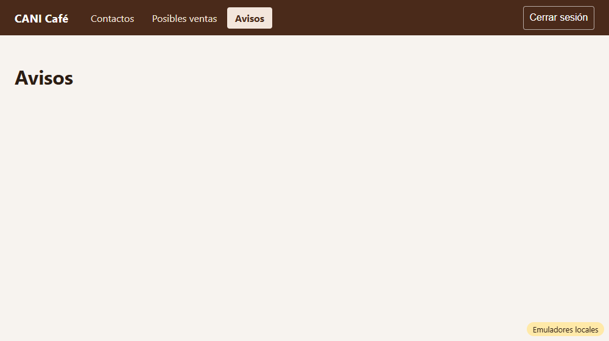
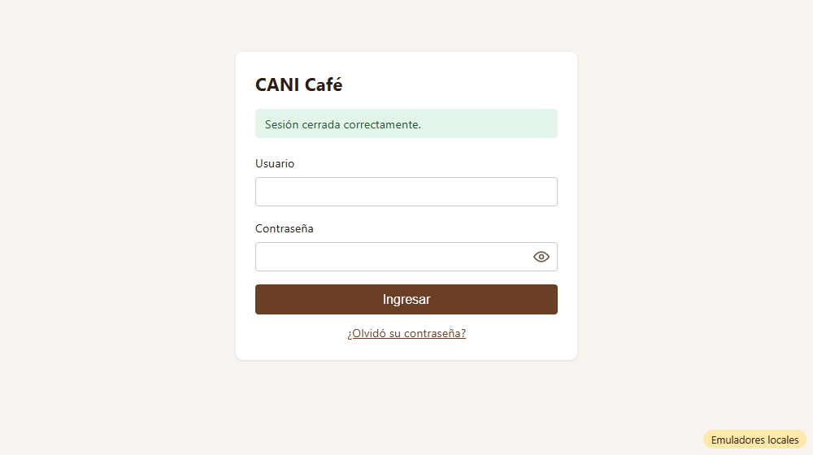
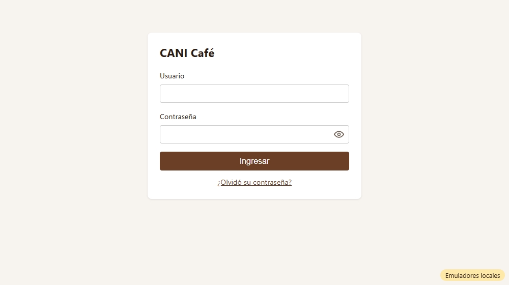

# Evidencia HU-104: Cerrar sesión

**Responsable:** Gabriel · **Revisa:** Dylan · **Fecha:** 2026-10-12

> Como administrador quiero cerrar mi sesión para que nadie más pueda usar el sistema desde mi computadora.

## Datos de prueba

- Ambiente: Firebase Emulator Suite, proyecto `demo-cani-crm`, datos cargados con `npm run seed`, sesión con el usuario `admin`.
- Recorrido automático en Microsoft Edge (headless) con una sesión limpia. El detalle completo está en [recorrido.json](recorrido.json).
- Historial antes de salir: Contactos → Posibles ventas → Avisos.

## Criterios de aceptación

| # | Criterio | Resultado | Evidencia |
|---|---|---|---|
| 1 | Al dar clic en "Cerrar sesión", la sesión se cierra de inmediato, sin pedir confirmación. | ✅ Cumple | 0 diálogos de confirmación en el recorrido real. Pruebas *"clic en Cerrar sesión llama a signOut sin confirmación…"* y *"el botón se desactiva mientras se cierra la sesión"* (evita doble clic). |
| 2 | Después de cerrar la sesión, aparece la pantalla de ingreso con el mensaje "Sesión cerrada correctamente.". | ✅ Cumple | [02](02-sesion-cerrada.png). El mensaje se borra del historial (`history.state = null`), así que **no reaparece al recargar** ni al iniciar sesión de nuevo (ver recorrido). |
| 3 | Después de cerrar la sesión, el botón "Atrás" del navegador no permite volver a las pantallas del sistema interno. | ✅ Cumple | "Atrás" ×3 siempre termina en el ingreso: [03](03-tras-atras.png). Un registro de toda la pantalla confirmó que **no se vio ninguna pantalla interna ni la barra, ni por un instante** (`vistas: []`). Abrir `/contactos` o `/avisos` directamente sin sesión lleva al ingreso: [04](04-url-interna-sin-sesion.png). |

**Error relevante (definición de terminado):** si `signOut` falla, la barra muestra *"No se pudo cerrar la sesión. Intente de nuevo."*, la persona sigue en la misma pantalla y el botón vuelve a habilitarse. Lo cubre la prueba *"si signOut falla, muestra el error y no navega"*.

**Seguridad en el servidor:** contra los emuladores reales de Auth y Firestore, un usuario activo puede leer `contacts`. Después de `signOut`, la misma lectura es **rechazada** (`permission-denied`). Lo cubre la prueba `tests/auth/signOut.emulator.test.ts`.

## Cómo funciona

- **"Cerrar sesión" en la barra:**
  1. Marca la salida como voluntaria (`SessionProvider`).
  2. Llama a `signOut` de Firebase Auth.
  3. `onAuthStateChanged` deja la sesión en "sin usuario".
  4. `ProtectedRoute` lleva al ingreso con `replace` y el aviso.
- **Pantallas internas:** dependen del estado real de Firebase Auth. Mientras se resuelve muestran solo "Cargando…"; sin sesión redirigen al ingreso con `replace`.
- **Limpieza en memoria:** el perfil del usuario se descarta con el cambio de sesión, y las pantallas internas se desmontan.
- **Firestore:** no usa persistencia offline (caché solo en memoria), así que no queda nada en disco.

## Pruebas automatizadas

Salida completa en [pruebas.txt](pruebas.txt).

- `npm run typecheck`: sin errores.
- `npm test`: 54/54, de las cuales 7 son de HU-104.
- Pruebas contra emuladores: 18/18, de las cuales 1 es de HU-104.
- HT-001 y HU-101 a HU-103 siguen pasando.

## Capturas

| | |
|---|---|
|  |  |
| 01. Sesión iniciada (Avisos) | 02. Clic en "Cerrar sesión" → mensaje |
|  |  |
| 03. Después de "Atrás" ×3 | 04. URL interna abierta sin sesión |
