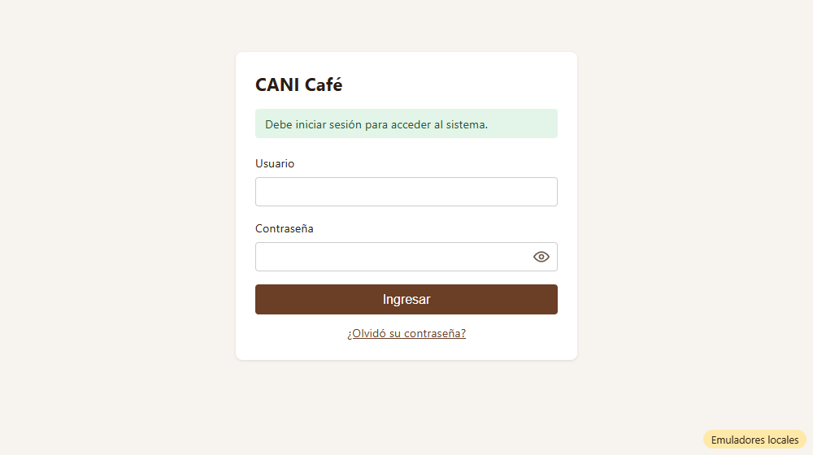
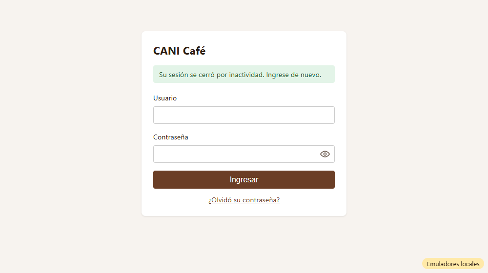

# Evidencia HU-105: Proteger el sistema interno

**Responsable:** Gabriel · **Revisa:** Dylan · **Fecha:** 2026-10-12

> Como administrador quiero que el sistema interno solo pueda usarse con una sesión iniciada
> para que las personas ajenas a CANI Café no vean la información de los contactos.

## Datos de prueba

- Ambiente: Firebase Emulator Suite, proyecto `demo-cani-crm`, datos cargados con `npm run seed`, usuario `admin`.
- Recorrido automático en Microsoft Edge (headless). El detalle completo está en [recorrido.json](recorrido.json).
- **Cómo se simularon los 30 minutos:** la app guarda en el navegador la hora del último clic o tecla. Para no esperar media hora, se atrasó esa hora 31 minutos. La app hace exactamente el mismo cálculo que si hubiera pasado el tiempo. Las pruebas unitarias usan un reloj falso para medir los 30:00 exactos.

## Criterios de aceptación

| # | Criterio | Resultado | Evidencia |
|---|---|---|---|
| 1 | Si alguien intenta abrir una pantalla del sistema interno sin haber iniciado sesión, aparece la pantalla de ingreso con el mensaje "Debe iniciar sesión para acceder al sistema.". | ✅ Cumple | Probado con `/contactos`, `/posibles-ventas` y `/avisos`: [01](01-url-interna-sin-sesion.png). La pantalla interna **no se vio ni un instante** (`vioPantallaInterna: false`) y el mensaje no reaparece al recargar. |
| 2 | Si el usuario pasa 30 minutos sin dar clic ni escribir en el sistema, su sesión se cierra sola. | ✅ Cumple | Pruebas con reloj falso: a los 29:59 sigue abierta y a los 30:00 se cierra (se revisa cada 15 s). Un clic o una tecla reinicia el contador. Mover el mouse o hacer scroll **no** cuenta. La actividad en otra pestaña sí cuenta. En el recorrido real, con 29 min y un clic, la sesión sigue abierta. |
| 3 | Cuando la sesión se cerró sola, la siguiente vez que el usuario da clic aparece la pantalla de ingreso con el mensaje "Su sesión se cerró por inactividad. Ingrese de nuevo.". | ✅ Cumple | [02](02-cierre-por-inactividad.png). Al dar el siguiente clic, la persona está en el ingreso con ese mensaje. Ver la decisión de diseño más abajo. |
| 4 | El sitio web público no tiene enlaces ni botones que lleven al sistema interno. | ✅ Cumple | El sitio público **no existe en este repositorio**, así que no hay enlaces hacia el sistema. Además, el sistema interno pide no ser indexado por buscadores (`<meta name="robots" content="noindex, nofollow">`). Cuando exista el sitio público, hay que revisar este criterio ahí. |

## Decisiones de diseño

- **Al cumplirse los 30 minutos, los datos se ocultan de inmediato.** No se espera al siguiente clic para cambiar de pantalla, porque esta HU busca que alguien ajeno no vea los contactos en una computadora abandonada. Cuando la persona vuelve y da clic, ya está en el ingreso con el mensaje de inactividad.
- **Navegador cerrado y reabierto:** Firebase recuerda la sesión. Si pasaron más de 30 minutos sin actividad, al reabrir la sesión se cierra sin mostrar la pantalla interna: [03](03-reabrir-sesion-vencida.png).
- **La dirección raíz `/`** muestra el ingreso sin el mensaje, como en la HU-101. El mensaje aparece al intentar abrir una pantalla interna, incluso después de cerrar sesión si se usa "Atrás".
- **Seguridad en el servidor:** sin sesión, Firestore rechaza las lecturas (`tests/auth/signOut.emulator.test.ts`). El cierre por inactividad usa el mismo `signOut`.

## Pruebas automatizadas

Salida completa en [pruebas.txt](pruebas.txt).

- `npm run typecheck`: sin errores.
- `npm test`: 69/69, de las cuales 15 son de HU-105 (7 del temporizador y 8 de protección de pantallas).
- Pruebas contra emuladores: 18/18.
- HT-001 y HU-101 a HU-104 siguen pasando.

## Capturas

| | |
|---|---|
|  |  |
| 01. `/contactos` sin sesión | 02. Sesión cerrada por inactividad |
|  | |
| 03. Reabrir con la sesión vencida | |
