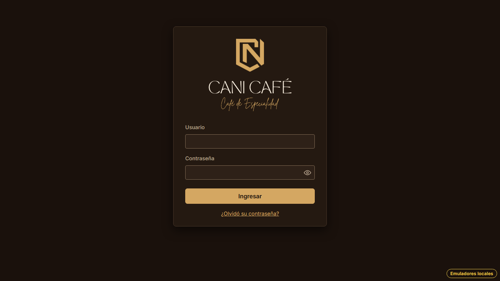
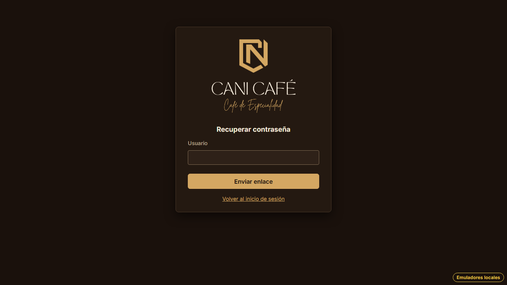
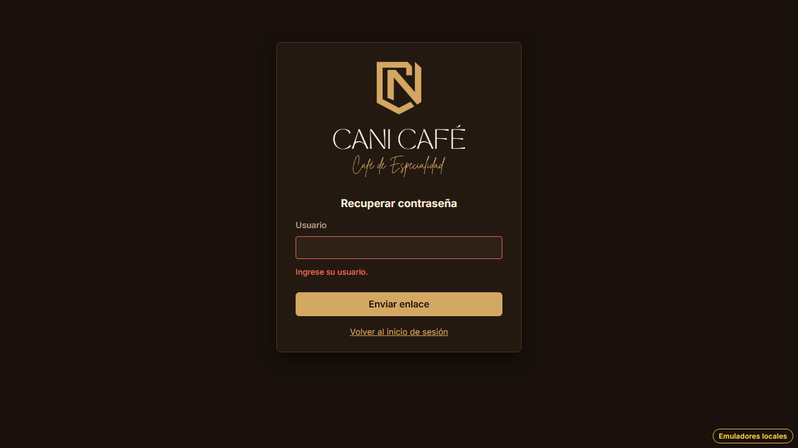
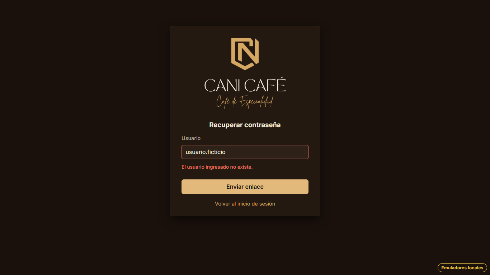
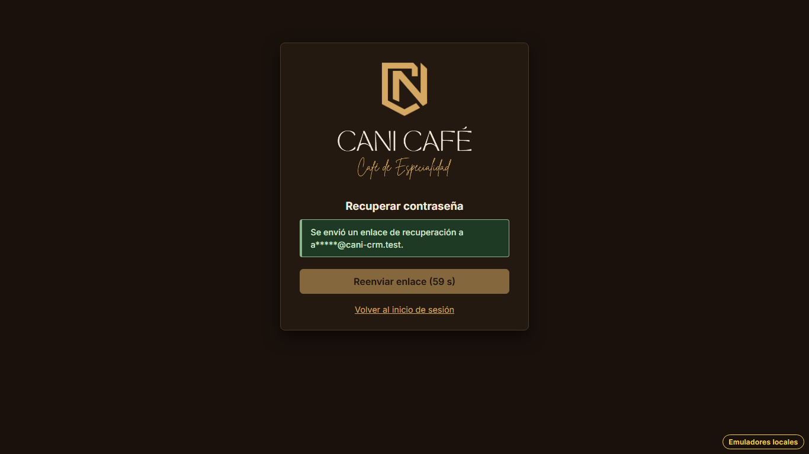

# Evidencia HU-106: Solicitar la recuperación de la contraseña

**Responsable:** Gabriel · **Revisa:** Dylan · **Fecha:** 2026-11-13

> Como administrador quiero pedir un enlace para crear una nueva contraseña
> para volver a entrar si la olvidé.

## Datos de prueba

- Ambiente: Firebase Emulator Suite, proyecto `demo-cani-crm`, datos cargados con `npm run seed`, usuario `admin`
  (correo ficticio `admin@cani-crm.test`).
- Usuario que no existe: `usuario.ficticio`.
- Los correos no salen a internet: el emulador de Auth los guarda y el recorrido los cuenta en
  `/emulator/v1/projects/demo-cani-crm/oobCodes`.
- El recorrido es automático, con Playwright (Chromium headless) en 1366 × 768. El detalle está en
  [recorrido.json](recorrido.json).

## Criterios de aceptación

| # | Criterio | Resultado | Evidencia |
|---|---|---|---|
| 1 | En la pantalla de ingreso está el enlace "¿Olvidó su contraseña?", que abre la pantalla "Recuperar contraseña" con el campo "Usuario", el botón "Enviar enlace" y el enlace "Volver al inicio de sesión". | ✅ Cumple | [01](01-ingreso-olvido-contrasena.png), [02](02-recuperar-contrasena.png). · prueba de pantalla *"¿Olvidó su contraseña? abre…"* |
| 2 | Si el campo está vacío: "Ingrese su usuario.". | ✅ Cumple | [03](03-usuario-vacio.png). No se envía ningún correo. |
| 3 | Si el usuario no existe: "El usuario ingresado no existe.". | ✅ Cumple | [04](04-usuario-no-existe.png). El emulador no registró ningún correo (`correosEnviados: 0`). |
| 4 | Si el usuario existe, se envía el enlace al correo de la cuenta y aparece "Se envió un enlace de recuperación a …", con el correo enmascarado. | ✅ Cumple | [05](05-enlace-enviado.png): "Se envió un enlace de recuperación a a*****@cani-crm.test.". Se ve solo la primera letra y lo que va después de "@", siempre con cinco asteriscos para no revelar el largo. |
| 5 | "Reenviar enlace" muestra los segundos que faltan y solo se puede usar después de 60 segundos. | ✅ Cumple | [05](05-enlace-enviado.png): "Reenviar enlace (60 s)", deshabilitado. A los 60 s queda habilitado; al usarlo se envía otro correo y vuelve a contar ([06](06-reenviar-enlace.png): "(59 s)"). |

El texto exacto de los criterios está en Notion. Los mensajes de la tabla son los literales que muestra el sistema
y que comprueban las pruebas.

## Cómo funciona

- **Ingreso por usuario:** la colección `usernames` relaciona cada usuario (normalizado) con su cuenta (`uid` y
  correo real). La recuperación busca el usuario ahí y pide a Firebase Auth que envíe el correo
  (`sendPasswordResetEmail`).
- **Reglas:** `usernames` se lee por id sin sesión (hace falta para ingresar y recuperar), pero no se puede listar.
- **Con sesión activa** la pantalla no se muestra: pasa directo al sistema.
- El correo y la validez del enlace son de [HU-107](../HU-107/README.md). La pantalla "Crear nueva contraseña" es
  de [HU-108](../HU-108/README.md).

## Textos no definidos en la HU

| Dónde | Texto |
|---|---|
| Falla de conexión o demasiados intentos | Aviso de error sin cambiar de pantalla (`passwordRecovery.ts`). Sin él, el botón no haría nada. |

## Riesgo aceptado

- Quien conozca un nombre de usuario puede leer el correo de esa cuenta en `usernames`. Hace falta para ingresar y
  recuperar sin sesión, y solo se consulta un usuario a la vez. Dylan lo anota en el informe de riesgos.

## Pruebas automatizadas

Salida en [pruebas.txt](pruebas.txt).

- `npm test`: de HU-106 son 6 de pantalla (`ForgotPassword.test.tsx`) y 4 unitarias (`passwordRecovery.test.ts`:
  correo enmascarado y textos).
- `npm run test:emulators`: 4 de HU-106 contra Auth y Firestore reales (vacío, inexistente, índice que apunta a una
  cuenta borrada y envío real), más las reglas de `usernames` en `firestore.rules.test.ts`.

## Capturas

| | |
|---|---|
|  |  |
| 01. "¿Olvidó su contraseña?" en el ingreso | 02. Pantalla "Recuperar contraseña" |
|  |  |
| 03. Usuario vacío | 04. Usuario que no existe |
|  |  |
| 05. Enlace enviado, correo enmascarado y "Reenviar enlace (60 s)" | 06. Después de reenviar, vuelve a contar |
