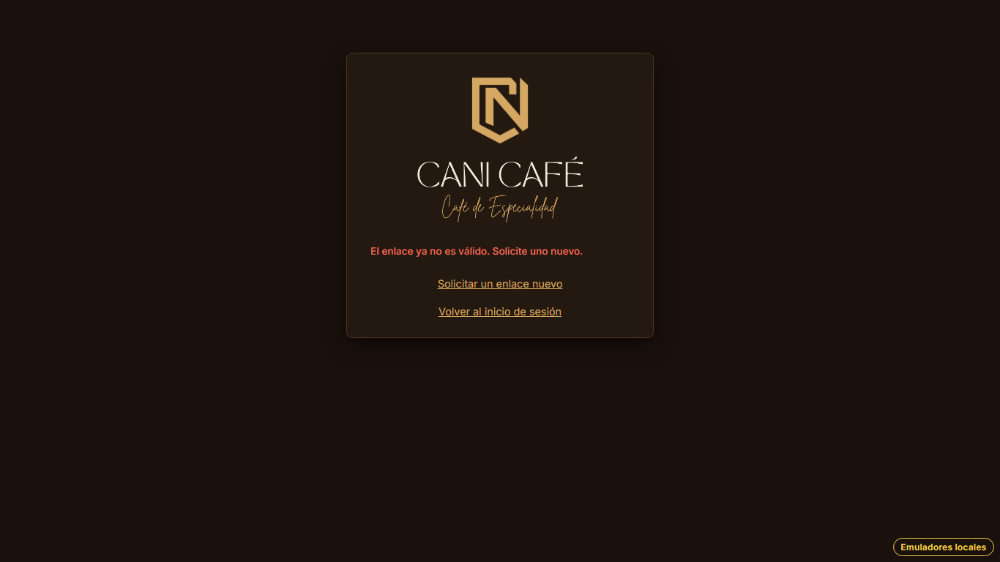
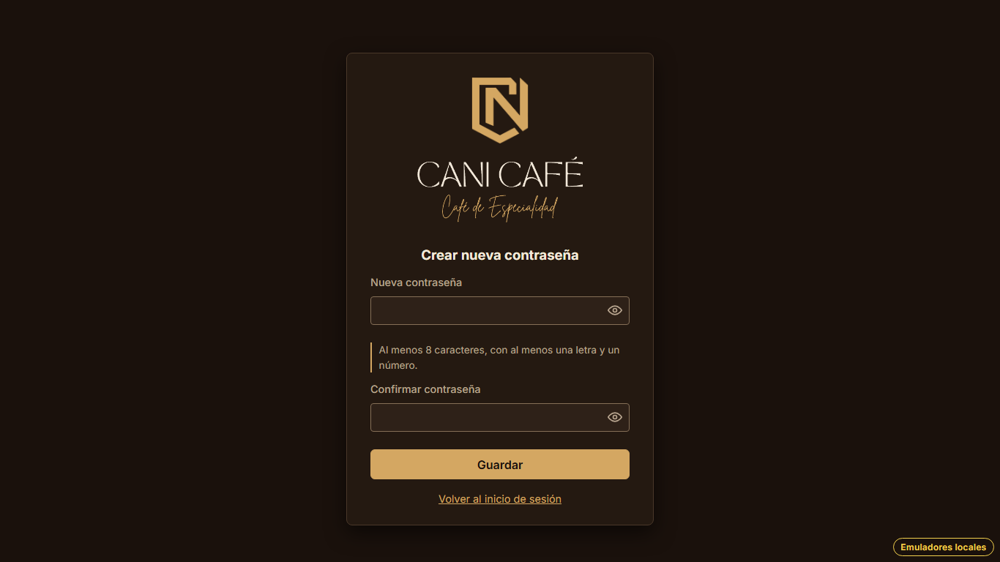

# Evidencia HU-107: Correo de recuperación y validez del enlace

**Responsable:** Gabriel · **Revisa:** Dylan · **Fecha:** 2026-11-13

> Como administrador quiero recibir un correo con un enlace seguro para crear una nueva contraseña.

## Datos de prueba

- Ambiente: Firebase Emulator Suite, proyecto `demo-cani-crm`, datos cargados con `npm run seed`, usuario `admin`.
- El enlace se pidió desde "Recuperar contraseña" ([HU-106](../HU-106/README.md)) y se tomó del emulador de Auth
  (`/emulator/v1/projects/demo-cani-crm/oobCodes`). El emulador no manda correos de verdad.
- Para probar el vencimiento sin esperar 30 minutos, el recorrido atrasa la hora de `passwordResets/admin`
  (`requestedAt`) directamente en el emulador.
- El recorrido es automático, con Playwright (Chromium headless) en 1366 × 768. El detalle está en
  [recorrido.json](recorrido.json).

## Criterios de aceptación

| # | Criterio | Resultado | Evidencia |
|---|---|---|---|
| 1 | El correo llega al buzón de la cuenta. | ⏳ Pendiente de producción (E5-060.1) | El emulador no envía correos. Se comprueba con un Gmail de pruebas después de publicar. |
| 2 | Remitente "CANI Café", asunto "CANI Café – Recuperación de contraseña", saludo "Hola, [usuario]:" y botón "Crear nueva contraseña". | ⏳ Pendiente de producción (E5-060.1) | La plantilla está en [`docs/HU-107-plantilla-correo.md`](../../HU-107-plantilla-correo.md) y se configura en la consola de Firebase. Cómo se ve el correo se comprueba en producción. |
| 3 | El correo indica cuándo vence el enlace y que solo se puede usar una vez. | ✅ Cumple (texto aprobado) | La plantilla dice "El enlace vence 30 minutos después de enviado. Solo se puede usar una vez." Danny aprobó el texto el 2026-11-08 (PC-07): la plantilla de Firebase no permite poner la hora exacta. |
| 4 | El enlace deja de servir 30 minutos después de enviado. | ✅ Cumple | [03](03-vencido-30-minutos.png): con 31 minutos aparece "El enlace ya no es válido. Solicite uno nuevo.". [04](04-con-29-minutos-sirve.png): con 29 minutos todavía abre "Crear nueva contraseña". [05](05-vence-antes-de-guardar.png): si los 30 minutos pasan con la pantalla abierta, "Guardar" tampoco cambia la contraseña. |
| 5 | El enlace deja de servir si se pidió otro. | ✅ Cumple | [01](01-enlace-valido.png): el último enlace abre la pantalla. [02](02-se-pidio-otro.png): el anterior muestra "El enlace ya no es válido. Solicite uno nuevo.". |
| 6 | El enlace deja de servir después de usarlo. | ✅ Cumple | [HU-108, captura 07](../HU-108/07-enlace-usado.png): el enlace ya usado muestra el mismo mensaje. |
| 7 | Si el enlace no sirve: "El enlace ya no es válido. Solicite uno nuevo.". | ✅ Cumple | [02](02-se-pidio-otro.png), [03](03-vencido-30-minutos.png) y [05](05-vence-antes-de-guardar.png). La pantalla ofrece "Solicitar un enlace nuevo" y "Volver al inicio de sesión". |

El texto exacto de los criterios está en Notion. Los mensajes de la tabla son los literales que muestra el sistema
y que comprueban las pruebas.

## Cómo funciona

- Firebase Auth crea el código del enlace (`oobCode`) y lo invalida al usarlo, pero no deja configurar el
  vencimiento ni anula un enlace cuando se pide otro. Por eso cada solicitud guarda en `passwordResets/{usuario}`
  un identificador aleatorio (`rid`), la hora (`requestedAt`, del servidor) y `used`.
- El `rid` viaja dentro del enlace. La pantalla "Nueva contraseña" solo lo acepta si:
  - es el último que se pidió (mismo `rid`);
  - no se usó;
  - no pasaron 30 minutos;
  - y Firebase acepta el código (`verifyPasswordResetCode`).
- **Se revisa dos veces:** al abrir el enlace (`checkResetLinkIn`) y otra vez al dar "Guardar" (`saveNewPasswordIn`,
  agregado el 2026-11-13 a pedido de Dylan). Así, dejar la pantalla abierta no alarga el plazo.

## Pruebas automatizadas

Salida en [pruebas.txt](pruebas.txt).

- `npm test`: de HU-107 son 7 unitarias (`passwordResetLinks.test.ts`: mensaje, `rid`, enlace, 30 minutos, otro
  pedido y usado) y las de pantalla de `ResetPasswordLink.test.tsx`.
- `npm run test:emulators`: 5 de HU-107 (sirve recién enviado, se pidió otro, 30 minutos, usado y código inventado)
  y 2 nuevas en HU-108 (vence con la pantalla abierta y se pidió otro antes de guardar), más las reglas de
  `passwordResets`.

## Capturas

| | |
|---|---|
|  |  |
| 01. El último enlace abre "Crear nueva contraseña" | 02. El anterior ya no sirve |
|  |  |
| 03. Con 31 minutos ya no sirve | 04. Con 29 minutos todavía sirve |
|  | |
| 05. Vence con la pantalla abierta: "Guardar" no cambia la contraseña | |
