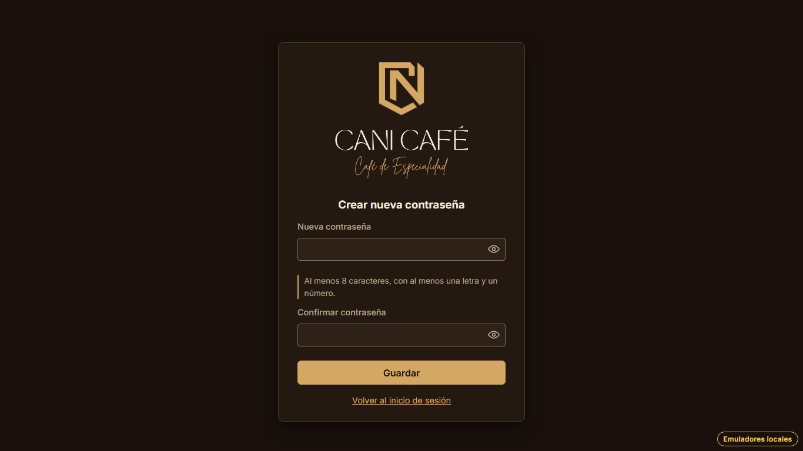
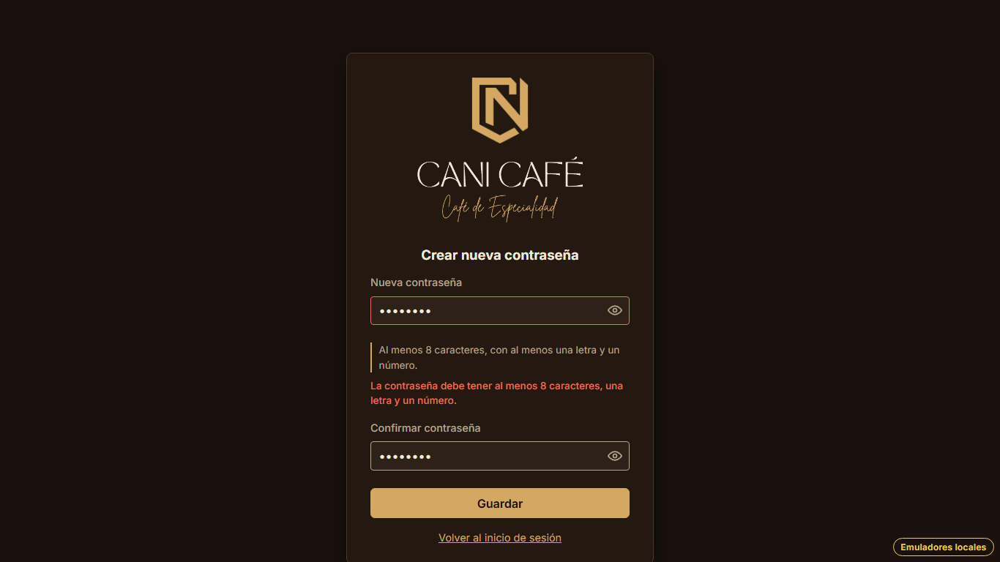
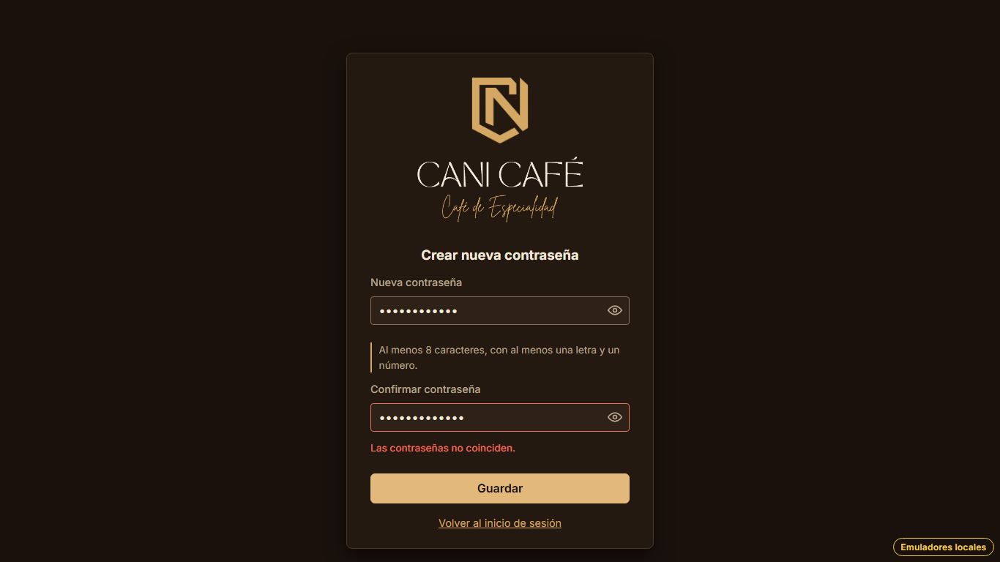
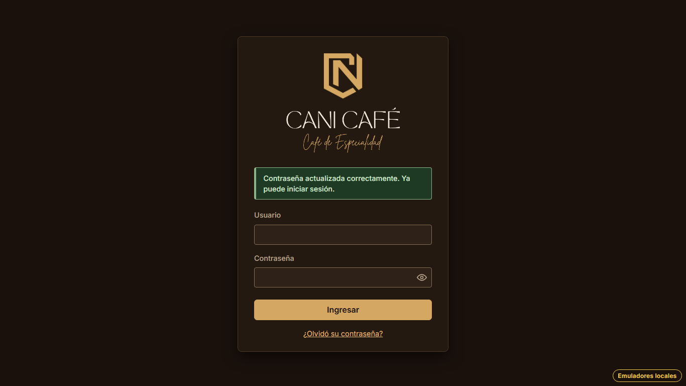
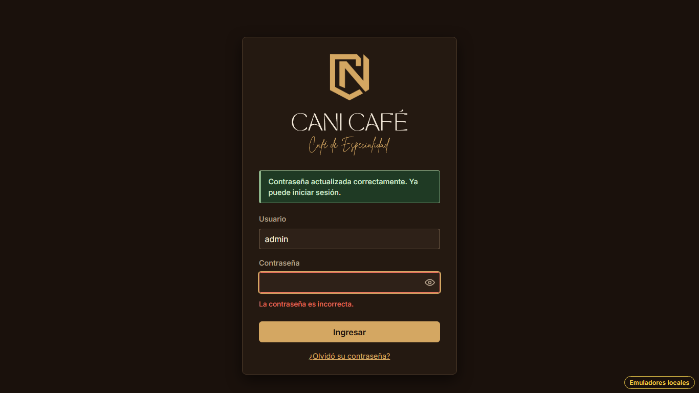
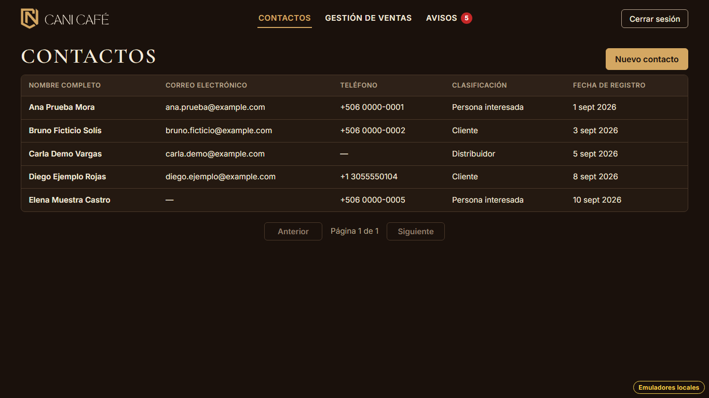
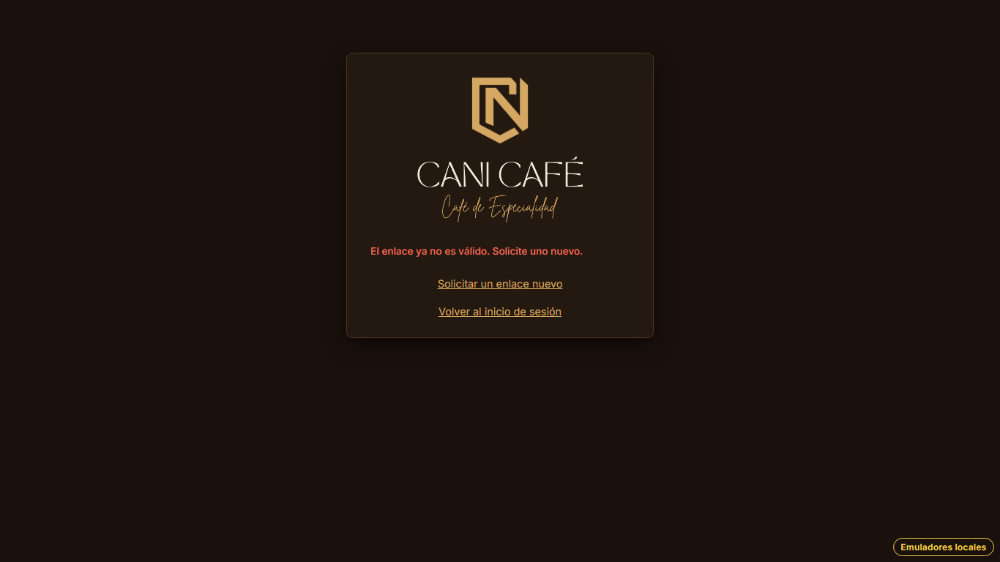

# Evidencia HU-108: Crear una nueva contraseña

**Responsable:** Gabriel · **Revisa:** Dylan · **Fecha:** 2026-11-03

> Como administrador quiero crear una nueva contraseña desde el enlace que recibí
> para recuperar el acceso a mi cuenta.

## Datos de prueba

- Ambiente: Firebase Emulator Suite, proyecto `demo-cani-crm`, datos cargados con `npm run seed`, usuario `admin`.
- El enlace se pidió desde "¿Olvidó su contraseña?" (HU-106). Después se tomó del emulador de Auth
  (`/emulator/v1/projects/demo-cani-crm/oobCodes`) y se abrió en `/nueva-contrasena`, que es lo que hace el botón del
  correo (HU-107).
- Nueva contraseña del recorrido: `CaniCafe2026`. Es un dato ficticio que solo existe en el emulador.
- El recorrido es automático, con Playwright (Chromium headless) en 1366 × 768. El detalle está en [recorrido.json](recorrido.json).

## Criterios de aceptación

| # | Criterio | Resultado | Evidencia |
|---|---|---|---|
| 1 | Al abrir un enlace válido, aparece la pantalla "Crear nueva contraseña", con los campos "Nueva contraseña" y "Confirmar contraseña" y el botón "Guardar". | ✅ Cumple | [01](01-crear-nueva-contrasena.png). Los dos campos llevan el ojo para mostrar u ocultar la contraseña (el mismo `PasswordInput` del ingreso). · prueba *"con un enlace válido aparece…"* |
| 2 | La nueva contraseña debe tener al menos 8 caracteres, con al menos una letra y un número. Esta regla aparece escrita debajo del primer campo. | ✅ Cumple | [01](01-crear-nueva-contrasena.png). Debajo de "Nueva contraseña" dice *"Al menos 8 caracteres, con al menos una letra y un número."*, y el lector de pantalla la anuncia con el campo (`aria-describedby`). La regla está en `isValidNewPassword`: cuenta cualquier letra, incluidas las tildes y la ñ, y cuenta caracteres, no bytes. · 18 pruebas unitarias |
| 3 | Si la contraseña no cumple la regla, aparece el mensaje "La contraseña debe tener al menos 8 caracteres, una letra y un número.". | ✅ Cumple | [02](02-no-cumple-la-regla.png). Con `cafecafe` (sin número) aparece el mensaje literal y no se guarda nada. |
| 4 | Si las dos contraseñas no son iguales, aparece el mensaje "Las contraseñas no coinciden.". | ✅ Cumple | [03](03-no-coinciden.png). Si fallan las dos cosas a la vez, aparecen los dos mensajes. |
| 5 | Al guardar, la contraseña anterior deja de funcionar. Aparece la pantalla de ingreso con el mensaje "Contraseña actualizada correctamente. Ya puede iniciar sesión.". | ✅ Cumple | [04](04-ingreso-contrasena-actualizada.png) muestra el mensaje en el ingreso. [05](05-contrasena-anterior-no-sirve.png): con la contraseña anterior aparece "La contraseña es incorrecta.". [06](06-ingreso-con-la-nueva.png): con la nueva entra a Contactos. · prueba de emuladores *"la anterior deja de funcionar, la nueva sirve y el enlace ya no"* |

**Un solo uso (HU-107):** al guardar, el enlace queda `used: true` en `passwordResets/{usuario}`, y Firebase tampoco
vuelve a aceptar el código. Si se abre el mismo enlace otra vez, aparece "El enlace ya no es válido. Solicite uno
nuevo." ([07](07-enlace-usado.png)). Si el enlace vence entre que se abre la pantalla y se da "Guardar", Firebase
rechaza el código y aparece ese mismo mensaje.

## Textos no definidos en la HU

| Dónde | Texto |
|---|---|
| Regla debajo del primer campo | "Al menos 8 caracteres, con al menos una letra y un número." |
| Falla de conexión al guardar | "No se pudo guardar la contraseña. Intente de nuevo." (se queda en el formulario con lo escrito) |
| Enlace debajo de "Guardar" | "Volver al inicio de sesión" (igual que en "Recuperar contraseña") |

## Notas

- Al volver al ingreso se usa `replace`, para que "Atrás" no regrese a un enlace que ya se usó. El mensaje no
  reaparece al recargar, igual que el de HU-104.
- `markResetLinkUsed` de HU-107 se reemplazó por `saveNewPassword`, que guarda la contraseña y marca el enlace en ese
  orden. Si falla la marca, la contraseña igual quedó cambiada y Firebase ya no acepta el código, así que se informa
  como guardada.

## Pruebas automatizadas

Salida en [pruebas.txt](pruebas.txt).

- `npm run typecheck`: sin errores.
- `npm test`: 763/763. De HU-108 son 18 unitarias (regla y mensajes) y 7 de pantalla.
- `npm run test:emulators`: 201/201. De HU-108 son 2: el cambio completo (la anterior deja de servir, la nueva sí, el
  enlace queda usado y Firebase rechaza el código) y un código inventado que no cambia nada.

## Capturas

| | |
|---|---|
|  |  |
| 01. Crear nueva contraseña | 02. No cumple la regla |
|  |  |
| 03. Las contraseñas no coinciden | 04. Ingreso con el mensaje |
|  |  |
| 05. La contraseña anterior ya no sirve | 06. Ingreso con la nueva |
|  | |
| 07. El mismo enlace otra vez | |
