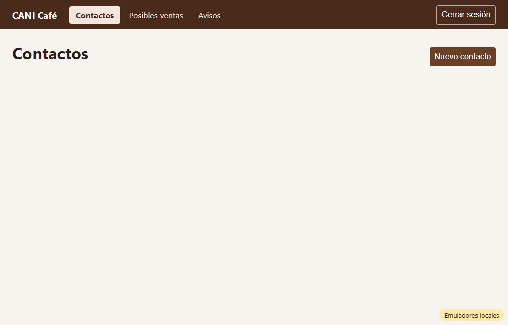
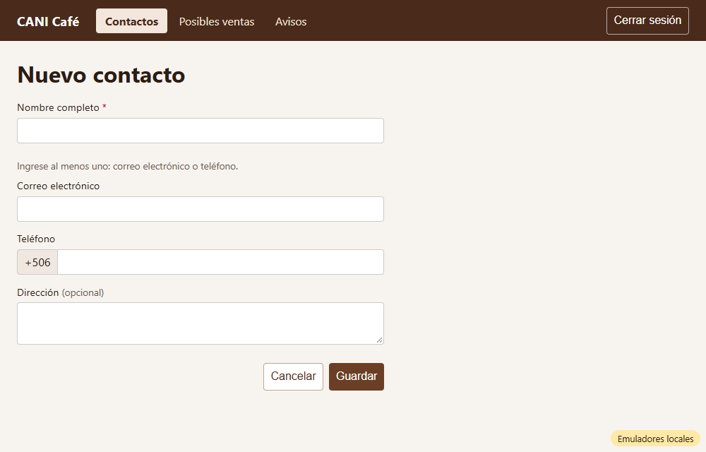
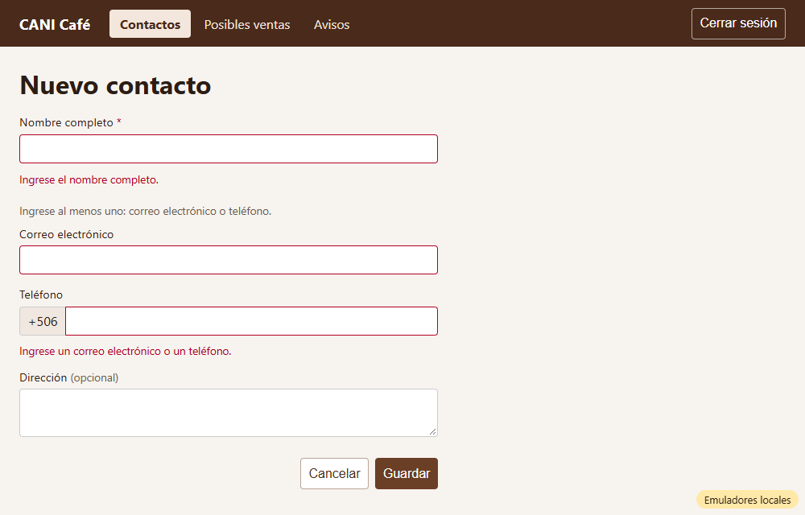
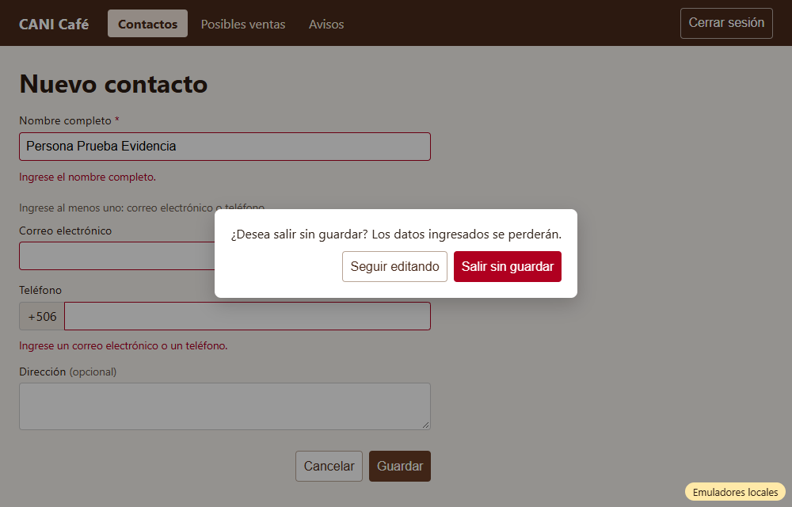
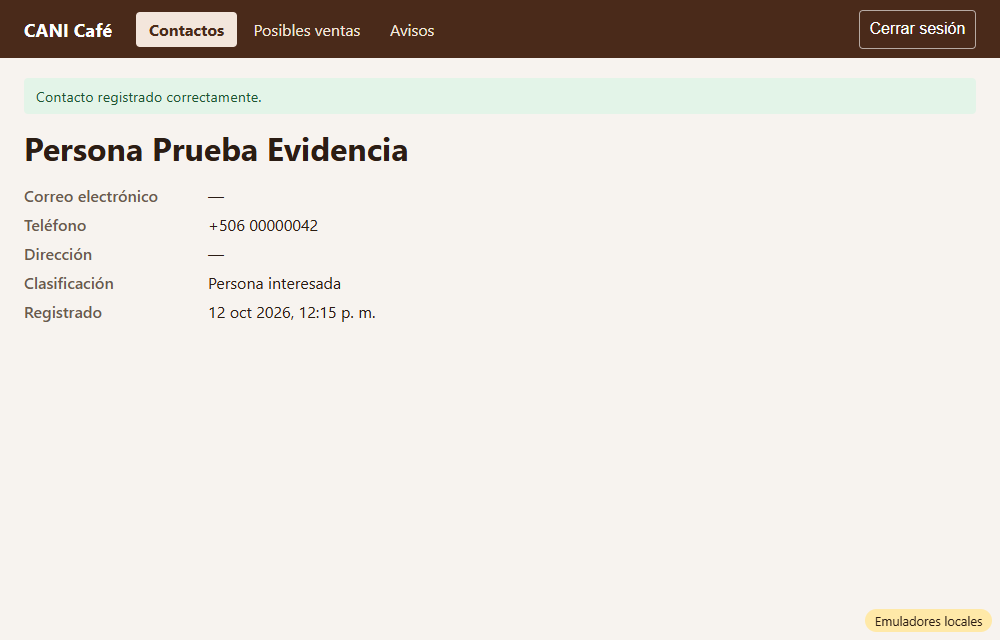

# Evidencia HU-201: Registrar un nuevo contacto

**Responsable:** Gabriel · **Revisa:** Dylan · **Fecha:** 2026-10-12

> Como administrador quiero registrar un nuevo contacto
> para que su información quede guardada en un solo lugar.

## Datos de prueba

- Ambiente: Firebase Emulator Suite, proyecto `demo-cani-crm`, datos cargados con `npm run seed`, usuario `admin`.
- Contacto registrado en el recorrido: "Persona Prueba Evidencia", con teléfono `0000 0042` y sin correo ni dirección. Es un dato ficticio.
- Recorrido automático en Microsoft Edge (headless). El detalle completo, incluido el documento guardado en Firestore, está en [recorrido.json](recorrido.json).

## Criterios de aceptación

| # | Criterio | Resultado | Evidencia |
|---|---|---|---|
| 1 | En "Contactos", arriba a la derecha, está el botón "Nuevo contacto". Al darle clic, se abre el formulario. | ✅ Cumple | [01](01-contactos-boton.png) → [02](02-formulario.png) · prueba *"en Contactos está el botón Nuevo contacto…"* |
| 2 | El formulario pide cuatro datos: nombre completo, correo electrónico, teléfono y dirección. | ✅ Cumple | Exactamente 4 campos. El teléfono lleva el prefijo fijo **+506**, porque los contactos son nacionales. [02](02-formulario.png) |
| 3 | El nombre completo es obligatorio. También es obligatorio al menos uno de: correo o teléfono. La dirección es opcional. | ✅ Cumple | [03](03-obligatorios.png). Se puede llenar solo el correo, solo el teléfono o los dos; si faltan los dos, aparece un aviso. · pruebas unitarias y de pantalla |
| 4 | Al guardar, aparece la ficha del nuevo contacto con "Contacto registrado correctamente.". El contacto queda clasificado como "Persona interesada". | ✅ Cumple | [05](05-ficha-contacto-registrado.png). En Firestore queda `classification: "persona_interesada"`. El mensaje no reaparece al recargar. |
| 5 | "Cancelar" después de escribir pregunta "¿Desea salir sin guardar? Los datos ingresados se perderán.". Sin datos, vuelve directo a la lista. | ✅ Cumple | [04](04-cancelar-con-datos.png). "Seguir editando" conserva lo escrito y "Salir sin guardar" vuelve a Contactos. Sin datos, vuelve sin preguntar. |

**Error relevante (definición de terminado):** si Firestore no puede guardar, aparece *"No se pudo registrar el contacto. Intente de nuevo."* y el formulario conserva lo escrito.

## Cambio de contrato (`contacts`), acordado por Gabriel como responsable

| Campo | Antes | Ahora |
|---|---|---|
| `address` | no existía | `string \| null` (nuevo, opcional) |
| `email` | `string` | `string \| null` |
| `phoneCountry` / `phoneNumber` | `string` | `string \| null` (siempre `"CR"` si hay teléfono) |
| `origin` | obligatorio | `ContactOrigin \| null` (el formulario no lo pide) |
| `classification` | `prospecto \| cliente \| distribuidor \| otro` | **`persona_interesada`** \| cliente \| distribuidor \| otro |

Los campos no llenados se guardan como `null` explícito, no se omiten. El seed se actualizó: hay un contacto con solo correo y otro con solo teléfono.

## Notas

- Los mensajes *"Ingrese el nombre completo."* e *"Ingrese un correo electrónico o un teléfono."* son provisionales. Los textos definitivos de validación son de la HU-202.
- La ficha que se muestra al guardar es una versión mínima. La ficha completa es la HU-207, y la lista de contactos es la HU-204.

## Pruebas automatizadas

Salida completa en [pruebas.txt](pruebas.txt).

- `npm run typecheck`: sin errores.
- `npm test`: 85/85, de las cuales 16 son de HU-201 (7 de reglas del formulario y 9 de pantallas).
- Pruebas contra emuladores: 20/20, de las cuales 2 son de HU-201: se guarda con las reglas reales, y sin sesión no se puede guardar.
- HT-001 y HU-101 a HU-105 siguen pasando.

## Capturas

| | |
|---|---|
|  |  |
| 01. Botón "Nuevo contacto" | 02. Formulario |
|  |  |
| 03. Guardar sin datos | 04. Cancelar después de escribir |
|  | |
| 05. Ficha con el mensaje | |
