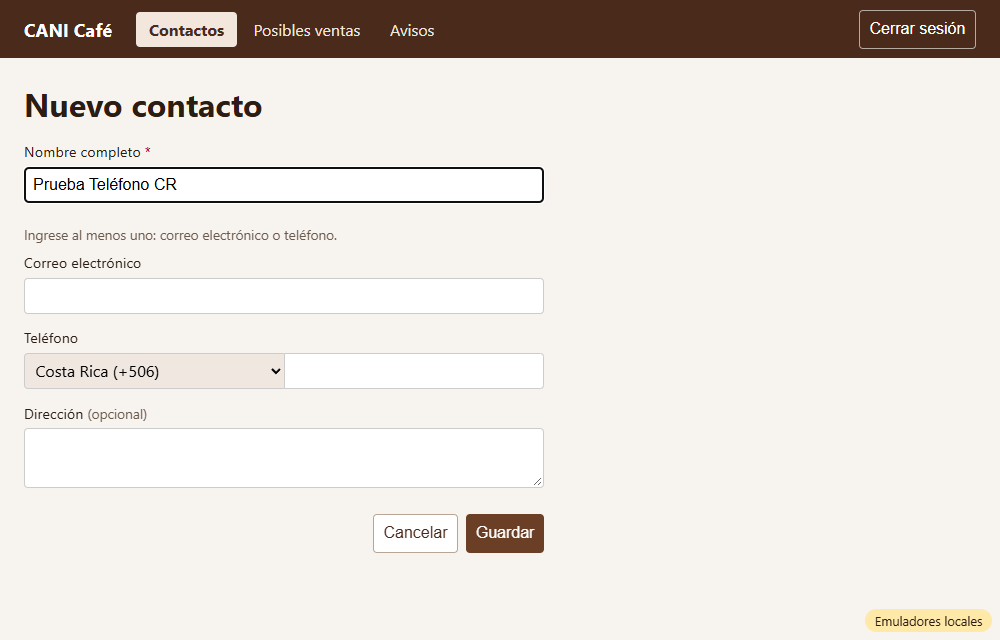
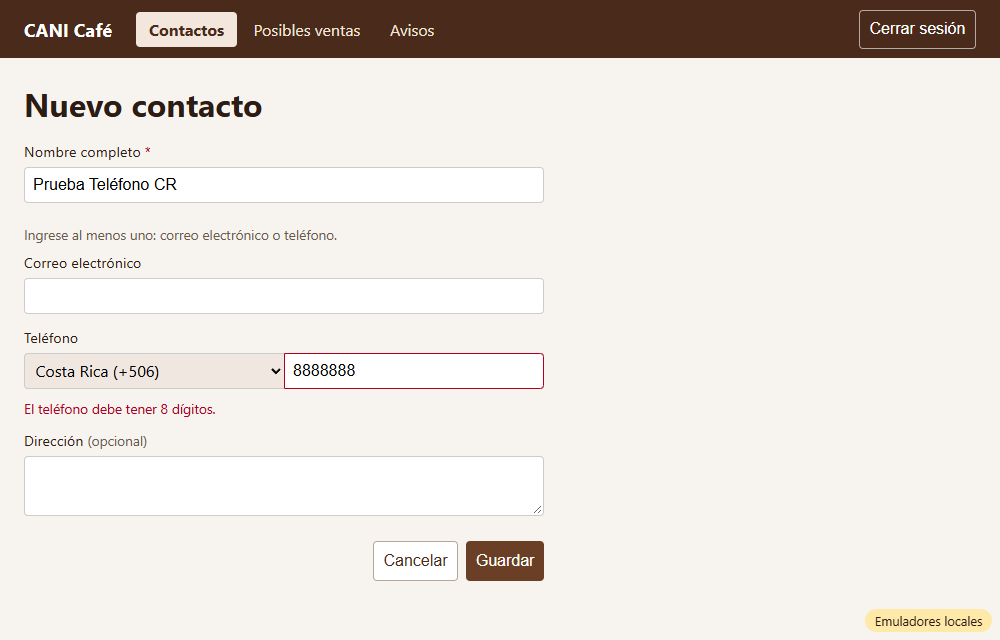
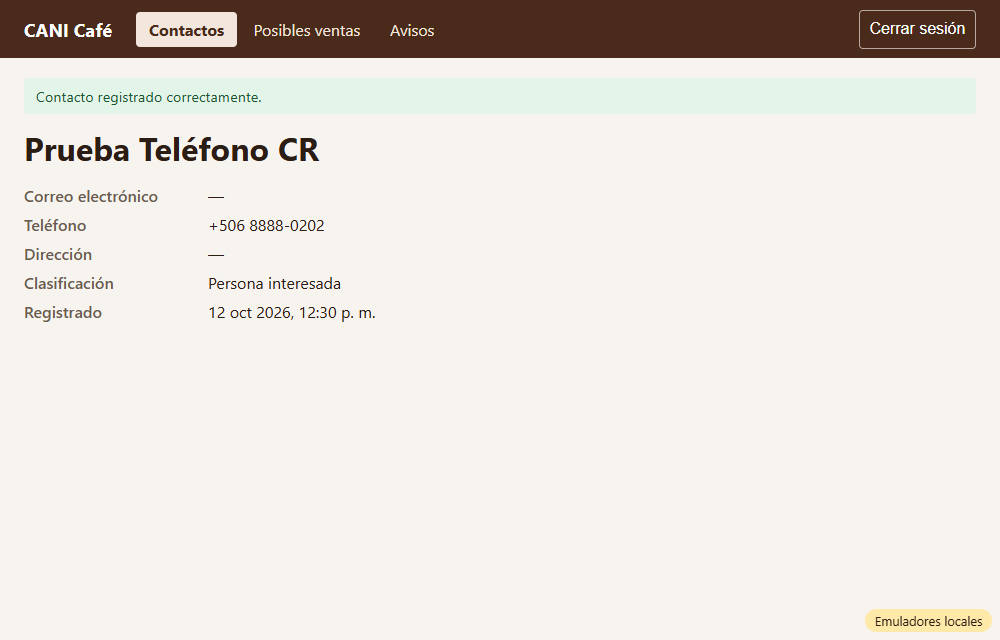
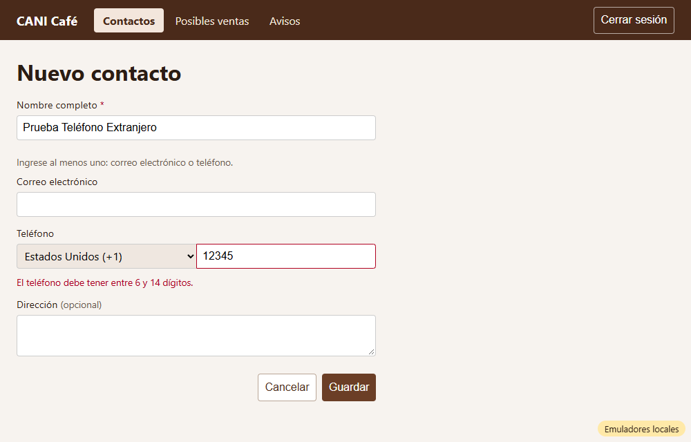
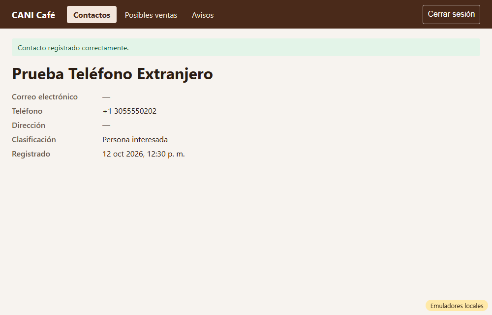

# Evidencia HU-202: Teléfonos de Costa Rica y de otros países

**Responsable:** Gabriel · **Revisa:** Dylan · **Fecha:** 2026-10-12

> Como administrador quiero registrar teléfonos de Costa Rica y de otros países
> para que pueda guardar contactos de cualquier país.

## Datos de prueba

- Ambiente: Firebase Emulator Suite, proyecto `demo-cani-crm`, datos cargados con `npm run seed`, usuario `admin`.
- Números usados, todos ficticios: Costa Rica `8888-0202`, Estados Unidos `305 555 0202` (serie 555) y Nicaragua con 15 dígitos.
- Recorrido automático en Microsoft Edge (headless). El detalle completo está en [recorrido.json](recorrido.json).

## Criterios de aceptación

| # | Criterio | Resultado | Evidencia |
|---|---|---|---|
| 1 | El teléfono tiene dos partes: primero se elige el país en una lista y después se escribe el número. | ✅ Cumple | [01](01-telefono-dos-partes.png). Primero la lista de países y a la derecha el número. · prueba *"el teléfono tiene dos partes…"* |
| 2 | La lista muestra el nombre de cada país con su código. Costa Rica (+506) viene elegido de forma automática. | ✅ Cumple | 245 países, con el formato "Nombre (+código)" y ordenados alfabéticamente, por ejemplo "Estados Unidos (+1)" o "Nicaragua (+505)". "Costa Rica (+506)" viene elegido. |
| 3 | Un teléfono de Costa Rica debe tener 8 números. Se muestra así: +506 8888-8888. | ✅ Cumple | [03](03-ficha-costa-rica.png): en la ficha aparece **+506 8888-0202**. |
| 4 | Un teléfono de otro país debe tener entre 6 y 14 números, sin contar el código. Se muestra con su código, por ejemplo: +1 3055551234. | ✅ Cumple | [05](05-ficha-otro-pais.png): en la ficha aparece **+1 3055550202**. En Firestore queda `phoneCountry: "US"` y `phoneNumber: "3055550202"`. |
| 5 | Si el número no tiene la cantidad correcta: "El teléfono debe tener 8 dígitos." (Costa Rica) o "El teléfono debe tener entre 6 y 14 dígitos." (otros países). | ✅ Cumple | [02](02-error-costa-rica.png) con 7 dígitos en Costa Rica y [04](04-error-otro-pais.png) con 5 dígitos en Estados Unidos. Con 15 dígitos en Nicaragua también aparece el mensaje. |

## Cómo funciona

- **Qué se guarda:** el país (`phoneCountry`, código ISO como `"CR"` o `"US"`) y el número solo con dígitos (`phoneNumber`), sin el código del país. **El contrato no cambia.**
- **Al escribir:** se aceptan espacios, guiones y paréntesis, que se quitan al guardar.
- **Lista de países:** sale de `libphonenumber-js`, la referencia estándar de códigos telefónicos. Los nombres en español los da el navegador. Las reglas de largo son exactamente las de la HU.
- **Validación:** si se escribe un teléfono, se valida su largo aunque también se haya llenado el correo. Sigue siendo obligatorio al menos uno de los dos (HU-201).
- **Para HU-203 (duplicados):** `phoneKey(país, número)` da una forma única del teléfono, por ejemplo `+50688888888`.
- **Editar contacto:** el campo es un componente reutilizable (`PhoneField`), listo para esa pantalla cuando se haga su HU.

## Pruebas automatizadas

Salida completa en [pruebas.txt](pruebas.txt).

- `npm run typecheck`: sin errores.
- `npm test`: 102/102, de las cuales 17 son de HU-202 (6 de reglas de teléfono, 2 del formulario y 9 de pantalla).
- Pruebas contra emuladores: 20/20.
- HT-001, HU-101 a HU-105 y HU-201 siguen pasando.

## Capturas

| | |
|---|---|
|  |  |
| 01. País + número; Costa Rica elegido | 02. Costa Rica con 7 dígitos |
|  |  |
| 03. +506 8888-0202 | 04. Estados Unidos con 5 dígitos |
|  | |
| 05. +1 3055550202 | |
