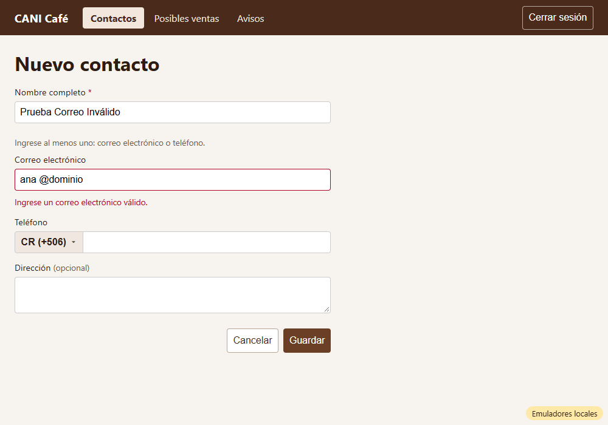
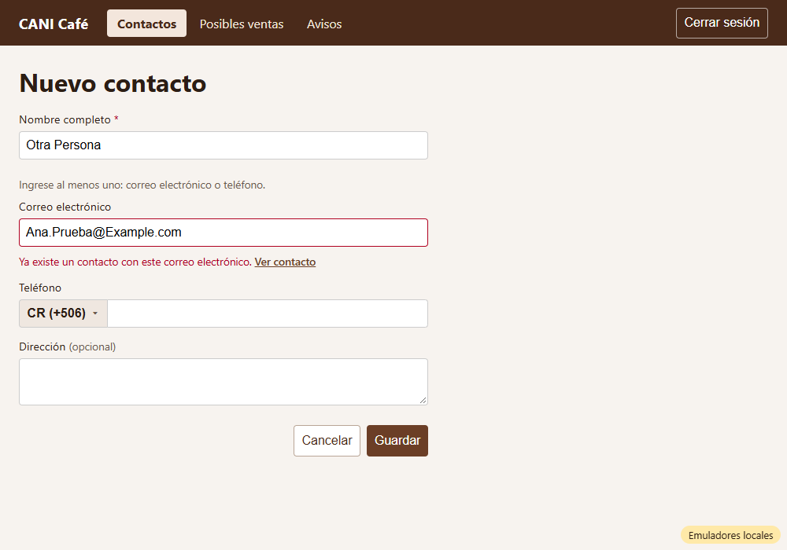
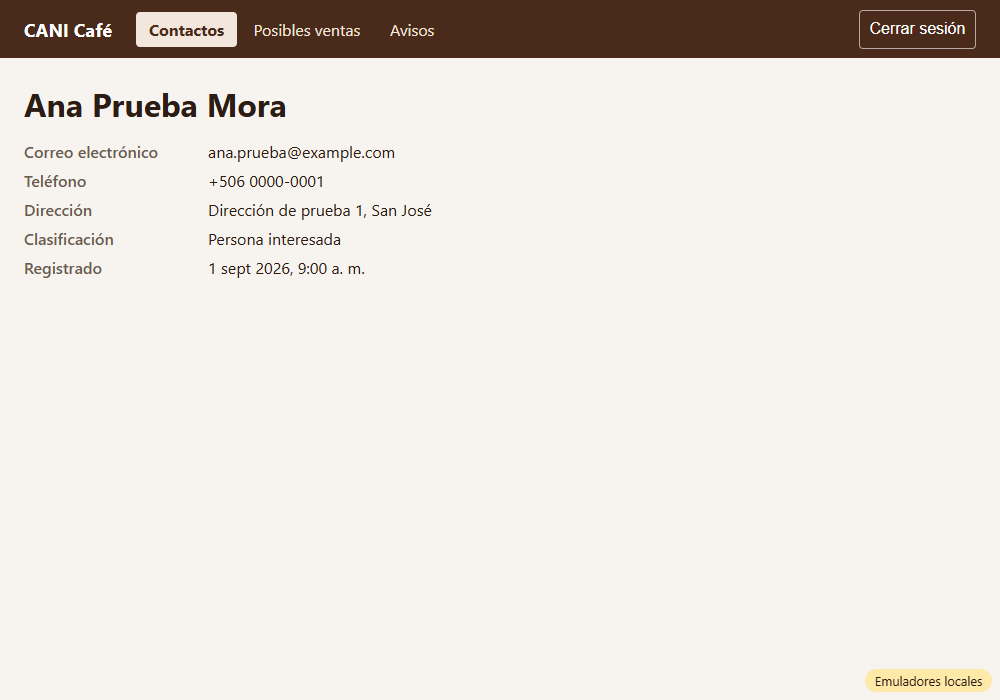
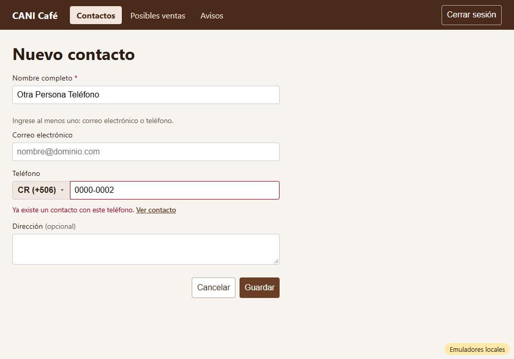
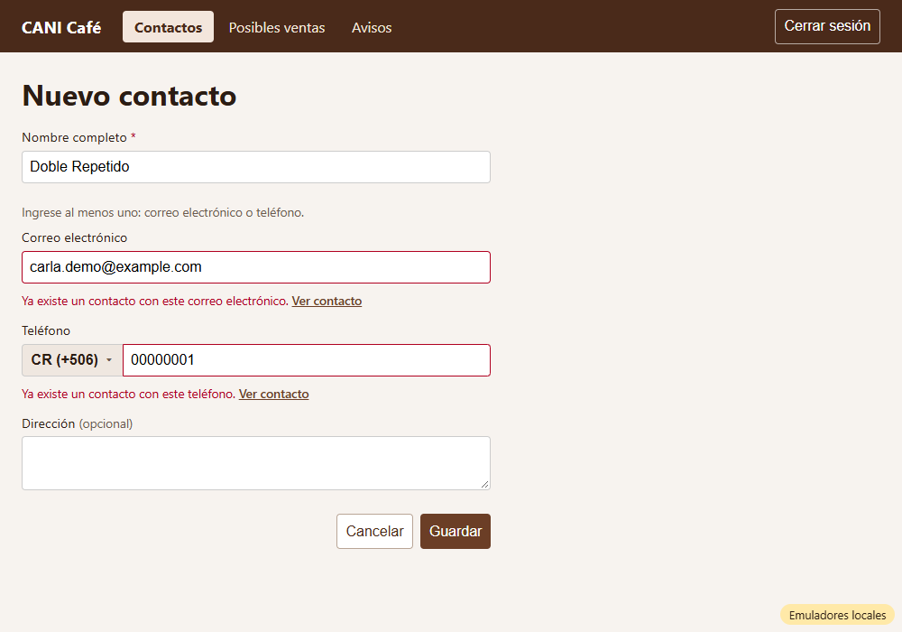

# Evidencia HU-203: Revisar los datos de un contacto antes de guardarlo

**Responsable:** Gabriel · **Revisa:** Dylan · **Fecha:** 2026-10-12

> Como administrador quiero que el sistema revise los datos de un contacto antes de guardarlo
> para que el directorio no tenga datos incorrectos ni contactos repetidos.

## Datos de prueba

- Ambiente: Firebase Emulator Suite, proyecto `demo-cani-crm`, datos cargados con `npm run seed`, usuario `admin`.
- Contactos "ya existentes" (del seed, ficticios):

  | Contacto | Correo | Teléfono |
  |---|---|---|
  | `contact-001` | `ana.prueba@example.com` | CR 0000-0001 |
  | `contact-002` | — | CR 0000-0002 |
  | `contact-003` | `carla.demo@example.com` | — |
- Recorrido automático en Microsoft Edge (headless). El detalle completo está en [recorrido.json](recorrido.json).

## Criterios de aceptación

| # | Criterio | Resultado | Evidencia |
|---|---|---|---|
| 1 | Nombre completo y correo aceptan como máximo 100 caracteres. La dirección, como máximo 250. | ✅ Cumple | Al escribir 110, 110 y 260 caracteres, quedan **100, 100 y 250**. Pegar texto más largo también se corta. |
| 2 | El correo debe ser nombre@dominio.com, sin espacios. Si no, "Ingrese un correo electrónico válido.". | ✅ Cumple | [01](01-correo-invalido.png) con "ana @dominio". También se probaron `ana`, `ana@dominio`, `ana@dominio .com` y `@dominio.com`. |
| 3 | No puede haber dos contactos con el mismo correo: "Ya existe un contacto con este correo electrónico.". | ✅ Cumple | [02](02-correo-repetido.png). Se detecta aunque se escriba con mayúsculas (`Ana.Prueba@Example.com`). |
| 4 | No puede haber dos contactos con el mismo teléfono (mismo país y número): "Ya existe un contacto con este teléfono.". | ✅ Cumple | [04](04-telefono-repetido.png) con CR 0000-0002. El **mismo número en otro país** (Nicaragua) **no** es repetido y se guarda como `+505 00000002`. |
| 5 | Junto a los mensajes de repetido aparece "Ver contacto", que abre la ficha existente. Mientras haya un error, no se guarda. | ✅ Cumple | "Ver contacto" abre `/contactos/contact-001` (Ana Prueba Mora): [03](03-ver-contacto-existente.png). Con correo y teléfono repetidos a la vez salen los dos mensajes, cada uno con su enlace: [05](05-ambos-repetidos.png). En las pruebas, `createContact` nunca se llama mientras hay errores. |

## Cómo funciona

- **Largos máximos:** el campo no deja escribir más (`maxLength`). Además se valida antes de guardar.
- **Correo:**
  - Formato `algo@dominio.ext`, sin espacios en medio.
  - Se guarda **en minúsculas**, así `Ana@Example.com` y `ana@example.com` son el mismo correo.
- **Repetidos:** Firestore no tiene restricciones de unicidad como PostgreSQL. Antes de guardar se consulta si existe otro contacto:
  - con el mismo correo
  - o con el mismo `phoneCountry` + `phoneNumber`
- **Limitación conocida:** si dos personas guardan el mismo contacto en el mismo instante, ambas consultas podrían pasar. Para un sistema interno con pocos usuarios el riesgo es mínimo. Si hiciera falta una garantía total, se puede agregar una colección de "llaves únicas" con transacciones, pero cambia el contrato.
- **Editar contacto (más adelante):** la consulta acepta `excludeId`, para que el propio contacto no cuente como repetido.
- **Reglas de seguridad:** sin cambios. Las consultas usan las reglas actuales (usuario activo) y lo verifican las pruebas contra el emulador.

## Pruebas automatizadas

Salida completa en [pruebas.txt](pruebas.txt).

- `npm run typecheck`: sin errores.
- `npm test`: 129/129, de las cuales 16 son de HU-203 (5 unitarias y 11 de pantalla).
- Pruebas contra emuladores: 25/25, de las cuales 5 son de HU-203: correo repetido, teléfono repetido, mismo número en otro país, datos nuevos y `excludeId`.
- HT-001, HU-101 a HU-105, HU-201 y HU-202 siguen pasando.

## Capturas

| | |
|---|---|
|  |  |
| 01. Correo inválido | 02. Correo repetido + "Ver contacto" |
|  |  |
| 03. "Ver contacto" abre la ficha existente | 04. Teléfono repetido |
|  | |
| 05. Correo y teléfono repetidos | |
