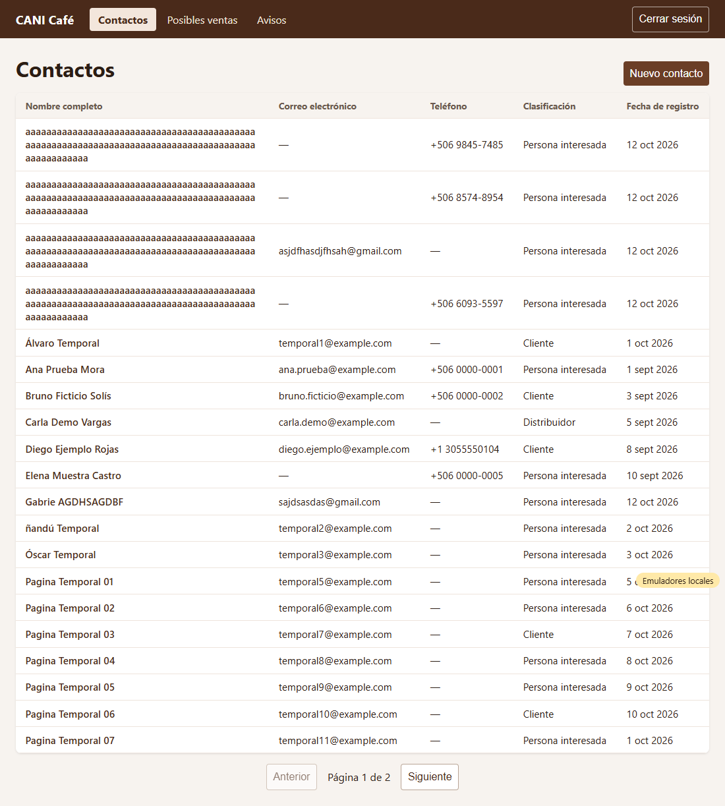
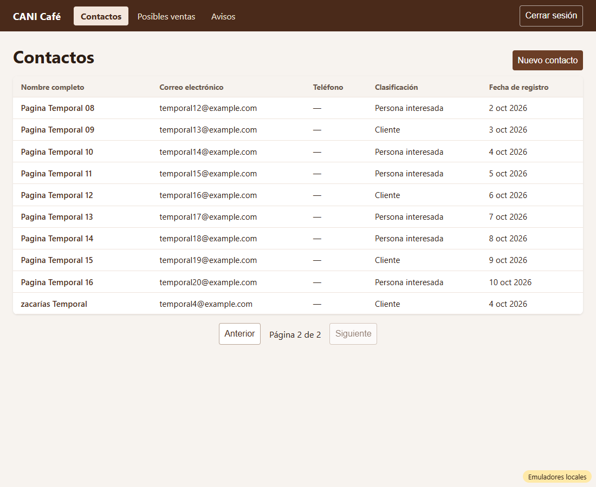
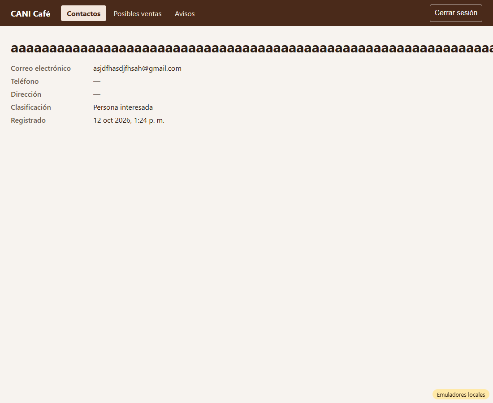

# Evidencia HU-204: Ver la lista de contactos

**Responsable:** Gabriel · **Revisa:** Dylan · **Fecha:** 2026-10-12

> Como administrador quiero ver la lista de todos los contactos
> para que tenga una vista general del directorio.

## Datos de prueba

- Ambiente: Firebase Emulator Suite, proyecto `demo-cani-crm`, datos cargados con `npm run seed`, usuario `admin`.
- Para mostrar la paginación (más de 20 contactos), el recorrido crea **20 contactos temporales ficticios** (`tmp-hu204-…`) y **los borra al terminar**. En `recorrido.json`, `temporalesQueQuedan` da 0.
- Se incluyeron nombres con tildes, ñ y minúscula inicial ("Álvaro", "ñandú", "Óscar", "zacarías") para comprobar el orden alfabético. También aparecen contactos creados a mano durante las pruebas, entre ellos nombres de 100 letras sin espacios.
- Recorrido automático en Microsoft Edge (headless). El detalle completo está en [recorrido.json](recorrido.json).

## Criterios de aceptación

| # | Criterio | Resultado | Evidencia |
|---|---|---|---|
| 1 | La pantalla "Contactos" muestra una tabla con: nombre completo, correo electrónico, teléfono, clasificación y fecha de registro. | ✅ Cumple | [01](01-lista-pagina-1.png). Los datos vacíos se muestran como "—". El teléfono usa el formato de HU-202 (`+506 0000-0001`, `+1 3055550104`). La fecha es la de Costa Rica. |
| 2 | Los contactos aparecen en orden alfabético por nombre. | ✅ Cumple | Se ordena **en Firestore** con `nameSortKey` (nombre en minúsculas y sin tildes), así que el orden no depende de tildes ni mayúsculas: Álvaro → Ana → Bruno → … → Óscar → … → zacarías. Lo verifica la prueba contra el emulador real. |
| 3 | 20 contactos por página. Debajo, "Anterior", "Siguiente" y "Página X de Y". | ✅ Cumple | [01](01-lista-pagina-1.png) muestra 20 filas y "Página 1 de 2", con "Anterior" desactivado. [02](02-lista-pagina-2.png) muestra 10 filas y "Página 2 de 2", con "Siguiente" desactivado. "Anterior" vuelve a la página 1. |
| 4 | Sin contactos: "Aún no hay contactos registrados.". | ✅ Cumple | Prueba de pantalla *"sin contactos: Aún no hay contactos registrados. (sin tabla)"*. |
| 5 | Al dar clic sobre un contacto de la tabla, se abre su ficha. | ✅ Cumple | El clic en cualquier celda de la fila abre la ficha: [03](03-ficha-desde-lista.png). El nombre además es un enlace, accesible con teclado. |

## Cómo funciona

- **Consulta paginada en Firestore:** cada página trae solo 20 documentos (`orderBy('nameSortKey')`, `limit`, cursor `startAfter`). El total para "Página X de Y" sale de un conteo en el servidor (`getCountFromServer`), sin descargar los contactos.
- **Cambio de contrato en `contacts` (responsable: Gabriel):**
  - Campo interno nuevo: **`nameSortKey`**. Es el nombre en minúsculas y sin tildes, y no se muestra en pantalla.
  - Lo calcula el sistema al guardar (`createContactIn`).
  - `npm run seed` lo completa en contactos viejos que no lo tengan.
  - Hace falta porque Firestore ordena por código de carácter: sin este campo, "Álvaro" quedaría después de "Zoe" y "ana" después de "Bruno".
- **Nombres muy largos:** los nombres de 100 letras sin espacios se parten dentro de su columna y no empujan las demás. Este problema apareció con datos reales de prueba y quedó corregido.
- Si falla la consulta, aparece *"No se pudieron cargar los contactos. Intente de nuevo."*.

## Pruebas automatizadas

Salida completa en [pruebas.txt](pruebas.txt).

- `npm run typecheck`: sin errores.
- `npm test`: 141/141, de las cuales 10 son de HU-204 (8 de pantalla y 2 de la clave de orden).
- Pruebas contra emuladores: 29/29, de las cuales 4 son de HU-204: conteo, página 1 ordenada, página 2 y sin sesión no se puede listar.
- HT-001, HU-101 a HU-105 y HU-201 a HU-203 siguen pasando.

## Capturas

| | |
|---|---|
|  |  |
| 01. Página 1 de 2 (20 contactos) | 02. Página 2 de 2 |
|  | |
| 03. Clic en una fila → ficha | |
