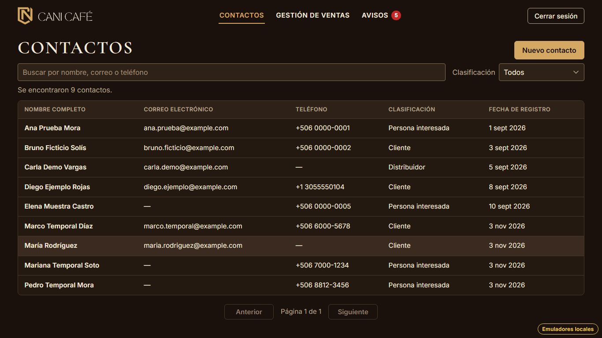
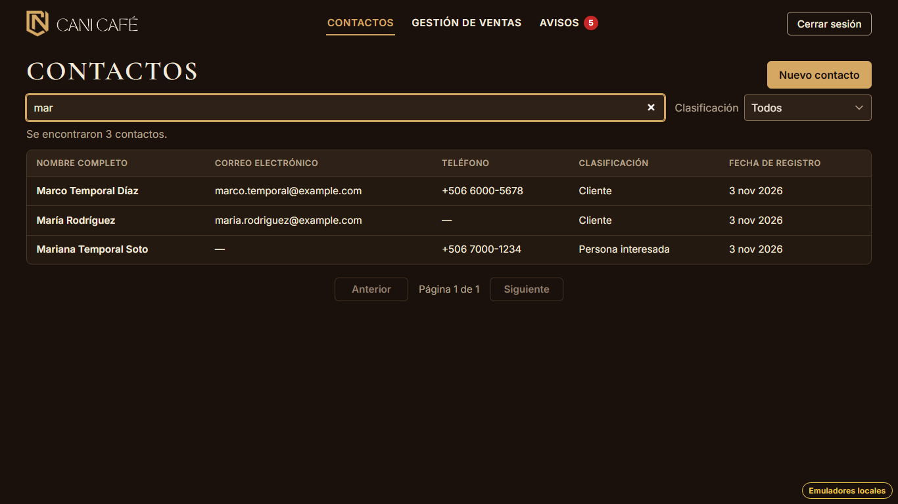
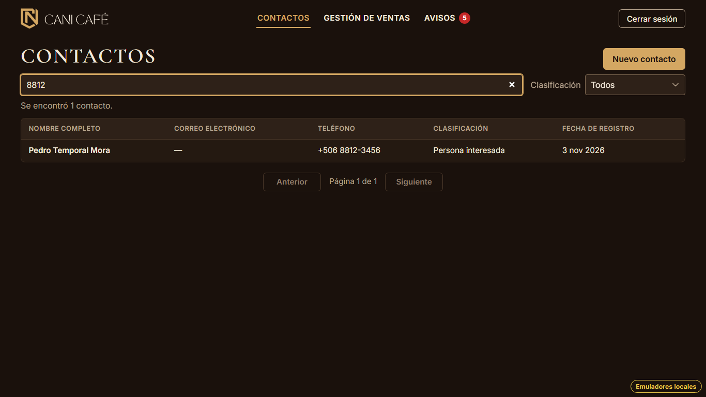
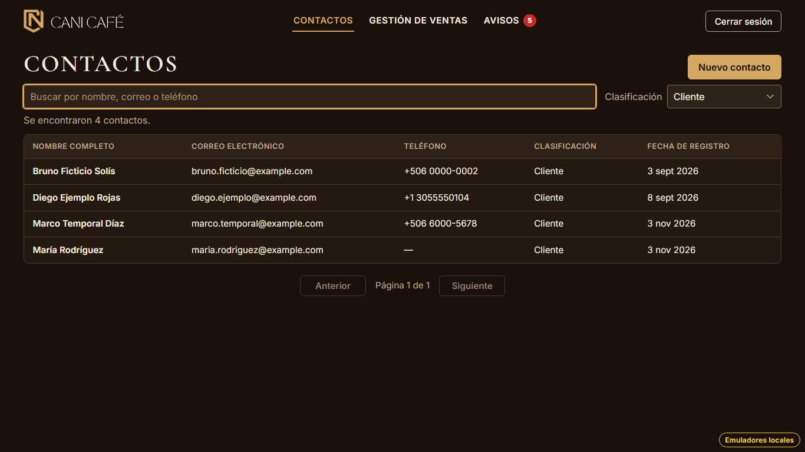
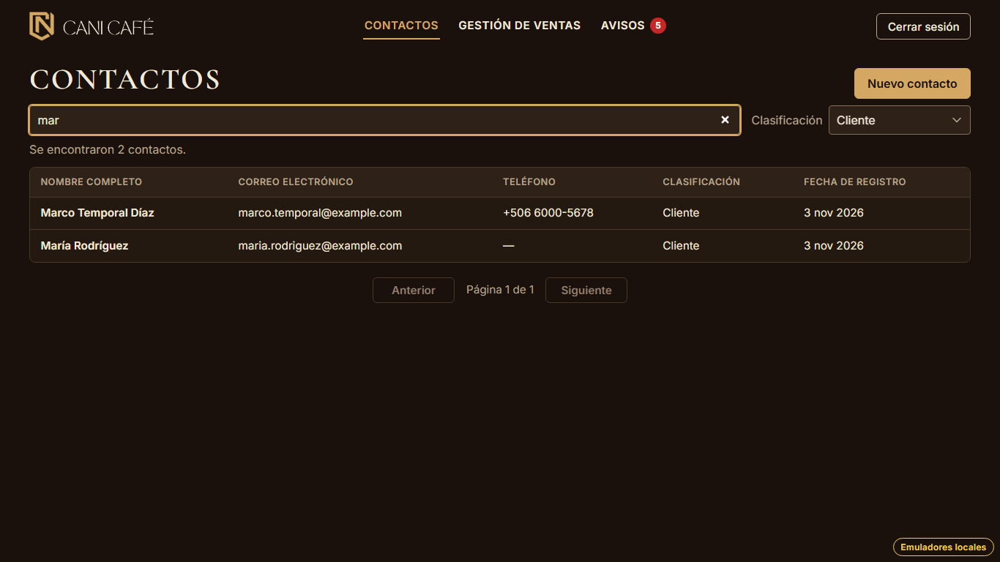
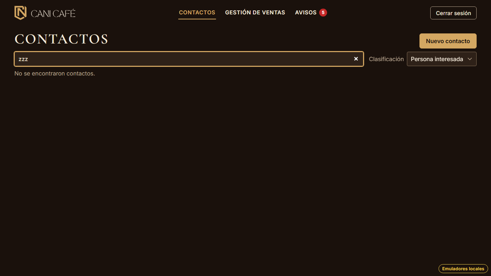

# Evidencia HU-205: Buscar y filtrar contactos

**Responsable:** Gabriel · **Revisa:** Dylan · **Fecha:** 2026-11-03

> Como administrador quiero buscar un contacto por su nombre, correo o teléfono y filtrar la lista por clasificación,
> para encontrar rápido a una persona.

## Datos de prueba

- Ambiente: Firebase Emulator Suite, proyecto `demo-cani-crm`, datos cargados con `npm run seed`, usuario `admin`.
- Para reproducir los ejemplos del criterio, el recorrido crea **4 contactos temporales ficticios** (`tmp-hu205-…`) y
  **los borra al terminar**. En `recorrido.json`, `temporalesQueQuedan` da 0. Los contactos temporales son
  "María Rodríguez", "Mariana Temporal Soto", "Marco Temporal Díaz" y "Pedro Temporal Mora". Este último tiene el
  teléfono 8812-3456. Con los 5 del seed suman 9 contactos.
- El recorrido es automático, con Playwright (Chromium headless) en 1366 × 768. Escribe letra por letra, como una
  persona. El detalle está en [recorrido.json](recorrido.json).

## Criterios de aceptación

| # | Criterio | Resultado | Evidencia |
|---|---|---|---|
| 1 | Arriba de la tabla está el buscador "Buscar por nombre, correo o teléfono". La tabla cambia mientras se escribe. | ✅ Cumple | [01](01-lista-buscador-y-clasificacion.png). En `recorrido.json`, "Escribir mar letra por letra" registra la tabla después de cada letra: con "m" hay 9 (todos tienen "m" en el correo `@example.com`), con "ma" hay 3 y con "mar" hay 3. No hay botón "Buscar". |
| 2 | Por ejemplo, al escribir "mar" aparece "María Rodríguez", y al escribir "8812" aparece el contacto con el teléfono 8812-3456. | ✅ Cumple | [02](02-buscar-mar.png): "mar" muestra María Rodríguez, Mariana y Marco. [03](03-buscar-8812.png): "8812" muestra a Pedro Temporal Mora (+506 8812-3456). |
| 3 | A la derecha del buscador está la lista "Clasificación", con las opciones "Todos", "Persona interesada" y "Cliente". Al abrir la pantalla, está en "Todos". | ✅ Cumple | [01](01-lista-buscador-y-clasificacion.png) y [04](04-clasificacion-cliente.png). El recorrido mide las posiciones: la lista está a la derecha del buscador y los dos están arriba de la tabla. |
| 4 | Si se usan el buscador y la clasificación a la vez, la tabla muestra solo los contactos que cumplen ambos. | ✅ Cumple | [05](05-mar-y-cliente.png): "mar" + "Cliente" muestra Marco y María; Mariana queda fuera porque es "Persona interesada". |
| 5 | Arriba de la tabla se indica cuántos contactos se encontraron, por ejemplo: "Se encontraron 12 contactos.". Si no hay ninguno, aparece "No se encontraron contactos.". | ✅ Cumple | "Se encontraron 9 contactos." en [01](01-lista-buscador-y-clasificacion.png). [06](06-sin-resultados.png) muestra "No se encontraron contactos." y no muestra la tabla. El conteo se anuncia a los lectores de pantalla (`role="status"`). |

**Regla general (texto parcial, sin mayúsculas ni tildes):**
- "mar" encuentra "María", y "rodriguez" encuentra "Rodríguez".
- El texto puede estar en cualquier parte del nombre o del correo.
- El teléfono se compara por dígitos, así que "8812", "8812-3456" y "+506 8812" encuentran el mismo contacto.

## Cómo funciona

- **Decisión: la búsqueda se hace en el navegador.** Firestore no tiene búsqueda de texto: solo permite buscar por
  prefijo en un campo (por ejemplo, `nameSortKey`). Así no se encontraría "mar" dentro de "Ana Marín", ni nada en el
  correo o en el teléfono. CANI Café tiene pocos cientos de contactos, así que al empezar a buscar o filtrar se traen
  todos una sola vez (`listAllContactsIn`). Después la tabla cambia al instante con cada letra. La explicación está en
  `src/contacts/contactSearch.ts`. Dylan usa el mismo enfoque en el selector de contactos de HU-302.
- **Sin búsqueda ni filtro**, la lista sigue igual que en HU-204: 20 por página, consultadas en Firestore, y el total
  sale del conteo del servidor.
- **Los resultados también se paginan de 20 en 20.** Al cambiar la búsqueda o la clasificación se vuelve a la
  página 1.
- **La búsqueda y la clasificación quedan en la URL** (`?buscar=mar&clasificacion=cliente`):
  - Al abrir una ficha, "Volver a contactos" regresa a la lista como estaba (prueba de HU-207 y paso 7 del recorrido).
  - "Atrás" también la recupera.
  - "Contactos" en la barra superior vuelve a la lista sin buscar.
- Se incluyen los contactos inactivos, igual que en la lista de HU-204.
- **Índices:** no hace falta ninguno nuevo. La consulta es solo `orderBy('nameSortKey')`, que usa el índice automático.

## Defecto encontrado y corregido durante la evidencia

Al escribir rápido "8812", el buscador quedaba con "82". React Router cambia la URL como transición, y el campo tomaba
su valor de la URL, así que se perdían letras. Las pruebas de pantalla no lo detectaron; el recorrido con Playwright
sí. Ahora lo escrito vive en la pantalla y se copia a la URL, y la pantalla solo vuelve a leer la URL cuando la cambia
otra cosa. Después de la corrección, el recorrido completo se repitió.

## Textos no definidos en la HU

| Dónde | Texto |
|---|---|
| Conteo con un solo resultado | "Se encontró 1 contacto." |

## Notas

- La lista "Clasificación" tiene solo las tres opciones del criterio. Los contactos "Distribuidor" u "Otro" aparecen
  en "Todos", pero no se pueden filtrar por separado.
- Si no hay ningún contacto registrado y no se está buscando, se mantiene "Aún no hay contactos registrados." de
  HU-204.
- Mientras la pantalla está abierta y se busca, los contactos que entren en ese momento (por ejemplo, desde el
  formulario) aparecen al volver a entrar a "Contactos".

## Pruebas automatizadas

Salida en [pruebas.txt](pruebas.txt).

- `npm run typecheck`: sin errores.
- `npm test`: 791/791. De HU-205 son 15 unitarias (búsqueda, clasificación y mensajes) y 13 de pantalla.
- `npm run test:emulators`: 203/203. De HU-205 son 2: trae todos (también los inactivos) en orden y la búsqueda
  funciona sobre esos datos, y sin sesión no se pueden leer.
- HU-204 y HU-207 siguen pasando. La prueba de HU-207 que ya preveía la búsqueda en la URL se ajustó al nombre real
  del parámetro (`buscar`).

## Capturas

| | |
|---|---|
|  |  |
| 01. Buscador y "Clasificación" en "Todos" | 02. "mar" |
|  |  |
| 03. "8812" | 04. Solo "Cliente" |
|  |  |
| 05. "mar" + "Cliente" | 06. Sin resultados |
