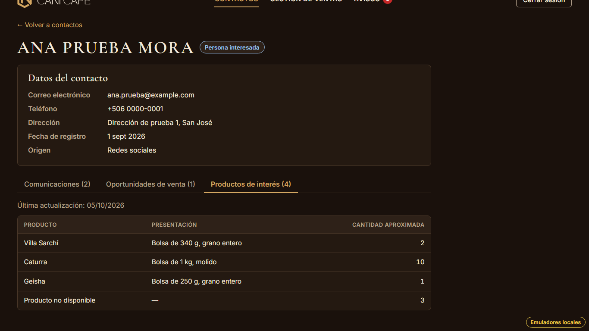
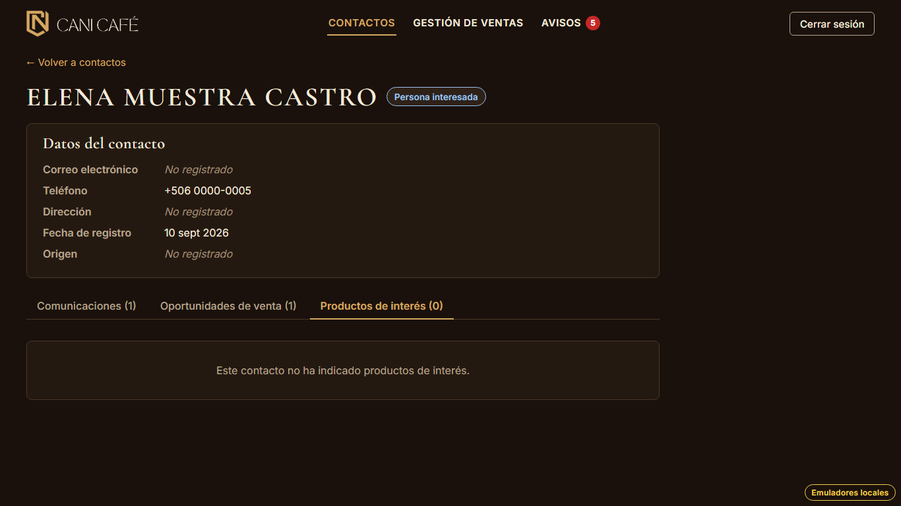

# Evidencia HU-209: Ver los productos de interés de un contacto

**Responsable:** Gabriel · **Revisa:** Dylan · **Fecha:** 2026-11-03

> Como administrador quiero ver en la ficha los productos que le interesan a un contacto
> para preparar la conversación con él.

## Datos de prueba

- Ambiente: Firebase Emulator Suite, proyecto `demo-cani-crm`, datos cargados con `npm run seed`, usuario `admin`.
- En el seed, "Ana Prueba Mora" (`contact-001`) indicó en su último formulario, del 05/10/2026, cuatro productos del
  catálogo oficial. El último ya no existe, para mostrar "Producto no disponible".
- "Elena Muestra Castro" (`contact-005`) no indicó productos.
- "Bruno Ficticio Solís" (`contact-002`) tiene oportunidades con productos, pero no envió el formulario.
- Mientras HU-502 y HU-503 no estén hechas, los productos del formulario vienen del seed. Esas historias son las que
  llenan los campos con cada envío.
- El recorrido es automático, con Playwright (Chromium headless) en 1366 × 768. El detalle está en
  [recorrido.json](recorrido.json).

## Criterios de aceptación

| # | Criterio | Resultado | Evidencia |
|---|---|---|---|
| 1 | La pestaña "Productos de interés" muestra una tabla con estas columnas: producto, presentación y cantidad aproximada. | ✅ Cumple | [01](01-productos-de-interes.png). Columnas "Producto", "Presentación" y "Cantidad aproximada". Los productos aparecen en el orden en que la persona los indicó (el del catálogo). La cantidad va alineada a la derecha. |
| 2 | Arriba de la tabla se indica la fecha del último formulario que envió el contacto, por ejemplo: "Última actualización: 05/10/2026". | ✅ Cumple | [01](01-productos-de-interes.png): "Última actualización: 05/10/2026", arriba de la tabla. Es el día en Costa Rica: un formulario del 5 de octubre a las 11:30 p. m. sigue diciendo 05/10/2026 (prueba unitaria y de pantalla). |
| 3 | Si el contacto no tiene productos de interés, aparece el mensaje "Este contacto no ha indicado productos de interés.". | ✅ Cumple | [02](02-sin-productos.png). No se muestra la tabla y la pestaña dice "Productos de interés (0)". |

## Decisión: solo los productos del formulario

- **Qué decía cada documento:** el contrato v3 decía que la pestaña mostraba los productos del formulario y además
  los de las oportunidades. Los criterios de HU-209 solo hablan de lo que indicó el contacto (cantidad aproximada y
  fecha del último formulario).
- **Qué se decidió (Gabriel, 03/11/2026):** la pestaña muestra **solo** los productos del formulario. Los productos de
  las oportunidades se siguen viendo en la pestaña "Oportunidades de venta". En el recorrido, Bruno tiene
  oportunidades con productos y la pestaña dice "Este contacto no ha indicado productos de interés.".
- `docs/CONTRATO_FORMULARIO.md` (punto 3) quedó corregido.

## Cómo funciona

- **Contrato del contacto:**
  - `interests: [{ productId, quantity }]`: los productos del último formulario (contrato v3, punto 3).
  - `interestsUpdatedAt` (nuevo): la fecha y hora del último formulario (`submittedAt`).
  - HU-502 escribe los dos campos al crear el contacto y HU-503 los reemplaza en cada nuevo envío.
- **Nombre y presentación:** salen del catálogo actual. Solo se leen los productos indicados, no todo el catálogo.
  - Un producto inactivo se muestra igual.
  - Un producto que ya no existe aparece como "Producto no disponible" con presentación "—".
- **Menos lecturas:** la ficha ya no consulta `saleProducts` para esta pestaña.
- **Seed:** `SeedDoc` ahora respeta los campos opcionales del tipo, así que un contacto del seed no está obligado a
  tener productos de interés.
- **Índices:** no hace falta ninguno nuevo.

## Notas

- Si un contacto tiene productos sin fecha (por ejemplo, si la carga inicial E5-050.1 los trae), se muestra la tabla
  sin la línea "Última actualización" (prueba de pantalla).

## Pruebas automatizadas

Salida en [pruebas.txt](pruebas.txt).

- `npm run typecheck`: sin errores.
- `npm test`: 800/800.
  - De HU-209: 6 pruebas unitarias (textos, orden, cantidad, producto inexistente, repetidos y fecha de Costa Rica) y
    6 de pantalla.
  - Se actualizaron 3 pruebas de HU-207 que esperaban la lista anterior y el mensaje "Sin productos de interés.".
- `npm run test:emulators`: 204/204. De HU-209: los productos del formulario con su cantidad y la fecha, sin los de las
  ventas, contra Firestore y las reglas reales.

## Capturas

| | |
|---|---|
|  |  |
| 01. Tabla y "Última actualización" | 02. Sin productos de interés |
