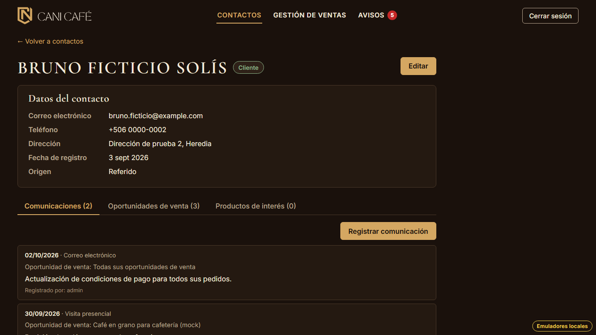
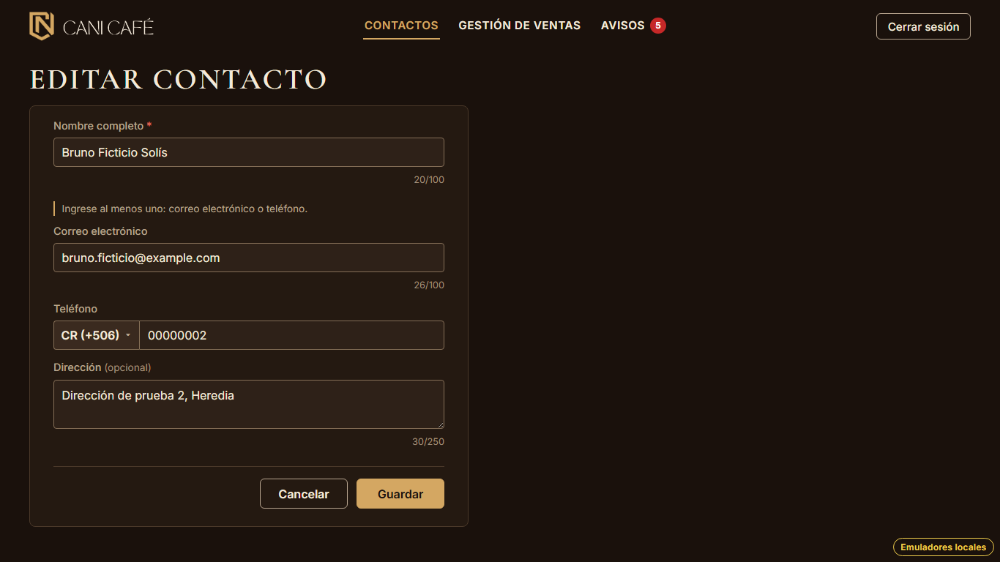
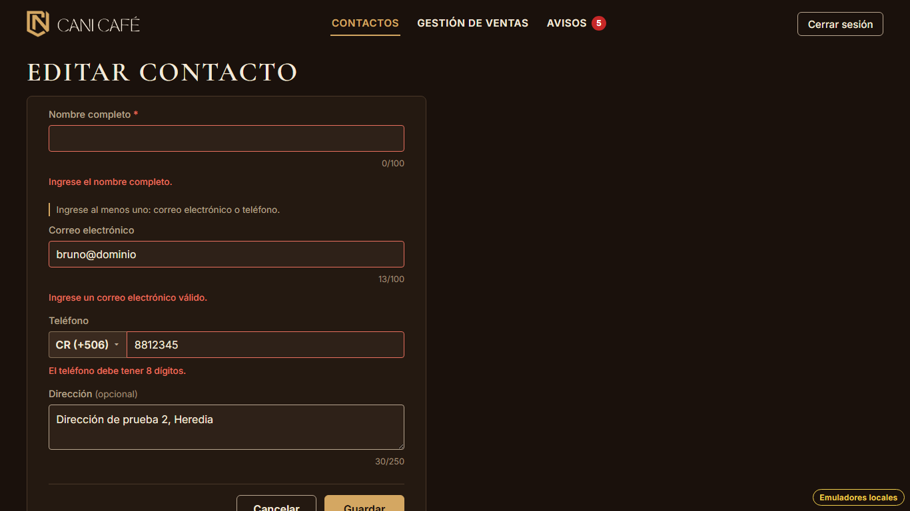
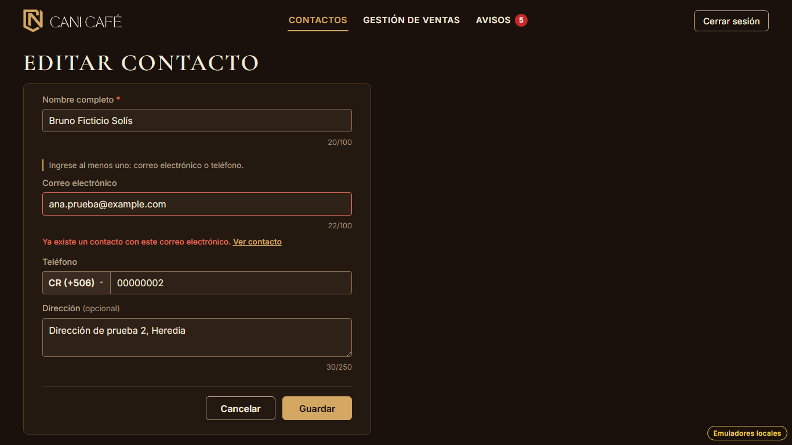
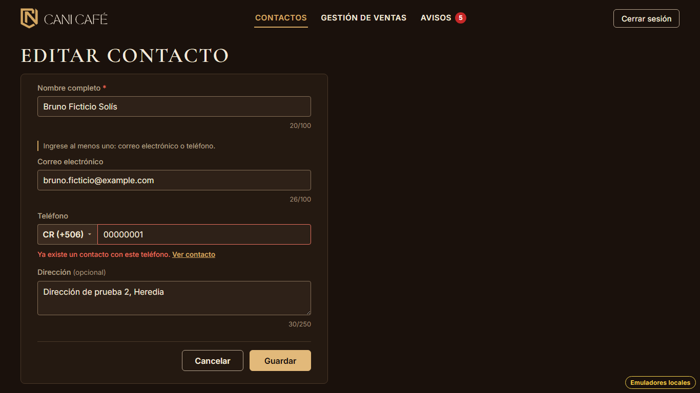
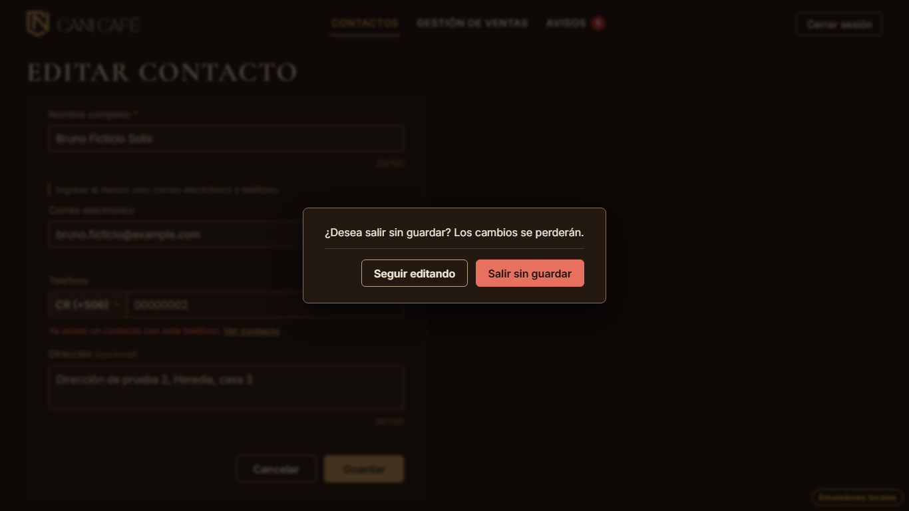
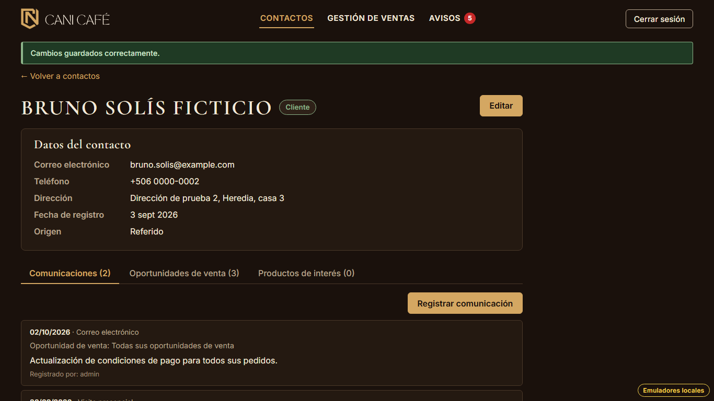

# Evidencia HU-210: Editar un contacto

**Responsable:** Gabriel · **Revisa:** Dylan · **Fecha:** 2026-11-03

> Como administrador quiero modificar los datos de un contacto
> para que su información se mantenga actualizada.

## Datos de prueba

- Ambiente: Firebase Emulator Suite, proyecto `demo-cani-crm`, datos cargados con `npm run seed`, usuario `admin`.
- Se edita a "Bruno Ficticio Solís" (`contact-002`). Para los repetidos se usan el correo y el teléfono de "Ana Prueba
  Mora" (`contact-001`). Todos los datos son ficticios.
- Al terminar, `npm run seed` se vuelve a correr para dejar a Bruno como estaba.
- El recorrido es automático, con Playwright (Chromium headless) en 1366 × 768. El detalle está en
  [recorrido.json](recorrido.json), incluido el documento de Firestore antes y después.

## Criterios de aceptación

| # | Criterio | Resultado | Evidencia |
|---|---|---|---|
| 1 | En la ficha, arriba a la derecha, está el botón "Editar". Al darle clic, se abre el formulario del contacto con sus datos actuales. | ✅ Cumple | [01](01-ficha-boton-editar.png): "Editar" está a la altura del nombre y alineado con el borde derecho del recuadro de datos (el recorrido lo mide). [02](02-formulario-datos-actuales.png): `/contactos/contact-002/editar` con nombre, correo, país (+506), teléfono y dirección actuales. |
| 2 | Se pueden cambiar el nombre completo, el correo, el teléfono (con su país) y la dirección. No se pueden cambiar la clasificación, el origen ni la fecha de registro. | ✅ Cumple | El formulario tiene solo esos cuatro campos y el país del teléfono. Al guardar solo se escriben esos campos (más `nameSortKey`). En `recorrido.json` y en la prueba de emulador, `classification`, `origin`, `createdAt` y los productos de interés (HU-209) quedan iguales. |
| 3 | Al editar, el nombre sigue siendo obligatorio y debe quedar al menos un correo o un teléfono. El correo debe escribirse como nombre@dominio.com; el teléfono debe tener 8 números si es de Costa Rica o entre 6 y 14 si es de otro país. | ✅ Cumple | [03](03-validaciones.png): "Ingrese el nombre completo.", "Ingrese un correo electrónico válido." y "El teléfono debe tener 8 dígitos.". Son las mismas validaciones de HU-201 a HU-203: el formulario usa los mismos campos y las mismas funciones. |
| 4 | Si el nuevo correo o teléfono ya pertenece a otro contacto, aparece "Ya existe un contacto con este correo electrónico." o "Ya existe un contacto con este teléfono.", y no se guarda. | ✅ Cumple | [04](04-correo-repetido.png) y [05](05-telefono-repetido.png), con el enlace "Ver contacto" de HU-203. Firestore no cambió (`firestoreSinCambios` en el recorrido). Los datos del propio contacto no cuentan como repetidos (`findDuplicateContactsIn` excluye su id). |
| 5 | Al guardar, se vuelve a la ficha con el mensaje "Cambios guardados correctamente.". Si se da clic en "Cancelar" después de cambiar algo, el sistema pregunta "¿Desea salir sin guardar? Los cambios se perderán.". | ✅ Cumple | [06](06-cancelar-con-cambios.png): la pregunta, con "Seguir editando" y "Salir sin guardar". [07](07-cambios-guardados.png): la ficha con "Cambios guardados correctamente." y los datos nuevos. Sin cambios, "Cancelar" vuelve directo a la ficha. |

## Cómo funciona

- **Pantalla nueva:** "Editar contacto" en `/contactos/:id/editar` (`src/contacts/EditContactPage.tsx`).
- **Campos compartidos:** los campos de "Nuevo contacto" se pasaron a un componente común
  (`src/contacts/ContactFormFields.tsx`). Así, los dos formularios tienen exactamente los mismos campos, contadores,
  mensajes y validaciones de HU-201 a HU-203. Las pruebas de esas historias siguen pasando sin cambios.
- **Guardar:** `updateContactIn` cambia solo nombre, correo, teléfono con país y dirección, y recalcula
  `nameSortKey` (HU-204).
  - Antes de guardar se revisan los repetidos contra los demás contactos, excluyendo el propio.
  - Firestore no tiene unicidad: es la misma revisión de HU-203.
- **Qué cuenta como "cambiar algo"** al dar "Cancelar":
  - Agregar espacios o cambiar mayúsculas en el correo no cuenta, porque eso no cambia lo que se guarda.
  - Cambiar el país del teléfono sí cuenta, siempre que haya teléfono.
- **"Volver a contactos":** al guardar o cancelar, la ficha vuelve a llevar a la lista como estaba (por ejemplo, con
  la búsqueda de HU-205).
- **Atrás:** se vuelve con `replace`, así que "Atrás" desde la ficha no regresa al formulario.
- **Índices:** no hace falta ninguno nuevo.

## Textos no definidos en la HU

| Dónde | Texto |
|---|---|
| Título del formulario | "Editar contacto" |
| Falla al guardar | "No se pudieron guardar los cambios. Intente de nuevo." (conserva lo escrito) |
| Botones de la pregunta al cancelar | "Seguir editando" / "Salir sin guardar" (los mismos de HU-201) |

## Arreglo en las pruebas

Durante esta historia, `npm test` terminó dos veces seguidas con código 1, aunque todas las pruebas pasaban.

- **Causa:** cuatro pruebas de pantalla (ingreso, barra superior, avisos y protección) entraban al sistema sin
  mockear los contactos ni el tablero, e intentaban conectarse a Firestore. Ese aviso a veces llegaba cuando Vitest ya
  estaba cerrando ("Closing rpc while onUserConsoleLog was pending").
- **Arreglo:**
  - `tests/setup.ts` mockea `contactsApi` por defecto, igual que ya mockeaba `alertsApi`.
  - `TopBar.test.tsx` mockea el tablero de ventas.
- **Resultado:** ya no queda ningún intento de conexión en `npm test`, y varias corridas seguidas terminan en 0.

## Pruebas automatizadas

Salida en [pruebas.txt](pruebas.txt).

- `npm run typecheck`: sin errores.
- `npm test`: 817/817, sin errores sin manejar. De HU-210 son 12 de pantalla y 5 unitarias. HU-201 a HU-203 siguen
  pasando con los campos compartidos.
- `npm run test:emulators`: 207/207. De HU-210 son 3:
  - guarda solo lo editable y recalcula `nameSortKey` sin tocar clasificación, origen, fecha ni productos de interés;
  - los repetidos son solo los de otros contactos;
  - sin sesión no se puede editar.

## Capturas

| | |
|---|---|
|  |  |
| 01. "Editar" en la ficha | 02. Formulario con los datos actuales |
|  |  |
| 03. Validaciones | 04. Correo de otro contacto |
|  |  |
| 05. Teléfono de otro contacto | 06. Cancelar después de cambiar algo |
|  | |
| 07. Cambios guardados | |
