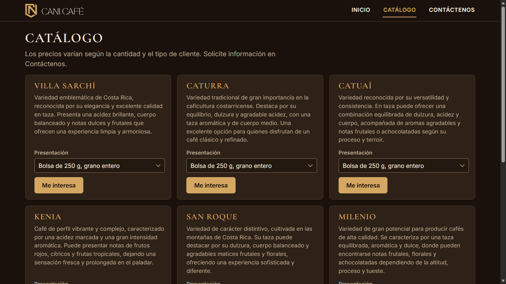
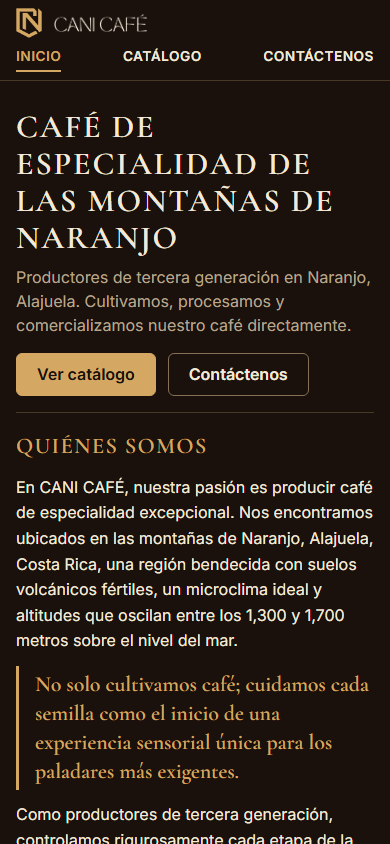
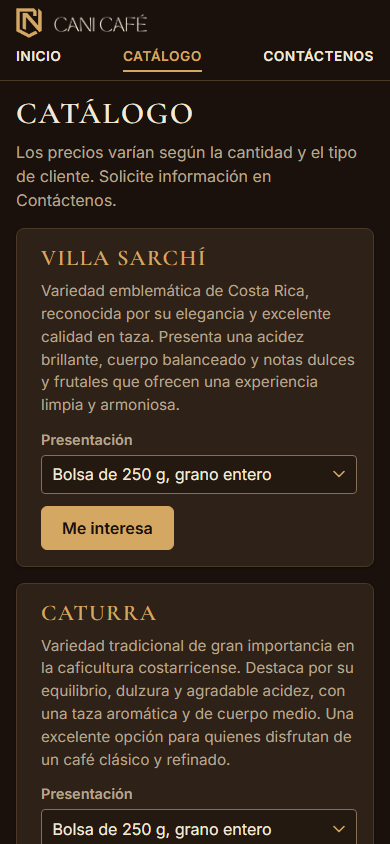
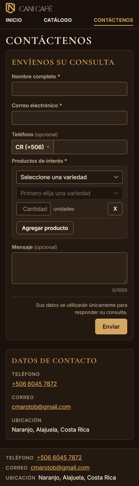
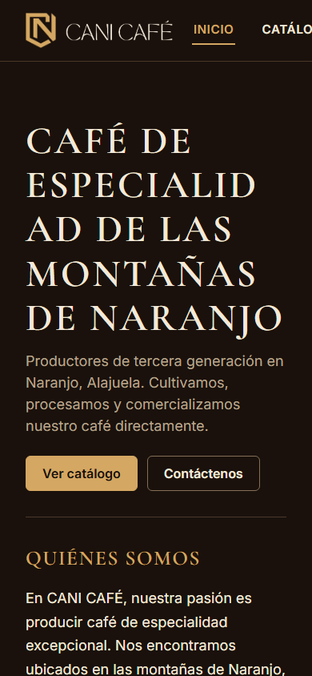

# Evidencia HU-401: Ver la página de inicio

**Responsable:** Dylan · **Revisa:** Gabriel · **Fecha:** 2026-11-02

> Como persona interesada en un producto quiero conocer quién es CANI Café y cómo comunicarme con la empresa
> para que decida si me interesan sus productos.

## Datos de prueba

- Sitio público (`sitio-publico/`) en `http://localhost:5174`, contra Firebase Emulator Suite (proyecto `demo-cani-crm`, catálogo cargado con `npm run seed`).
- Recorrido automático en Microsoft Edge (headless) a **1366 × 768**. El detalle está en [recorrido.json](recorrido.json).
- Los textos de Inicio salen de la web oficial hecha para CANI Café (aprobados por el cliente), salvo dos redacciones **PROVISIONALES** por confirmar: el subtítulo de la presentación y el texto de "¿Cómo comprar?".
- Los datos de contacto (teléfono +506 6045 7872, correo cmarotob@gmail.com y ubicación Naranjo, Alajuela, Costa Rica) están **CONFIRMADOS** por el cliente (2026-11-02). La empresa no tiene correo propio.
- Capturas rehechas con el acomodo visual y móvil de la fase 3: contenedor de 1280 px, encabezado y pie compactos, encabezado fijo al desplazar (escritorio). Ver la tabla de antes y después en [HU-401](../HU-401/README.md#acomodo-visual-y-móvil-fase-3).

## Criterios de aceptación

| # | Criterio | Resultado | Evidencia |
|---|---|---|---|
| 1 | Todas las páginas tienen, arriba, el nombre "CANI Café" a la izquierda y el menú "Inicio", "Catálogo" y "Contáctenos" a la derecha. La página actual aparece subrayada. | ✅ Cumple | [01](01-inicio-presentacion.png), [05](05-menu-catalogo-subrayado.png), [06](06-menu-contactenos-subrayado.png). En las tres páginas el nombre queda a la izquierda del menú y solo la opción de la página actual está subrayada y en dorado (`aria-current="page"`). Inicio no queda subrayado en las demás páginas. El nombre es el logo oficial (escudo y "CANI CAFÉ") con nombre accesible "CANI Café", y lleva a Inicio. |
| 2 | "Inicio" tiene tres partes: presentación con los botones "Ver catálogo" y "Contáctenos"; "Quiénes somos"; "¿Cómo comprar?". | ✅ Cumple | [01](01-inicio-presentacion.png), [02](02-inicio-quienes-somos.png), [03](03-inicio-como-comprar-y-pie.png), [04](04-inicio-pagina-completa.png). "Ver catálogo" abre `/catalogo` y "Contáctenos" abre `/contactenos`. "Quiénes somos" trae los tres párrafos y la cita (como cita) entre el primero y el segundo. |
| 3 | "¿Cómo comprar?" explica que los precios dependen del tipo de cliente y de la cantidad, y que se pueden solicitar por medio del formulario. | ✅ Cumple | [03](03-inicio-como-comprar-y-pie.png). Texto PROVISIONAL (redacción propuesta, por confirmar). |
| 4 | Al final de todas las páginas aparecen el teléfono, el correo y la ubicación. | ✅ Cumple | [03](03-inicio-como-comprar-y-pie.png). El pie de Inicio, Catálogo y Contáctenos muestra solo `+506 6045 7872`, `cmarotob@gmail.com` y `Naranjo, Alajuela, Costa Rica`. |
| 5 | El sitio no pide usuario ni contraseña. | ✅ Cumple | Ninguna página tiene campos de contraseña ni de usuario (`camposDeContrasena: 0`), el sitio no usa Firebase Auth y la prueba de aislamiento (`tests/unit/publicBuild.test.ts`) comprueba que el paquete no incluye código de inicio de sesión. |

Además: el título de la pestaña es "CANI Café | Inicio" (y "| Catálogo", "| Contáctenos"), no hay desplazamiento horizontal a 1366 × 768 y no hay errores de consola.

## Acomodo visual y móvil (fase 3)

Solo CSS y estructura de presentación, sin cambios de lógica, datos, reglas ni envío.

**Todo el sitio:**
- Encabezado de 77 a 58 px. Pie en una línea, de 97 a 54 px.
- Encabezado fijo arriba al desplazar, solo en escritorio. Es **opcional**: `scroll-padding-top` evita que tape el foco.
- Contenedor de 1280 px.
- Punto de corte en 720 px. En móvil, el logo es más chico, el menú va en una fila completa debajo y no hay desbordamiento horizontal. El pie se muestra en 3 líneas.

**Por página:**
- **Inicio:** presentación de 372 a 215 px. "Quiénes somos" en dos columnas de texto (párrafo 1 y cita a la izquierda, párrafos 2 y 3 a la derecha), sin cambiar el orden de lectura.
- **Catálogo:** tarjetas más compactas (de 367 a 338 px, con la descripción completa y la presentación sin cortar). Rejilla de 3 columnas en escritorio, 2 desde 600 px y 1 en móvil.
- **Contáctenos:**
  - nombre y correo lado a lado;
  - cada fila del selector de productos en una línea en escritorio (dos en pantallas angostas);
  - columna de datos de contacto más angosta (19rem);
  - en móvil, una sola columna con los datos debajo.

Medición en Microsoft Edge (headless) contra emuladores. El detalle está en [medidas-acomodo.json](medidas-acomodo.json). "Pantallas" es el alto de la página dividido entre el alto de la ventana.

| Página | Escritorio 1366 × 768, antes | Escritorio, después | Móvil 390 × 844, antes | Móvil, después |
|---|---|---|---|---|
| Inicio | 1418 px (1,85) | **849 px (1,11)** | 2344 px (2,78), desborde 186 px | **1541 px (1,83), sin desborde** |
| Catálogo | 1539 px (2,00) | **1335 px (1,74)** | 4642 px (5,50), desborde 186 px | **3577 px (4,24), sin desborde** |
| Contáctenos | 1163 px (1,51) | **843 px (1,10)** | 1515 px (1,80), desborde 186 px | **1359 px (1,61), sin desborde** |

- **"Antes"** ya incluye el catálogo por variedad y el selector por filas. El catálogo de 72 tarjetas medía 9647 px.
- **En móvil, antes,** la página se desbordaba 186 px y Edge la mostraba alejada (ancho de 576 px). Por eso esas alturas no se comparan exactamente con las de después: [10](10-movil-antes-desbordado.png).
- **Modo claro y oscuro:** se midió con el sistema en los dos modos y los resultados son idénticos. El sitio tiene un solo tema, oscuro (igual que el sistema interno): fondo `rgb(26, 17, 12)` y texto `rgb(243, 233, 218)` en los dos casos.
- **Selects:** una revisión automática confirmó que ningún select corta el texto elegido, en escritorio ni en móvil.

## Cómo funciona

- Una sola estructura (`PublicLayout`) pinta el encabezado y el pie en todas las páginas; el contenido de Inicio vive en `sitio-publico/src/contenido.ts`.
- Los estilos usan los mismos tokens que el sistema interno (`src/shared/styles/tokens.css`), con diseño propio de página (sin tablas ni tablero).

## Pruebas automatizadas

Salida en [pruebas.txt](pruebas.txt): pruebas de pantalla (encabezado, menú, pie, Inicio) en `tests/components/PublicSite.test.tsx` y aislamiento del sitio público en `tests/unit/publicBuild.test.ts`.

## Capturas

| | |
|---|---|
|  |  |
| 01. Presentación | 02. Quiénes somos |
|  |  |
| 03. ¿Cómo comprar? y pie | 05. Menú con Catálogo subrayado |
|  |  |
| 07. Móvil: Inicio | 08. Móvil: Catálogo |
|  |  |
| 09. Móvil: Contáctenos (página completa) | 10. Móvil antes del acomodo: menú desbordado |
