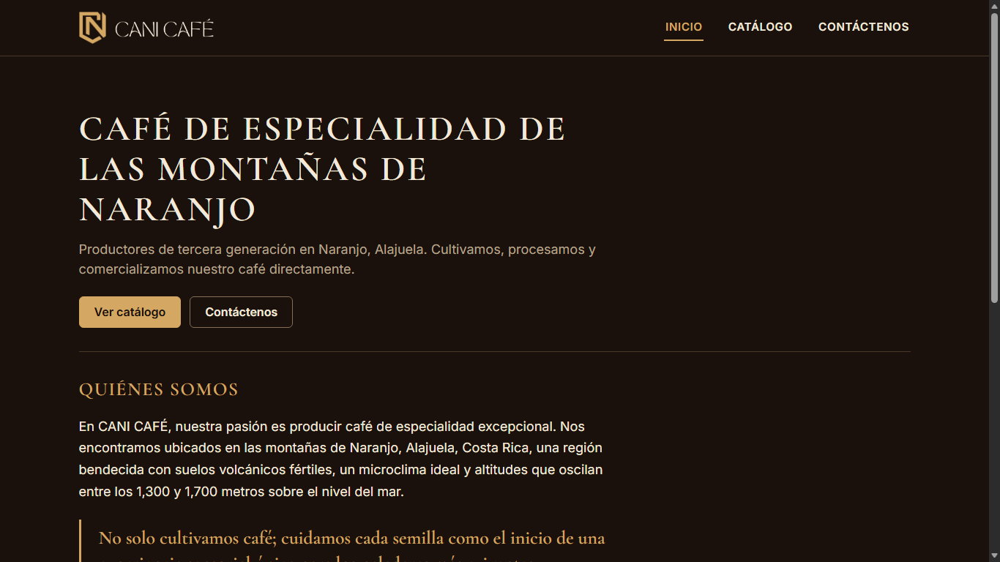
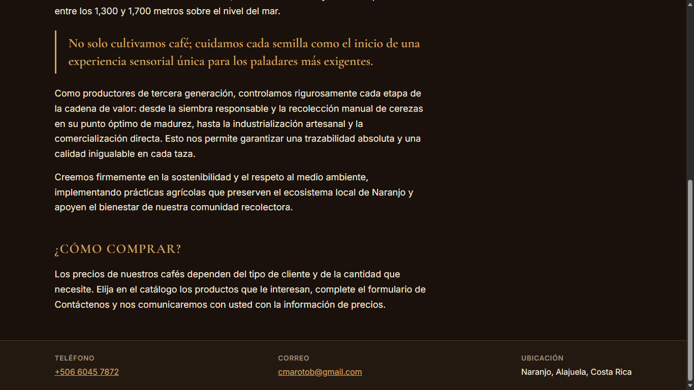

# Evidencia HU-401: Ver la página de inicio

**Responsable:** Dylan · **Revisa:** Gabriel · **Fecha:** 2026-11-02

> Como persona interesada en un producto quiero conocer quién es CANI Café y cómo comunicarme con la empresa
> para que decida si me interesan sus productos.

## Datos de prueba

- Sitio público (`sitio-publico/`) en `http://localhost:5174`, contra Firebase Emulator Suite (proyecto `demo-cani-crm`, catálogo cargado con `npm run seed`).
- Recorrido automático en Microsoft Edge (headless) a **1366 × 768**. El detalle está en [recorrido.json](recorrido.json).
- Los textos de Inicio y los datos de contacto salen de la web oficial hecha para CANI Café (aprobados por el cliente), salvo dos redacciones **PROVISIONALES** por confirmar: el subtítulo de la presentación y el texto de "¿Cómo comprar?".

## Criterios de aceptación

| # | Criterio | Resultado | Evidencia |
|---|---|---|---|
| 1 | Todas las páginas tienen, arriba, el nombre "CANI Café" a la izquierda y el menú "Inicio", "Catálogo" y "Contáctenos" a la derecha. La página actual aparece subrayada. | ✅ Cumple | [01](01-inicio-presentacion.png), [05](05-menu-catalogo-subrayado.png), [06](06-menu-contactenos-subrayado.png). En las tres páginas el nombre queda a la izquierda del menú y solo la opción de la página actual está subrayada y en dorado (`aria-current="page"`). Inicio no queda subrayado en las demás páginas. El nombre es el logo oficial (escudo y "CANI CAFÉ") con nombre accesible "CANI Café", y lleva a Inicio. |
| 2 | "Inicio" tiene tres partes: presentación con los botones "Ver catálogo" y "Contáctenos"; "Quiénes somos"; "¿Cómo comprar?". | ✅ Cumple | [01](01-inicio-presentacion.png), [02](02-inicio-quienes-somos.png), [03](03-inicio-como-comprar-y-pie.png), [04](04-inicio-pagina-completa.png). "Ver catálogo" abre `/catalogo` y "Contáctenos" abre `/contactenos`. "Quiénes somos" trae los tres párrafos y la cita (como cita) entre el primero y el segundo. |
| 3 | "¿Cómo comprar?" explica que los precios dependen del tipo de cliente y de la cantidad, y que se pueden solicitar por medio del formulario. | ✅ Cumple | [03](03-inicio-como-comprar-y-pie.png). Texto PROVISIONAL (redacción propuesta, por confirmar). |
| 4 | Al final de todas las páginas aparecen el teléfono, el correo y la ubicación. | ✅ Cumple | [03](03-inicio-como-comprar-y-pie.png). El pie de Inicio, Catálogo y Contáctenos muestra solo `+506 6045 7872`, `cmarotob@gmail.com` y `Naranjo, Alajuela, Costa Rica`. |
| 5 | El sitio no pide usuario ni contraseña. | ✅ Cumple | Ninguna página tiene campos de contraseña ni de usuario (`camposDeContrasena: 0`), el sitio no usa Firebase Auth y la prueba de aislamiento (`tests/unit/publicBuild.test.ts`) comprueba que el paquete no incluye código de inicio de sesión. |

Además: el título de la pestaña es "CANI Café | Inicio" (y "| Catálogo", "| Contáctenos"), no hay desplazamiento horizontal a 1366 × 768 y no hay errores de consola.

## Cómo funciona

- Una sola estructura (`PublicLayout`) pinta el encabezado y el pie en todas las páginas; el contenido de Inicio vive en `sitio-publico/src/contenido.ts`.
- Los estilos usan los mismos tokens que el sistema interno (`src/shared/styles/tokens.css`), con diseño propio de página (sin tablas ni tablero).

## Pruebas automatizadas

Salida en [pruebas.txt](pruebas.txt): pruebas de pantalla (encabezado, menú, pie, Inicio) en `tests/components/PublicSite.test.tsx` y aislamiento del sitio público en `tests/unit/publicBuild.test.ts`.

## Capturas

| | |
|---|---|
|  |  |
| 01. Presentación | 02. Quiénes somos |
|  |  |
| 03. ¿Cómo comprar? y pie | 05. Menú con Catálogo subrayado |
