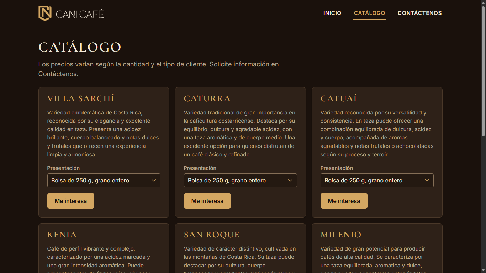
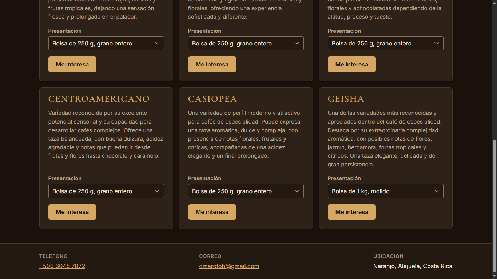
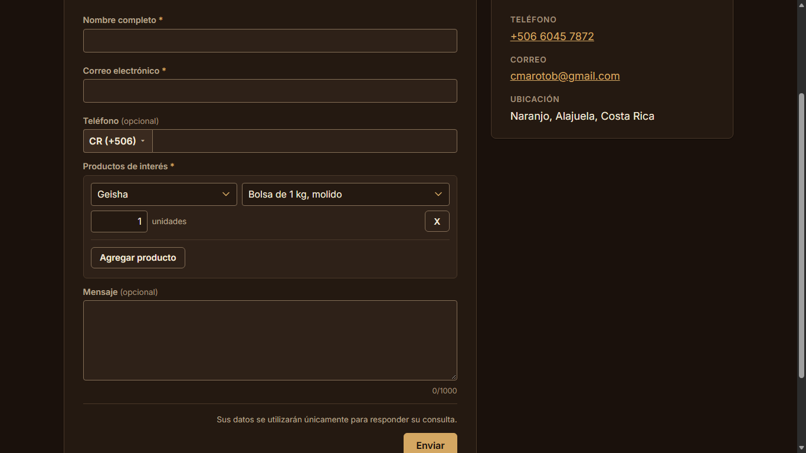
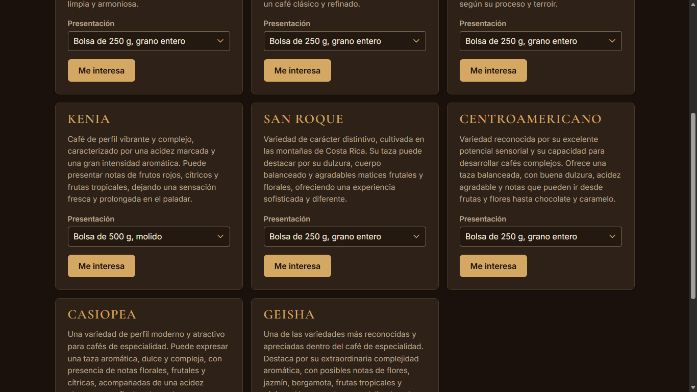
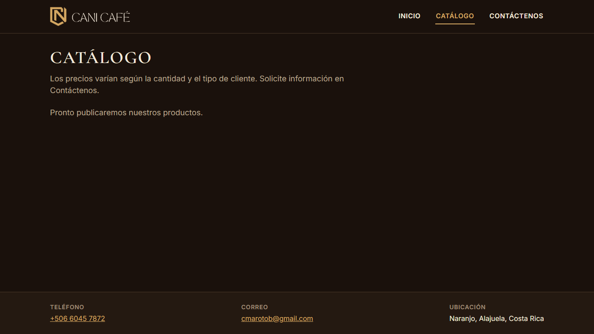

# Evidencia HU-402: Consultar el catálogo de productos

**Responsable:** Dylan · **Revisa:** Gabriel · **Fecha:** 2026-11-02 (actualizada: catálogo por variedad, opción C)

> Como persona interesada en un producto quiero ver los productos que ofrece CANI Café
> para que sepa qué puedo comprar.

**Cambio por decisión del equipo (pendiente de aprobación de Danny):** el catálogo muestra una tarjeta por variedad (9) con un selector de presentación, en lugar de una tarjeta por producto (72). Cambia la redacción de los criterios 2 y 4 (ver abajo). Los criterios 1, 3 y 5 no cambian.

## Datos de prueba

- Sitio público en `http://localhost:5174` contra Firebase Emulator Suite (`demo-cani-crm`) con el catálogo oficial cargado por `npm run seed`: 72 productos, 9 variedades de 8 presentaciones.
- Recorrido automático en Microsoft Edge (headless) a **1366 × 768**. Detalle en [recorrido.json](recorrido.json).
- Para probar presentaciones inactivas, una variedad sin activas y "sin productos", el recorrido desactiva productos del emulador y **los reactiva al terminar** (`restaurados: true`).

## Criterios de aceptación

| # | Criterio (literal) | Resultado | Evidencia |
|---|---|---|---|
| 1 | Arriba aparece "Los precios varían según la cantidad y el tipo de cliente. Solicite información en Contáctenos.". | ✅ Cumple (sin cambios) | [01](01-catalogo-arriba.png). Texto literal, bajo el título "Catálogo". |
| 2 | Cada producto aparece en una tarjeta, tres por fila. La tarjeta muestra el nombre, la presentación (por ejemplo, "Bolsa de 500 g, grano entero") y una descripción de como máximo 300 caracteres. | ✅ Cumple con la redacción nueva | [01](01-catalogo-arriba.png), [02](02-catalogo-pagina-completa.png). 9 tarjetas en 3 × 3, en el orden del catálogo. Cada una muestra el nombre de la variedad, su descripción (la más larga mide 267 caracteres; la pantalla recorta a 300 si alguna pasara) y el selector "Presentación" con sus 8 presentaciones en orden, con la primera elegida ("Bolsa de 250 g, grano entero"). |
| 3 | Ninguna tarjeta muestra precios ni permite comprar. | ✅ Cumple (sin cambios) | Sin precios, botones de compra ni campos de texto (`contienePrecios: false`). El selector solo elige la presentación. |
| 4 | Cada tarjeta tiene el botón "Me interesa", que abre la página "Contáctenos" con ese producto ya marcado. | ✅ Cumple con la redacción nueva | [03](03-cambio-de-presentacion.png), [04](04-me-interesa-presentacion-elegida.png). "Me interesa" abre `/contactenos?producto=<id de la presentación elegida>`. Con la presentación por defecto (Catuaí, 250 g, grano entero) o con otra elegida (Geisha, 1 kg, molido), el producto llega como una fila ya llena del selector de Contáctenos (variedad, presentación y cantidad 1). |
| 5 | Si todavía no hay productos, aparece el mensaje "Pronto publicaremos nuestros productos.". | ✅ Cumple (sin cambios) | [06](06-catalogo-sin-productos.png). |

## Cambio de redacción propuesto para Danny

| # | Redacción actual | Redacción propuesta |
|---|---|---|
| 402.2 | Cada producto aparece en una tarjeta, tres por fila. La tarjeta muestra el nombre, la presentación (por ejemplo, "Bolsa de 500 g, grano entero") y una descripción de como máximo 300 caracteres. | Cada variedad aparece en una tarjeta, tres por fila. La tarjeta muestra el nombre de la variedad, una descripción de como máximo 300 caracteres y un selector "Presentación" con sus presentaciones disponibles (por ejemplo, "Bolsa de 500 g, grano entero"); la primera viene elegida. |
| 402.4 | Cada tarjeta tiene el botón "Me interesa", que abre la página "Contáctenos" con ese producto ya marcado. | Cada tarjeta tiene el botón "Me interesa", que abre la página "Contáctenos" con la presentación elegida ya agregada en los productos de interés, con cantidad 1. |

Texto nuevo PROVISIONAL: la etiqueta "Presentación" del selector (nombre accesible "Presentación de &lt;variedad&gt;").

## Productos inactivos

Se siguen leyendo solo los productos activos (`where('active', '==', true)`).

- Una variedad con presentaciones inactivas solo ofrece las activas, y viene elegida la primera de ellas. En la prueba, Kenia quedó con "Bolsa de 500 g, molido" y "Bolsa de 1 kg, grano entero".
- Una variedad sin ninguna activa no tiene tarjeta. En la prueba, Milenio desapareció y quedaron 8 tarjetas.
- Captura [05](05-variedad-con-inactivas-y-sin-milenio.png).

## Cómo funciona

- `sitio-publico/src/pages/CatalogoPage.tsx`: agrupa los productos activos por variedad con `groupByVariety` (orden del catálogo del cliente, por id) y pinta una tarjeta por grupo.
- Cada tarjeta recuerda su presentación elegida. La descripción mostrada es la de esa presentación (es la misma en toda la variedad).
- Mensajes de carga, error y catálogo vacío sin cambios. La regla de Firestore de lectura pública de activos no cambió.
- El acomodo visual y la versión para móvil quedan para la fase siguiente. Aun así, la página bajó de 9647 px a 1539 px de alto a 1366 × 768, sin desplazamiento horizontal.

## Pruebas automatizadas

Salida en [pruebas.txt](pruebas.txt).

- Pantalla (`tests/components/PublicSite.test.tsx`):
  - texto superior y título;
  - 9 tarjetas en orden y en una sola rejilla;
  - nombre, descripción de hasta 300 caracteres y presentación elegida;
  - etiqueta "Presentación" y nombre accesible por tarjeta;
  - 8 presentaciones en orden, con la primera elegida;
  - "Me interesa" con la presentación por defecto y tras cambiarla;
  - solo presentaciones activas, y variedad sin activas sin tarjeta;
  - recorte a 300, sin precios ni compra;
  - catálogo vacío, carga y error.
- Preselección en Contáctenos (`tests/components/ProductosField.test.tsx`): con `?producto=` la fila llega llena.
- Reglas contra emulador (`tests/rules/firestore.rules.test.ts`) y `tests/products/listProducts.emulator.test.ts`: sin cambios, siguen pasando.

## Capturas

| | |
|---|---|
|  |  |
| 01. Texto superior y primera fila de tarjetas | 03. Geisha con "Bolsa de 1 kg, molido" elegida |
|  |  |
| 04. Contáctenos con esa presentación en una fila llena | 05. Kenia con 2 presentaciones activas; Milenio sin tarjeta |
|  | |
| 06. Sin productos | |

Página completa: [02](02-catalogo-pagina-completa.png).
