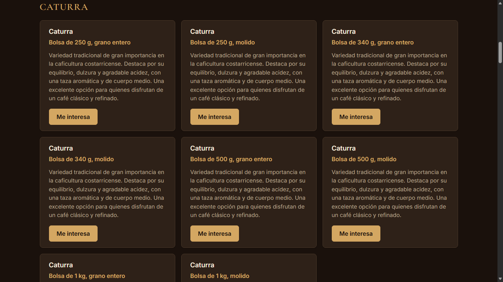
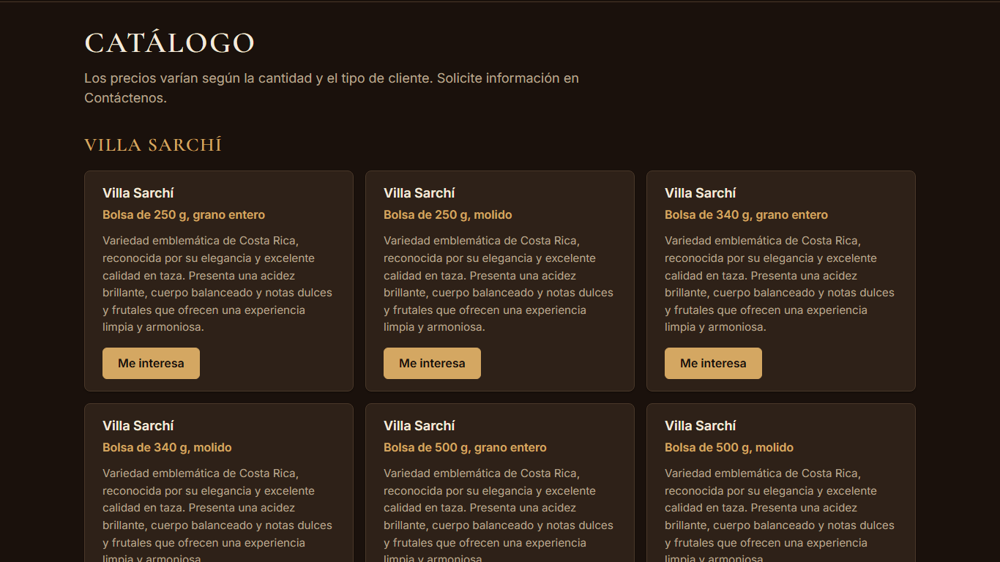
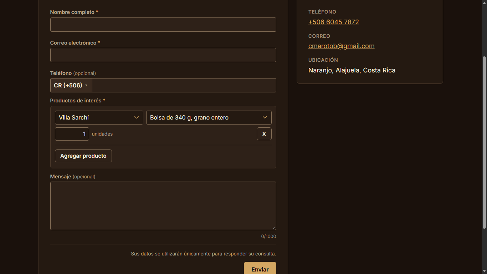
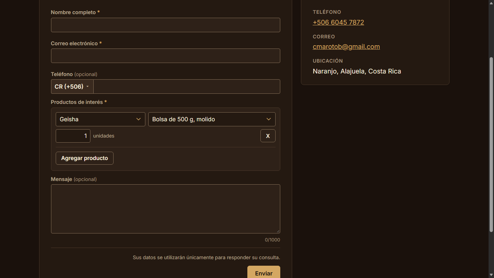

# Evidencia HU-402: Consultar el catálogo de productos

**Responsable:** Dylan · **Revisa:** Gabriel · **Fecha:** 2026-11-02

> Como persona interesada en un producto quiero ver los productos que ofrece CANI Café
> para que sepa qué puedo comprar.

## Datos de prueba

- Sitio público en `http://localhost:5174`, contra Firebase Emulator Suite (`demo-cani-crm`) con el catálogo oficial del cliente cargado por `npm run seed` (72 productos).
- Recorrido automático en Microsoft Edge (headless) a **1366 × 768**. Detalle en [recorrido.json](recorrido.json).
- Para probar "sin productos" y "producto inactivo" el recorrido desactiva productos del emulador y **los reactiva al terminar** (`restaurados: true`).

## Criterios de aceptación

| # | Criterio | Resultado | Evidencia |
|---|---|---|---|
| 1 | Arriba aparece "Los precios varían según la cantidad y el tipo de cliente. Solicite información en Contáctenos.". | ✅ Cumple | [01](01-catalogo-arriba.png). Texto literal, bajo el título "Catálogo". |
| 2 | Cada producto en una tarjeta, tres por fila, con nombre, presentación y descripción de máximo 300 caracteres. | ✅ Cumple | [01](01-catalogo-arriba.png), [02](02-catalogo-segunda-variedad.png), [03](03-catalogo-pagina-completa.png). 72 tarjetas agrupadas bajo un encabezado por variedad (9 grupos de 8), tres por fila (la última fila de cada grupo tiene 2, porque 8 = 3 + 3 + 2). La descripción más larga mide 267 caracteres, y la pantalla recorta a 300 si alguna pasara. |
| 3 | Ninguna tarjeta muestra precios ni permite comprar. | ✅ Cumple | Sin precios, botones de compra, formularios ni campos en el catálogo (`contienePrecios: false`, `botonesDeCompra: 0`). |
| 4 | Cada tarjeta tiene "Me interesa", que abre Contáctenos con ese producto ya marcado. | ✅ Cumple (redacción a ajustar con el selector por filas) | [04](04-tarjeta-me-interesa.png), [06](06-me-interesa-producto-marcado.png), [07](07-me-interesa-producto-del-final-a-la-vista.png). El botón abre `/contactenos?producto=<id>` y el producto llega como una **fila ya llena** del selector de productos (variedad, presentación y cantidad 1), incluso uno del final del catálogo (Geisha de 500 g, molido). Un producto inexistente deja la fila vacía. Con el selector por filas ([HU-404](../HU-404/README.md)) "marcado" significa "elegido en una fila". |
| 5 | Sin productos: "Pronto publicaremos nuestros productos.". | ✅ Cumple | [05](05-catalogo-sin-productos.png). |

Además: un producto inactivo no aparece (con uno desactivado, 71 tarjetas y el desactivado ausente), y si falla la carga se muestra "No se pudo cargar el catálogo. Intente de nuevo." (texto propio, el criterio no lo define; prueba de pantalla).

## Cómo funciona

- **Lectura sin sesión:** `listPublicProductsIn` (`src/products/publicCatalog.ts`) consulta `products` con `where('active', '==', true)`.
- **Regla nueva de Firestore** (`firestore.rules`): `allow read: if isActiveUser() || resource.data.active == true;`. Cualquiera lee un producto activo; los inactivos y los demás datos siguen cerrados; la lectura con sesión no cambia; escribir sigue exigiendo sesión. Una consulta sin el filtro de activos se deniega aunque existan activos.
- Las tarjetas se agrupan con `groupByVariety` (orden del catálogo del cliente, por id).

## Pruebas automatizadas

Salida en [pruebas.txt](pruebas.txt).

- Pantalla (`tests/components/PublicSite.test.tsx`): texto superior, 72 tarjetas en 9 grupos de 8, sin precios ni compra, "Me interesa" con el producto en la URL, catálogo vacío y error de carga.
- Preselección (`tests/components/ProductosField.test.tsx`): con `?producto=` el producto llega como una fila llena (variedad, presentación y cantidad 1); un producto inexistente se ignora; si el catálogo no carga, el formulario sigue disponible.
- Reglas contra emulador (`tests/rules/firestore.rules.test.ts`): producto activo legible sin sesión, inactivo no, consulta sin `where('active', '==', true)` denegada, sin sesión no escribe ni lee otras colecciones, con sesión se leen todos.
- `tests/products/listProducts.emulator.test.ts`: sin sesión, `listPublicProductsIn` trae solo los activos.

## Capturas

| | |
|---|---|
|  |  |
| 01. Texto superior y primera variedad | 02. Segunda variedad |
|  |  |
| 04. Tarjeta con "Me interesa" | 05. Sin productos |

## Capturas de la preselección (con el selector por filas de HU-404)

| | |
|---|---|
|  |  |
| 06. Contáctenos con el producto elegido en una fila llena | 07. Producto del final del catálogo, en una fila llena |
