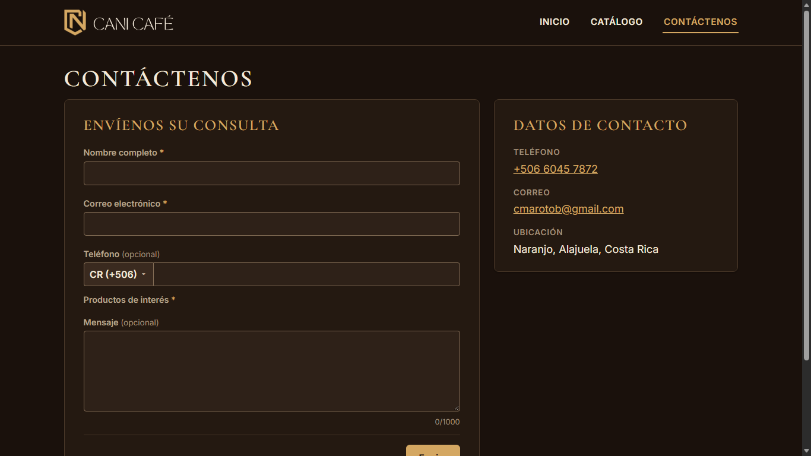
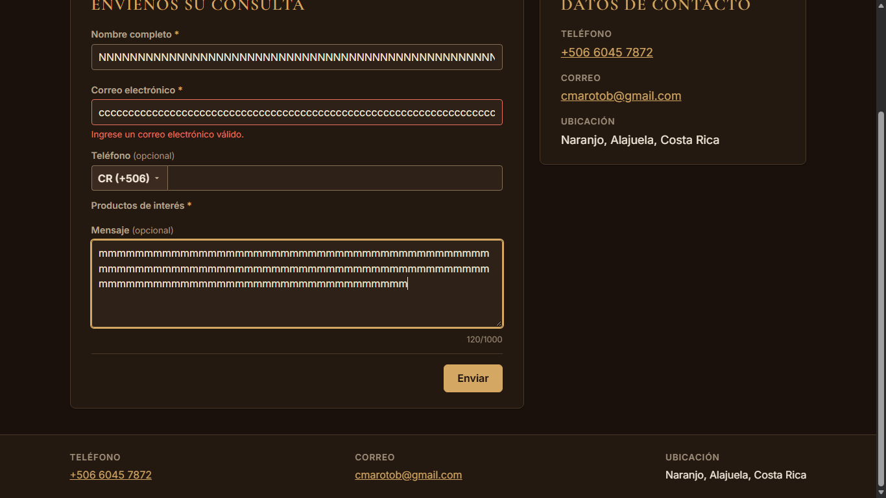
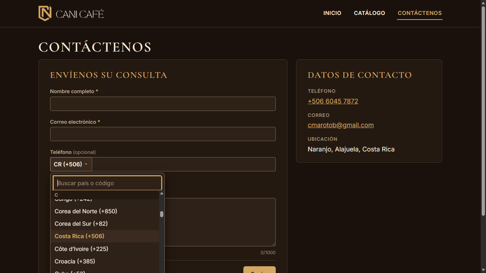
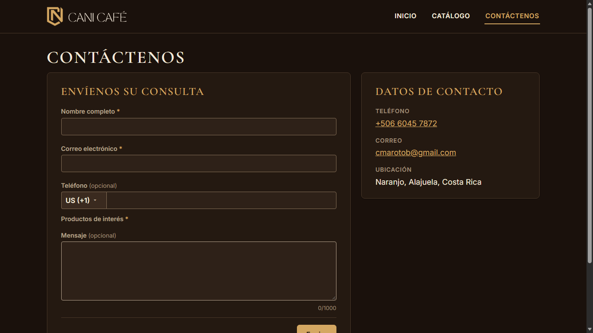

# Evidencia HU-403: Completar el formulario de interés

**Responsable:** Dylan · **Revisa:** Gabriel · **Fecha:** 2026-11-02

> Como persona interesada en un producto quiero llenar un formulario con mis datos y mi consulta
> para que CANI Café sepa quién soy y qué necesito.

**Alcance de esta entrega:** pantalla del formulario, topes, contador, teléfono con país y (con HU-404) la lista de productos. El envío se entrega con HU-405: por ahora "Enviar" solo valida (no escribe en Firestore).

## Datos de prueba

- Sitio público en `http://localhost:5174`. Las capturas de esta carpeta se tomaron antes de agregar la lista de productos (la página no consultaba Firestore); la lista está en HU-404.
- Recorrido automático en Microsoft Edge (headless) a **1366 × 768**. Detalle en [recorrido.json](recorrido.json). Datos ficticios (`ana@example.com`, etc.).

## Criterios de aceptación

| # | Criterio | Resultado | Evidencia |
|---|---|---|---|
| 1 | "Contáctenos" tiene el formulario "Envíenos su consulta" a la izquierda y los datos de contacto (teléfono, correo y ubicación) a la derecha. | ✅ Cumple | [01](01-contactenos.png). El formulario ocupa de x=141 a x=775 y los datos de x=832 a x=1243. La columna derecha muestra solo teléfono, correo y ubicación. |
| 2 | El formulario pide cinco datos: nombre completo, correo, teléfono, productos de interés y mensaje. | ✅ Cumple | [01](01-contactenos.png) y la lista de productos de [HU-404](../HU-404/README.md). |
| 3 | Son obligatorios el nombre, el correo y al menos un producto. El teléfono y el mensaje son opcionales. | ✅ Cumple | Nombre, correo y productos llevan asterisco y `aria-required`; teléfono y mensaje dicen "(opcional)". Enviar sin productos da "Seleccione al menos un producto." ([HU-404 captura 05](../HU-404/05-sin-productos-marcados.png)). |
| 4 | Nombre y correo aceptan como máximo 100 caracteres. El mensaje, 1000, con contador debajo ("120/1000"). | ✅ Cumple | [02](02-contador-120-de-1000.png). Al pegar 150 caracteres quedan 100 en nombre y en correo; al pegar 1100 en el mensaje quedan 1000 (`1000/1000`). El contador está debajo del mensaje. |
| 5 | El teléfono se registra con su país: Costa Rica (+506) viene elegido y se puede elegir otro. 8 números si es de Costa Rica o de 6 a 14 si es de otro país. | ✅ Cumple | [03](03-lista-de-paises.png), [04](04-pais-cambiado.png). "CR (+506)" viene elegido; se cambió a Estados Unidos (+1). Los largos se comprueban en HU-501. |

## Cómo funciona

- Página `sitio-publico/src/pages/ContactenosPage.tsx` con dos columnas; formulario en `components/ConsultaForm.tsx`.
- El país del teléfono usa el mismo `PhoneField` del sistema interno (lista con buscador).
- Los textos fijos están en `sitio-publico/src/contenido.ts`.

## Pruebas automatizadas

Salida en [pruebas.txt](pruebas.txt): `tests/components/ConsultaForm.test.tsx` (distribución, asteriscos, topes, contador, país) y `tests/unit/publicForm.test.ts`.

## Capturas

| | |
|---|---|
|  |  |
| 01. Formulario y datos de contacto | 02. Contador "120/1000" |
|  |  |
| 03. Lista de países | 04. País elegido |
