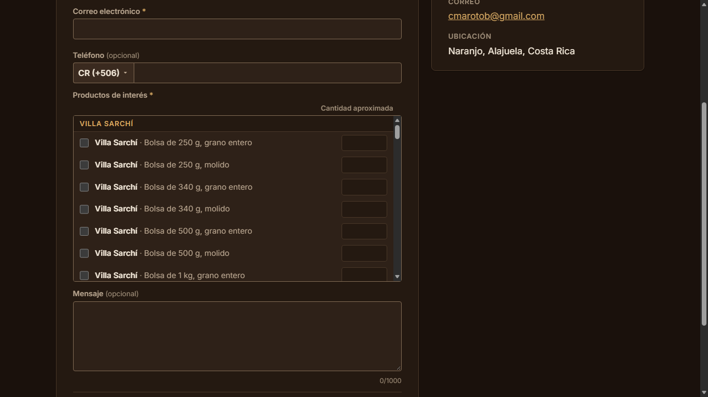
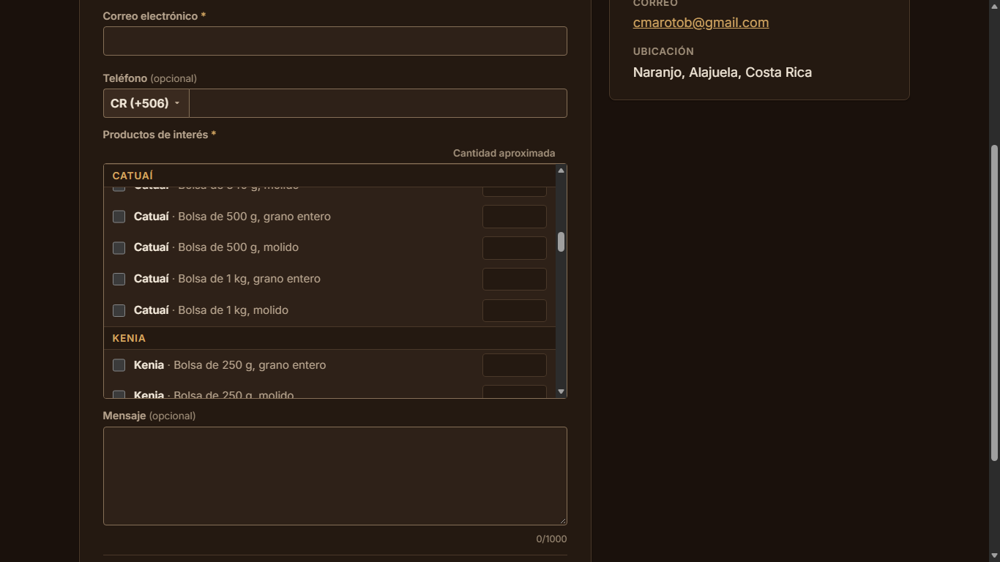
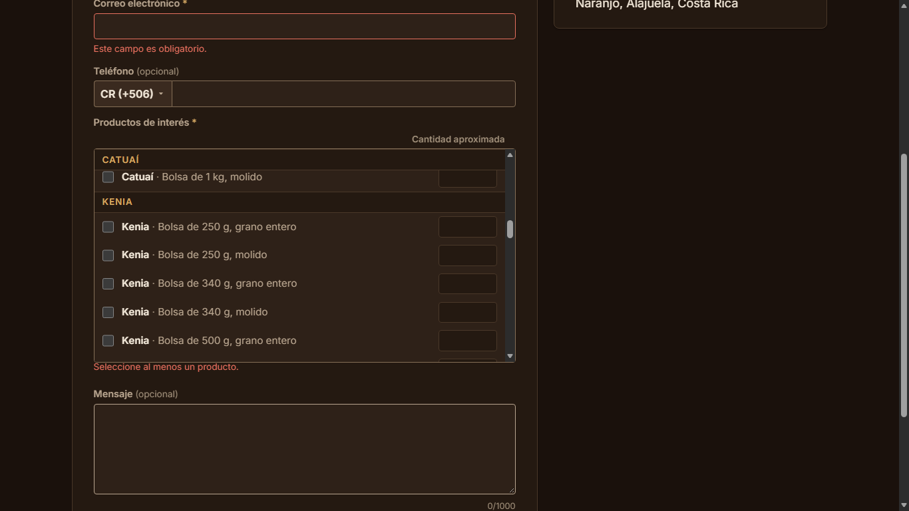

# Evidencia HU-404: Seleccionar los productos de interés

**Responsable:** Dylan · **Revisa:** Gabriel · **Fecha:** 2026-11-02

> Como persona interesada en un producto quiero marcar los productos que me interesan y la cantidad aproximada
> para que CANI Café sepa qué y cuánto quiero comprar.

## Datos de prueba

- Sitio público en `http://localhost:5174` contra Firebase Emulator Suite (`demo-cani-crm`) con el catálogo oficial cargado por `npm run seed` (72 productos). La lista se lee con la misma consulta pública del catálogo (solo productos activos, sin sesión).
- Recorrido automático en Microsoft Edge (headless) a **1366 × 768**. Detalle en [recorrido.json](recorrido.json). Datos ficticios.

## Criterios de aceptación

| # | Criterio | Resultado | Evidencia |
|---|---|---|---|
| 1 | El formulario muestra todos los productos del catálogo, uno por fila. Cada fila tiene una casilla, el nombre y la presentación, y un espacio para la cantidad aproximada. | ✅ Cumple | [01](01-lista-de-productos.png), [02](02-lista-desplazada-por-variedad.png). 72 filas en 9 grupos por variedad (8 por grupo), cada una con casilla, nombre, presentación y su campo de cantidad. La lista tiene desplazamiento propio (320 px de alto para 3367 px de contenido) y desplazarla no mueve la página. Todo empieza desmarcado, con las cantidades vacías y deshabilitadas. |
| 2 | La cantidad solo se puede escribir si el producto está marcado. Al marcarlo, empieza en 1. Acepta enteros de 1 a 9999. | ✅ Cumple | [03](03-varios-productos-con-su-cantidad.png), [04](04-cantidad-invalida.png). Sin marcar, el campo está deshabilitado y vacío; al marcar queda en `1`. Se aceptaron `12`, `3` y `9999`. Con `0`, `10000`, `1.5`, `abc` o vacío aparece "Ingrese una cantidad entre 1 y 9999." (al salir del campo y al enviar); al corregirla, el error desaparece. |
| 3 | Se pueden marcar varios productos, cada uno con su propia cantidad. Si se desmarca un producto, su cantidad se borra. | ✅ Cumple | [03](03-varios-productos-con-su-cantidad.png). Tres productos marcados con `12`, `3` y `9999`. Al desmarcar Geisha su cantidad quedó vacía y deshabilitada; al marcarla otra vez empezó en `1`, y las demás no cambiaron. |

## Mensajes de HU-501 con la lista (criterios 2 y 4)

| Mensaje | Evidencia |
|---|---|
| "Seleccione al menos un producto." (al salir de la lista sin marcar nada y al enviar) | [05](05-sin-productos-marcados.png) |
| "Ingrese una cantidad entre 1 y 9999." (bajo la fila con el error, en rojo) | [04](04-cantidad-invalida.png) |

## Preselección desde el catálogo (cierra el criterio 4 de HU-402)

Con `/contactenos?producto=<id>` el producto llega marcado, con cantidad 1, y su fila queda a la vista dentro de la lista (se desplaza solo la lista). Un producto que no existe o no está activo se ignora. Ver [HU-402](../HU-402/README.md) y sus capturas 06 y 07.

## Cómo funciona

- `sitio-publico/src/components/ProductosField.tsx` pinta la lista (agrupada con `groupByVariety`, en el orden del catálogo del cliente) y `ConsultaForm.tsx` guarda los productos marcados como `id → cantidad escrita`.
- La cantidad se valida con la regla copiada a `src/shared/validation/quantity.ts` (1 a 9999, solo dígitos).
- Un error de cantidad se ve al salir del campo o al enviar; el de "Seleccione al menos un producto." al salir de toda la lista o al enviar.
- La lista se puede recorrer con el teclado (la lista recibe foco, y cada casilla y cantidad con tabulador).

## Pruebas automatizadas

Salida en [pruebas.txt](pruebas.txt): `tests/components/ProductosField.test.tsx` (filas, cantidad habilitada y en 1, rangos válidos e inválidos, varios productos, desmarcar, mensajes, estados de carga, preselección) y las de validación de `tests/unit/publicForm.test.ts`.

## Capturas

| | |
|---|---|
|  |  |
| 01. Lista de productos | 02. Lista desplazada |
|  |  |
| 03. Varios productos con su cantidad | 04. Cantidad inválida |
|  | |
| 05. "Enviar" sin productos | |
