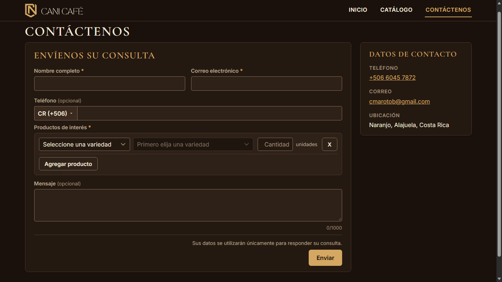
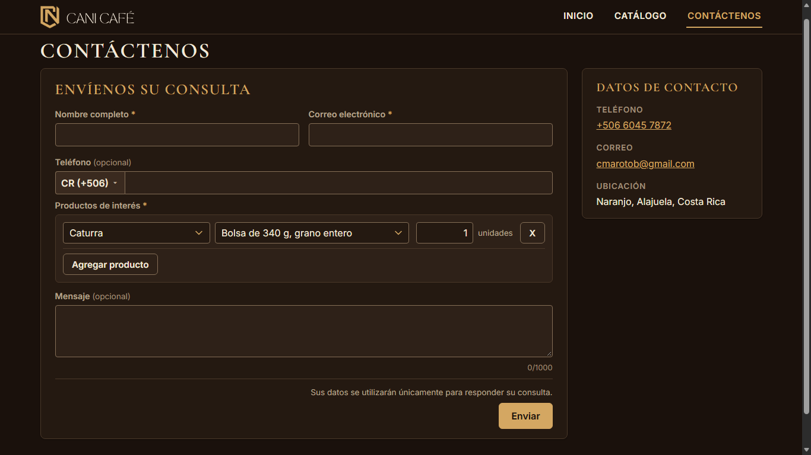
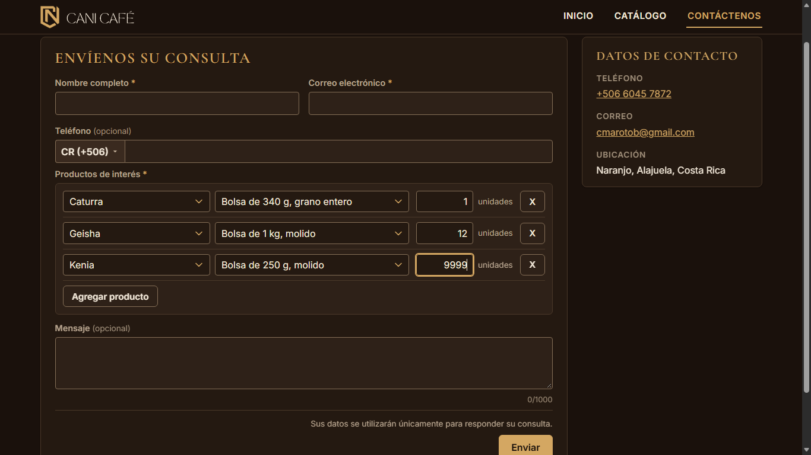
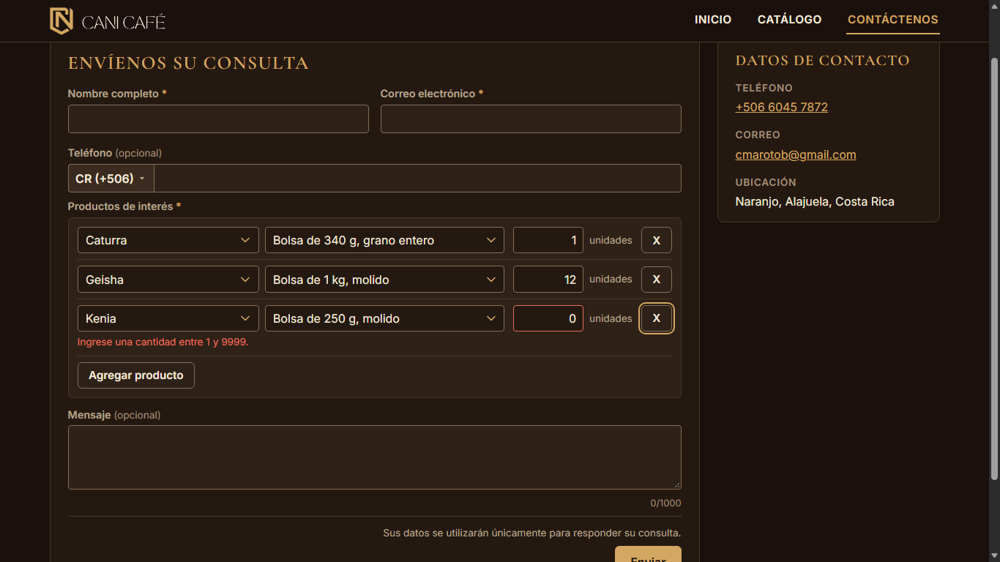
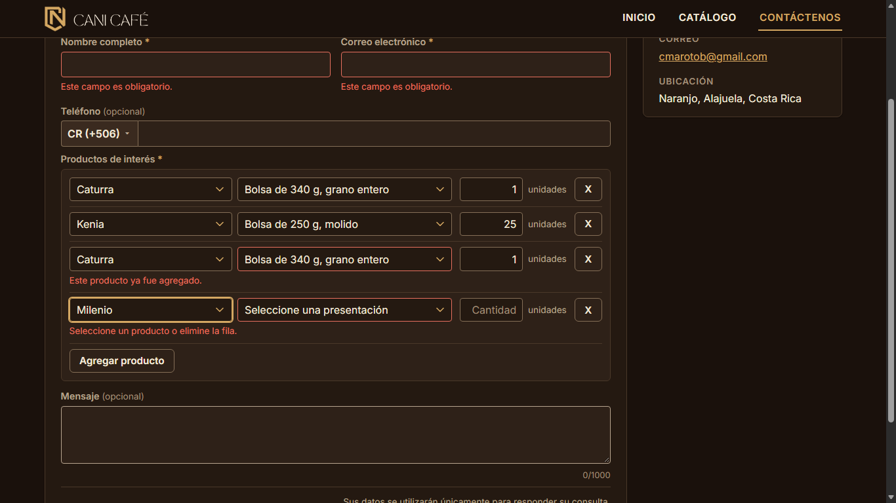
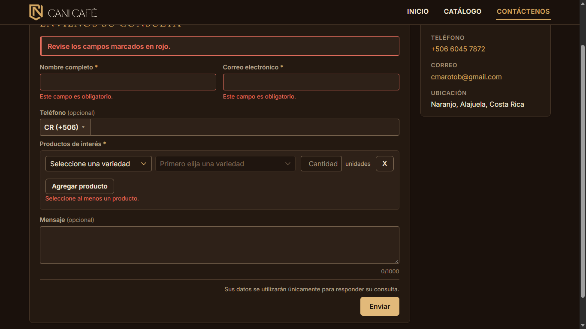

# Evidencia HU-404: Seleccionar los productos de interés

**Responsable:** Dylan · **Revisa:** Gabriel · **Fecha:** 2026-11-02 (actualizada: selector por filas)

> Como persona interesada en un producto quiero marcar los productos que me interesan y la cantidad aproximada
> para que CANI Café sepa qué y cuánto quiero comprar.

**Cambio por decisión del equipo (pendiente de aprobación de Danny):** el selector de productos de Contáctenos tiene ahora el mismo aspecto y funcionamiento que el del sistema interno (HU-304). Es un componente propio del sitio público (`sitio-publico/src/components/ProductosField.tsx`), sin importar código del sistema interno. Esto cambia la redacción de los criterios 1 a 3 (ver la tabla).

## Datos de prueba

- Capturas rehechas con el acomodo visual y móvil de la fase 3: contenedor de 1280 px, encabezado y pie compactos, encabezado fijo al desplazar (escritorio). Ver la tabla de antes y después en [HU-401](../HU-401/README.md#acomodo-visual-y-móvil-fase-3).
- Sitio público en `http://localhost:5174` contra Firebase Emulator Suite (`demo-cani-crm`), con el catálogo oficial cargado por `npm run seed` (72 productos, 9 variedades).
- Recorrido automático en Microsoft Edge (headless) a **1366 × 768**. Detalle en [recorrido.json](recorrido.json). No envía el formulario.

## Criterios de aceptación

| # | Criterio (literal) | Cómo se cumple ahora | Evidencia |
|---|---|---|---|
| 1 | El formulario muestra todos los productos del catálogo, uno por fila. Cada fila tiene una casilla, el nombre y la presentación, y un espacio para la cantidad aproximada. | **Cambia (requiere aprobación).** Cualquiera de los 72 productos se puede elegir, uno por fila, en dos pasos: variedad (9) y, ya elegida, su presentación (8). Cada fila tiene la cantidad con "unidades" y una "X" para quitarla; "Agregar producto" suma filas. No hay casilla. Empieza con una fila vacía; la presentación está deshabilitada ("Primero elija una variedad") hasta elegir la variedad. Sin buscador. | [01](01-fila-inicial.png), [02](02-variedad-y-presentacion-cantidad-1.png) |
| 2 | La cantidad solo se puede escribir si el producto está marcado. Al marcarlo, la cantidad empieza en 1. Acepta números enteros de 1 a 9999. | **Cambia (requiere aprobación).** Como en el sistema interno, la cantidad se puede escribir siempre. Al elegir la presentación empieza en `1` (si no se había escrito otra). Acepta enteros de 1 a 9999: con `0`, `10000`, `1.5`, `abc` o vacío aparece "Ingrese una cantidad entre 1 y 9999." al salir del campo y al enviar. | [02](02-variedad-y-presentacion-cantidad-1.png), [04](04-cantidad-invalida.png) |
| 3 | Se pueden marcar varios productos, cada uno con su propia cantidad. Si se desmarca un producto, su cantidad se borra. | **Cambia (requiere aprobación).** Se agregan varias filas, cada una con su cantidad (`1`, `12` y `9999` en la prueba). "Desmarcar" pasa a ser quitar la fila con la "X": la fila y su cantidad desaparecen y las demás no cambian. | [03](03-varios-productos-con-su-cantidad.png) |

## Revisión de las filas (HU-501)

| Situación | Mensaje | Evidencia |
|---|---|---|
| Ningún producto elegido (al salir del campo de productos o al enviar) | "Seleccione al menos un producto." (un solo aviso) | [06](06-sin-productos.png) |
| Una fila sin presentación junto a otras completas | "Seleccione un producto o elimine la fila." **(PROVISIONAL)** | [05](05-fila-repetida-y-fila-vacia.png) |
| El mismo producto en dos filas | "Este producto ya fue agregado." en la segunda **(PROVISIONAL)** | [05](05-fila-repetida-y-fila-vacia.png) |
| Cantidad fuera de 1 a 9999 | "Ingrese una cantidad entre 1 y 9999." | [04](04-cantidad-invalida.png) |

Con filas vacías o repetidas el formulario no se envía y arriba aparece "Revise los campos marcados en rojo.". Pasar de la variedad a la presentación de una fila no la revisa todavía; se revisa al salir de los dos.

## Textos nuevos (PROVISIONALES, sin literal en los criterios; los mismos del sistema interno)

"Agregar producto", "unidades", "X" (nombre accesible "Quitar producto N"), "Seleccione una variedad", "Seleccione una presentación", "Primero elija una variedad", "Cantidad" (texto de ayuda del campo), "Seleccione un producto o elimine la fila." y "Este producto ya fue agregado.".

## Preselección desde el catálogo (HU-402.4)

Con `/contactenos?producto=<id>` la fila llega llena: variedad, presentación y cantidad 1. Un id inexistente o inactivo se ignora y queda la fila vacía. Ver [HU-402](../HU-402/README.md), captura 04.

## Lo que se envía (sin cambios)

`interests [{productId, quantity}]`, en el orden del catálogo, sin filas vacías ni repetidas. Ver [HU-405](../HU-405/README.md).

## Pruebas automatizadas

Salida en [pruebas.txt](pruebas.txt): `tests/components/ProductosField.test.tsx` (aspecto, dos pasos, cantidad en 1, agregar y quitar filas, mensajes al salir y al enviar, estados de carga, preselección) y `tests/unit/publicForm.test.ts` (validación de filas).

## Capturas

| | |
|---|---|
|  |  |
| 01. Fila inicial | 02. Variedad y presentación: cantidad 1 |
|  |  |
| 03. Varios productos con su cantidad | 04. Cantidad inválida |
|  |  |
| 05. Fila repetida y fila vacía al enviar | 06. "Enviar" sin productos |
