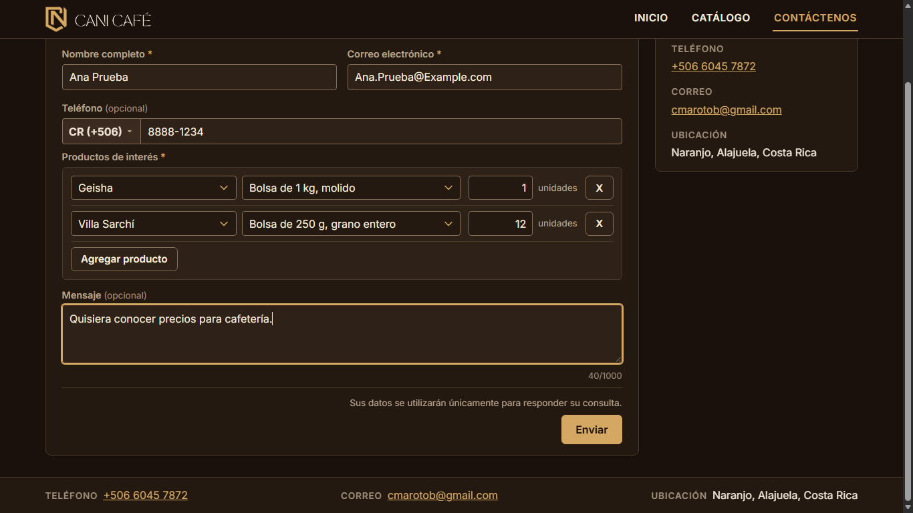
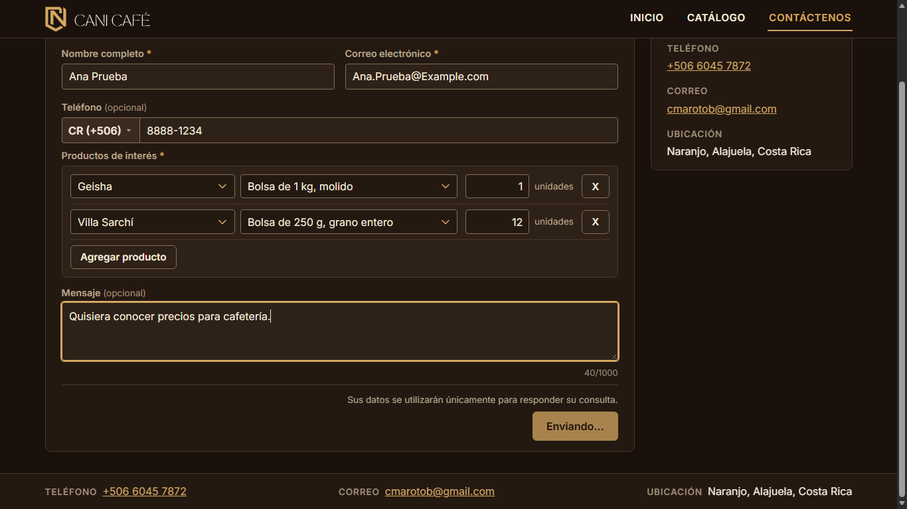
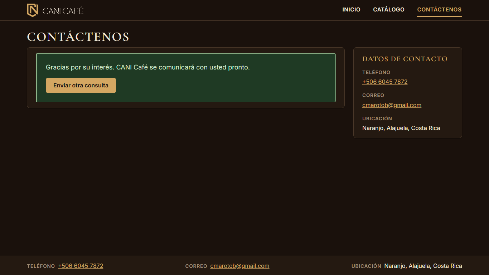
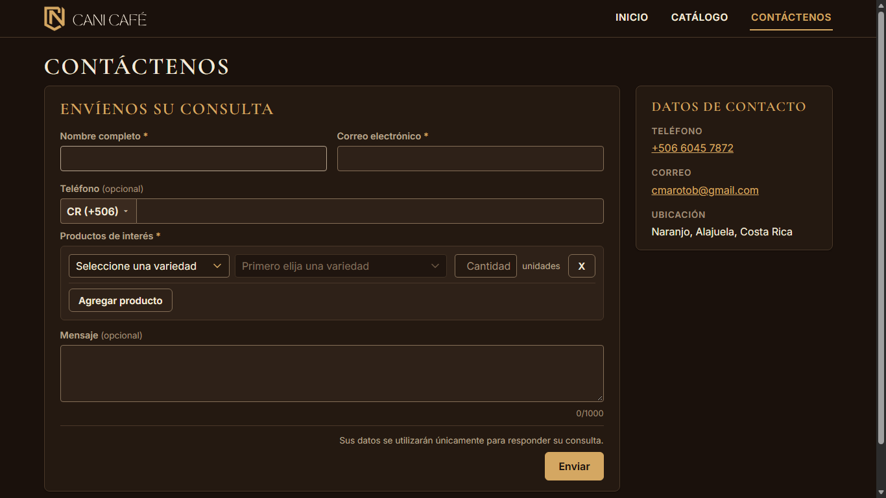
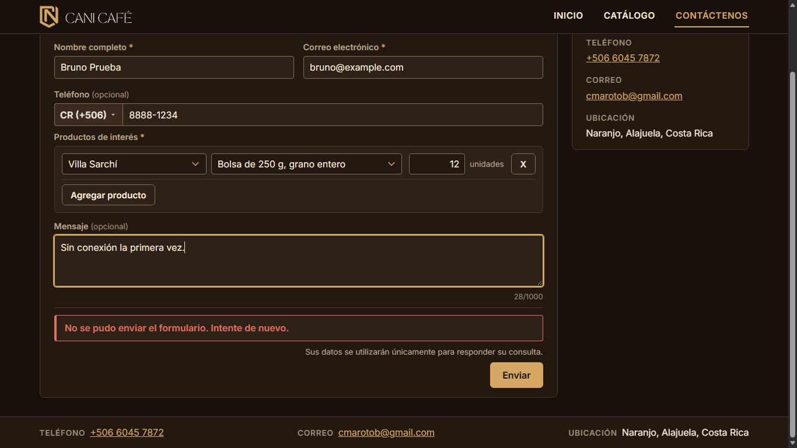
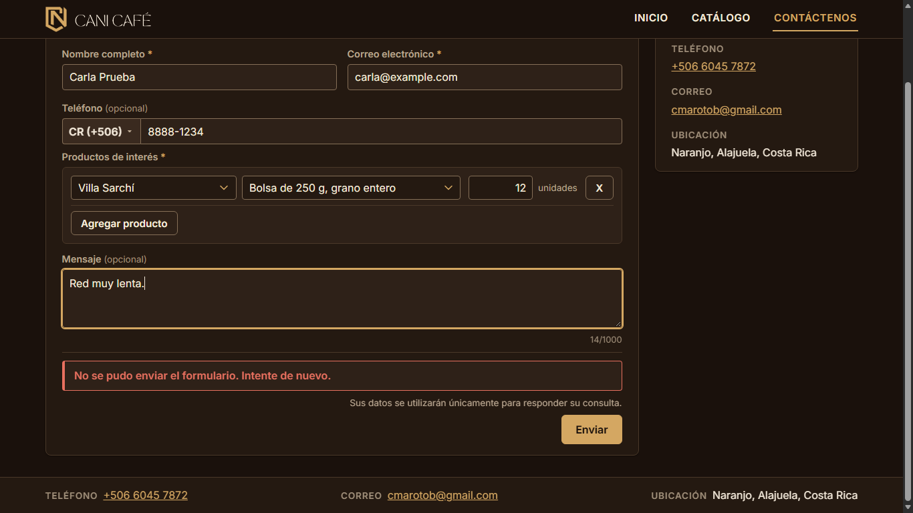

# Evidencia HU-405: Enviar el formulario de interés

**Responsable:** Dylan · **Revisa:** Gabriel · **Fecha:** 2026-11-02

> Como persona interesada en un producto quiero enviar el formulario y saber si llegó bien
> para que tenga la seguridad de que CANI Café se comunicará conmigo.

## Datos de prueba

- Capturas rehechas con el acomodo visual y móvil de la fase 3: contenedor de 1280 px, encabezado y pie compactos, encabezado fijo al desplazar (escritorio). Ver la tabla de antes y después en [HU-401](../HU-401/README.md#acomodo-visual-y-móvil-fase-3).
- Capturas actualizadas con el selector de productos por filas ([HU-404](../HU-404/README.md)); el envío no cambió.
- Sitio público en `http://localhost:5174` contra Firebase Emulator Suite (`demo-cani-crm`) con el catálogo cargado por `npm run seed`. Las solicitudes se escriben en la colección `formRequests` y se leen por REST para comprobar lo guardado. Datos ficticios (`ana.prueba@example.com`, etc.); el recorrido borra sus solicitudes al terminar.
- Recorrido automático en Microsoft Edge (headless) a **1366 × 768**. La red lenta y la falta de conexión se simularon con las herramientas de Edge (Network.emulateNetworkConditions). Detalle en [recorrido.json](recorrido.json).

## Criterios de aceptación

| # | Criterio | Resultado | Evidencia |
|---|---|---|---|
| 1 | Encima del botón "Enviar" aparece "Sus datos se utilizarán únicamente para responder su consulta.". | ✅ Cumple | [01](01-privacidad-encima-de-enviar.png). Texto literal, justo encima del botón. |
| 2 | Al dar clic en "Enviar", el botón cambia a "Enviando..." y no se puede presionar otra vez hasta que termine el envío. | ✅ Cumple | [02](02-enviando.png). Con la red lenta (3 s) el botón dice "Enviando..." y está deshabilitado; un segundo clic no hizo nada: se guardó **una** sola solicitud. |
| 3 | Si sale bien, el formulario se reemplaza por "Gracias por su interés. CANI Café se comunicará con usted pronto." y el botón "Enviar otra consulta". | ✅ Cumple | [03](03-gracias.png), [04](04-enviar-otra-consulta.png). El formulario desaparece y el foco pasa al mensaje. "Enviar otra consulta" muestra el formulario vacío (Costa Rica y una sola fila de productos vacía) y quita el producto elegido de la dirección (`/contactenos`). |
| 4 | Si falla por un problema de conexión, aparece "No se pudo enviar el formulario. Intente de nuevo.". Los datos escritos no se borran. | ✅ Cumple | [05](05-sin-conexion-datos-intactos.png), [06](06-tiempo-limite.png). Sin conexión, el error aparece en **84 ms** y no se guarda nada; con la red colgada, a los **10,04 s** (tiempo límite). En los dos casos nombre, correo, teléfono, productos con su cantidad y mensaje quedan igual, y el botón vuelve a "Enviar". Al reintentar con conexión se muestra el agradecimiento. |

## Lo que se guarda (contrato v2, PROVISIONAL)

Colección `formRequests` (nombre PROVISIONAL, definido solo en `src/shared/types/formRequest.ts`), con id generado en el navegador. Ejemplo real del recorrido:

```json
{
  "fullName": "Ana Prueba",
  "email": "ana.prueba@example.com",
  "phoneCountry": "CR",
  "phoneNumber": "88881234",
  "interests": [
    { "productId": "prod-01-villa-sarchi-0250-grano", "quantity": 12 },
    { "productId": "prod-09-geisha-1000-molido", "quantity": 1 }
  ],
  "message": "Quisiera conocer precios para cafetería.",
  "submittedAt": "2026-11-02T22:01:25.063Z",
  "processed": false
}
```

- El correo se escribió como `Ana.Prueba@Example.com` y se guarda en minúsculas; el teléfono `8888-1234`, solo con dígitos.
- Los productos van en el **orden del catálogo** (variedad, peso, formato), no en el orden de las filas (Geisha llegó en la primera fila desde el catálogo y Villa Sarchí se agregó en la segunda).
- Sin teléfono o sin mensaje se guarda `null`. `submittedAt` la pone el servidor; `processed` empieza en `false`.

## Decisión 7 actualizada: reintentos

El sitio público usa **Firestore Lite** (por REST, sin caché ni escrituras en cola): sin conexión la escritura falla al momento en vez de quedar pendiente. Aun así, una red colgada puede no responder, así que hay un **tiempo límite de 10 s**.

Los errores se clasifican en dos grupos: **"rechazo por reglas"** (`permission-denied`) y **"conexión"** (cualquier otro, incluido el tiempo límite). Reglas de reintento (`sitio-publico/src/formulario/envio.ts`):

- **a)** En el primer intento, `permission-denied` es **siempre** error, nunca éxito.
- **b)** Solo en un reintento con el **mismo id**, y solo si el intento anterior falló por tiempo límite o por conexión, `permission-denied` cuenta como éxito: significa que el primer intento sí se guardó y el reintento choca con él (sin sesión no se puede cambiar una solicitud).
- **c)** Si la persona cambia cualquier dato después de un error, el siguiente envío usa un **id nuevo**; mientras no cambie nada, reutiliza el mismo id. Se compara la solicitud tal como se guardaría (por ejemplo, un espacio de más al final del nombre no cuenta como cambio).

Comprobado en el navegador ([recorrido.json](recorrido.json)):

| Caso | Resultado |
|---|---|
| Regla b: la red tarda 13 s; a los 10 s aparece el error, pero la solicitud sí llega a guardarse. Se reintenta sin cambiar nada. | "Gracias por su interés…" y **una sola** solicitud guardada (mismo id). |
| Regla c: lo mismo, pero antes de reintentar se cambia el mensaje. | "Gracias por su interés…" y **dos** solicitudes: la primera con "Primer mensaje." y la nueva con "Mensaje corregido.". El procesamiento de Gabriel encuentra a la persona por su correo, así que no duplica el contacto (pero registraría dos comunicaciones). |

Riesgo aceptado: si el intento anterior falló por conexión y nunca se guardó, y el reintento lo rechazan las reglas por otra causa (por ejemplo, un cambio de reglas), se mostraría el agradecimiento sin que nada se guardara. Para que no pase desapercibido, todo rechazo por reglas se anota en la consola del navegador.

## Reglas de Firestore (bloque PROVISIONAL)

En `firestore.rules`, marcado "PROVISIONAL de Dylan: lo reemplaza Gabriel (E5-020.1)":

- **Crear sin sesión:** solo con exactamente los 8 campos del contrato. Nombre de 1 a 100 caracteres. Correo de hasta 100, en minúsculas, con forma nombre@dominio.com. Teléfono: los dos `null`, o país de 2 letras con 8 dígitos (Costa Rica) o de 6 a 14 (otros). Productos: lista de 1 a 72. Mensaje: `null` o de 1 a 1000. `submittedAt == request.time` y `processed == false`.
- **Sin sesión:** no se lee, no se lista, no se cambia y no se borra. Un reintento sobre un id que ya existe cuenta como cambio y se rechaza.
- **Con sesión activa:** se puede leer y actualizar, para el procesamiento de Gabriel, que definirá sus propias reglas.
- **Límite conocido:** las reglas no tienen ciclos y evalúan como máximo unas 1000 expresiones por petición. Revisar uno por uno hasta 72 productos no cabe: se probó en el emulador y con 10 o más productos rechazaba solicitudes válidas. Por eso las reglas solo revisan que sea una lista de 1 a 72. El id y la cantidad (1 a 9999) de cada producto los revisa el formulario (HU-501), y debe revisarlos el procesamiento, que además comprueba que el producto exista. Una prueba marca este límite para que cambie si Gabriel agrega esa revisión.

## Tamaño del sitio público

| JS de `npm run build:publico` | Minificado | gzip |
|---|---|---|
| Antes (SDK completo de Firestore) | 842,88 kB | 254,14 kB |
| Después (Firestore Lite) | 500,62 kB | 153,57 kB |

La prueba de aislamiento (`tests/unit/publicBuild.test.ts`) ahora también falla si el sitio público incluye el SDK completo: cualquier `firebase/firestore` que no sea `/lite`, `@firebase/firestore` fuera de `dist/lite`, o el canal `@firebase/webchannel-wrapper/webchannel-blob`. Se comprobó agregando a propósito un import de `firebase/firestore`: fallaron las tres revisiones nuevas. Al quitarlo, volvieron a pasar.

## Pruebas automatizadas

Salida en [pruebas.txt](pruebas.txt).

- `tests/unit/publicSubmit.test.ts`: solicitud que se guarda (normalización, `null`, orden del catálogo), clasificación de errores, reglas a, b y c, y el tiempo límite de 10 s con reloj simulado.
- `tests/components/EnvioFormulario.test.tsx`: los cuatro criterios en pantalla, y la página completa con el guardado simulado (contenido guardado, reintento con el mismo id, "Enviar otra consulta").
- `tests/rules/formRequests.rules.test.ts` (emulador): reglas del bloque PROVISIONAL y envío real con Firestore Lite (reglas a, b y c, tiempo límite).
- `tests/rules/firestore.rules.test.ts`: `formRequests` excluida del `it.each` que escribe `{ campo: 'valor' }` en todas las colecciones.

## Capturas

| | |
|---|---|
|  |  |
| 01. Texto de privacidad encima de "Enviar" | 02. "Enviando..." (deshabilitado) |
|  |  |
| 03. Agradecimiento y "Enviar otra consulta" | 04. Formulario vacío tras "Enviar otra consulta" |
|  |  |
| 05. Sin conexión: error y datos intactos | 06. Red colgada: error a los 10 s |
