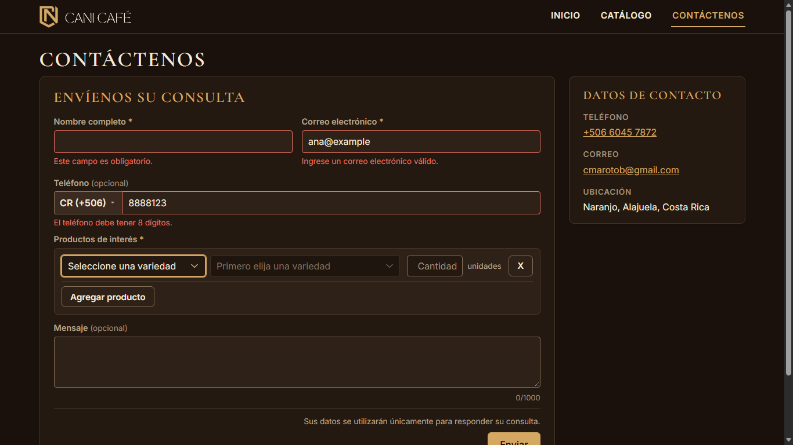
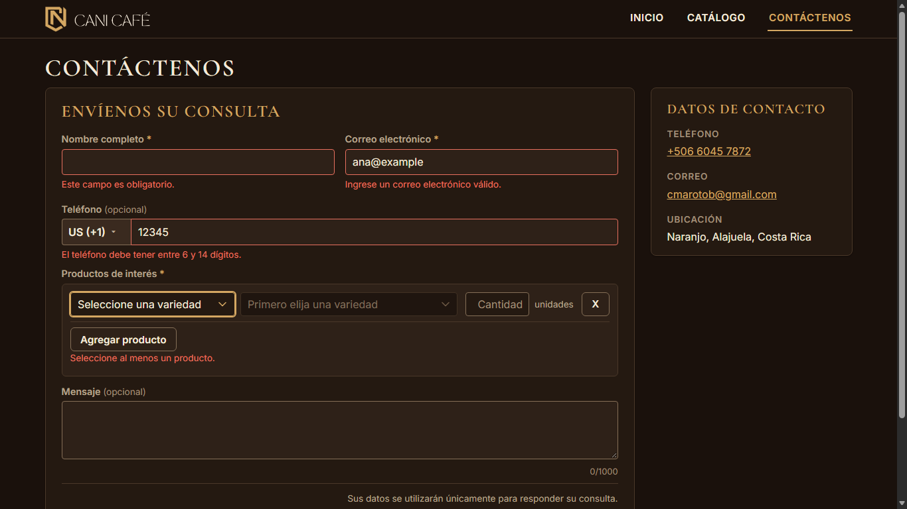
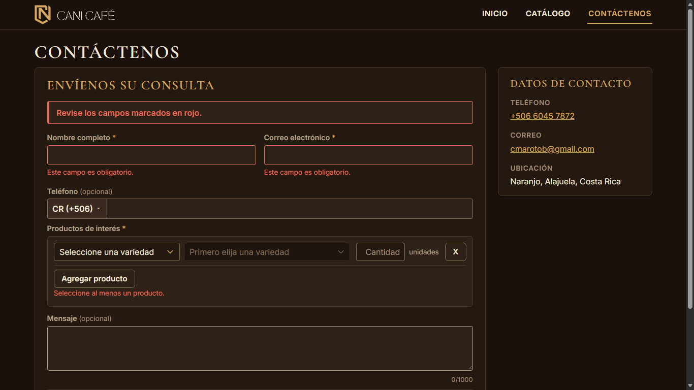

# Evidencia HU-501: Revisar los datos del formulario de interés

**Responsable:** Dylan (la validación vive en el formulario público) · **Verifica al cerrar HU-501:** Gabriel · **Fecha:** 2026-11-02

> Como persona interesada en un producto quiero que el formulario me avise si falta un dato o si algo está mal escrito
> para que pueda corregirlo antes de enviarlo.

**Alcance de esta entrega:** revisión de nombre, correo, teléfono, productos y cantidades, y el aviso general. "Enviar" todavía no escribe en Firestore (HU-405).

## Datos de prueba

- Capturas rehechas con el acomodo visual y móvil de la fase 3: contenedor de 1280 px, encabezado y pie compactos, encabezado fijo al desplazar (escritorio). Ver la tabla de antes y después en [HU-401](../HU-401/README.md#acomodo-visual-y-móvil-fase-3).
- Sitio público en `http://localhost:5174`, Edge headless a **1366 × 768**. Detalle en [recorrido.json](recorrido.json). Datos ficticios.

## Criterios de aceptación

| # | Criterio | Resultado | Evidencia |
|---|---|---|---|
| 1 | Cada dato se revisa al pasar al siguiente campo y otra vez al dar clic en "Enviar". | ✅ Cumple | [01](01-errores-al-salir-de-cada-campo.png). Al salir del nombre vacío aparece el error en ese momento (sin el aviso de arriba); lo mismo con correo y teléfono. El teléfono se revisa al salir del conjunto país + número. "Enviar" revisa todo de nuevo. |
| 2 | Si falta un dato obligatorio: "Este campo es obligatorio.". Si no se marcó ningún producto: "Seleccione al menos un producto.". | ✅ Cumple | [03](03-enviar-con-todo-vacio.png), [04](04-enviar-con-todo-vacio-pagina-completa.png). Con todo vacío: dos "Este campo es obligatorio." (nombre y correo) y "Seleccione al menos un producto.". |
| 3 | Correo que no es nombre@dominio.com: "Ingrese un correo electrónico válido.". | ✅ Cumple | [01](01-errores-al-salir-de-cada-campo.png), con `ana@example`. Al corregirlo el error desaparece. |
| 4 | Teléfono con cantidad incorrecta: "El teléfono debe tener 8 dígitos." (Costa Rica) o "El teléfono debe tener entre 6 y 14 dígitos." (otros países). Cantidad fuera de 1 a 9999: "Ingrese una cantidad entre 1 y 9999.". | ✅ Cumple | [01](01-errores-al-salir-de-cada-campo.png): Costa Rica con 7 dígitos. [02](02-telefono-otro-pais.png): Estados Unidos con 5 dígitos (y con 7 no hay error). Cantidad: [HU-404 captura 04](../HU-404/04-cantidad-invalida.png), con `0`, `10000`, `1.5`, `abc` y vacío, bajo la fila que tiene el error. |
| 5 | Si hay algún error, el formulario no se envía y arriba aparece "Revise los campos marcados en rojo.". | ✅ Cumple | [03](03-enviar-con-todo-vacio.png). El aviso está antes del primer campo y los campos con error quedan en rojo. Al corregir nombre y correo, el aviso sigue mientras falte el producto. "Enviar" no hizo ninguna petición a Firestore (`peticionesAFirestoreAlEnviar: 0`). El camino con datos correctos está en las pruebas de pantalla (nombre, correo y un producto marcado). |

## Con el selector de productos por filas (actualización)

- El selector de productos ahora funciona por filas, como el del sistema interno ([HU-404](../HU-404/README.md)). Además de los mensajes de HU-501, una fila puede mostrar dos mensajes **PROVISIONALES** (los mismos del sistema interno): "Seleccione un producto o elimine la fila." (fila sin presentación junto a otras completas) y "Este producto ya fue agregado." (producto repetido). Si ninguna fila tiene producto, el aviso es uno solo: "Seleccione al menos un producto.".
- Corrección: al dar clic en "Enviar" con el foco dentro de un campo, los errores que aparecían al salir de él empujaban el botón hacia abajo antes de soltar el clic, y había que hacer clic dos veces. Ahora presionar "Enviar" no le quita el foco al campo y el primer clic envía (o muestra "Revise los campos marcados en rojo."). Lo cubre una prueba de pantalla y se comprobó en Edge.
- Las capturas 01 a 04 se tomaron de nuevo con el selector por filas.

## Cómo funciona

- La lógica es pura y vive en `sitio-publico/src/formulario/validacion.ts` (el sitio público no puede importar la del sistema interno). Las reglas de correo y de cantidad son copias en `src/shared/validation/`, sin tocar los originales.
- Los mensajes del teléfono salen de `src/shared/phone/phone.ts`, que ya son los de la historia.
- Un error se ve al salir del campo o al enviar, y se actualiza mientras se escribe. El aviso de arriba aparece al enviar con errores y desaparece cuando ya no los hay.
- Nombre y correo no pasan de 100 caracteres y el mensaje de 1000 porque el campo no deja escribir más; por eso no hay un mensaje de "demasiado largo".
- Un teléfono con texto sin números también se revisa (no se ignora en silencio).

## Pruebas automatizadas

Salida en [pruebas.txt](pruebas.txt): `tests/unit/publicForm.test.ts` (todos los mensajes, correos válidos e inválidos, teléfono por país, cantidades) y `tests/components/ConsultaForm.test.tsx` (revisión al salir de cada campo, al enviar, aviso y corrección).

## Capturas

| | |
|---|---|
|  |  |
| 01. Errores al salir de cada campo | 02. Teléfono de otro país |
|  | |
| 03. "Enviar" con todo vacío | |
