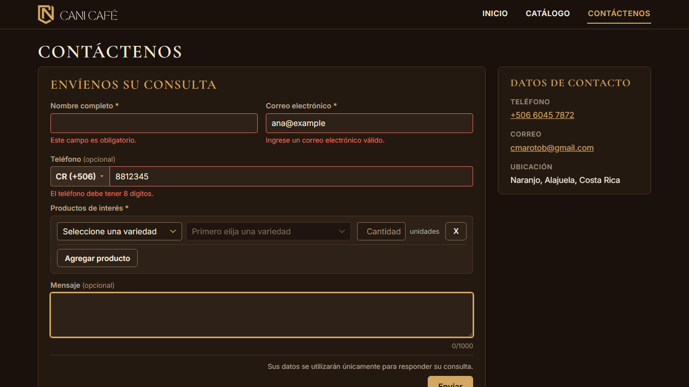
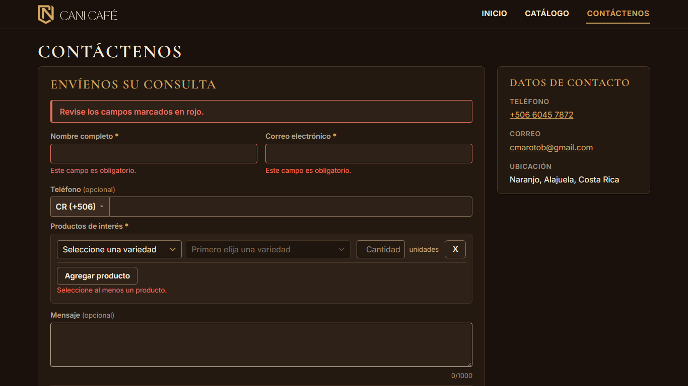
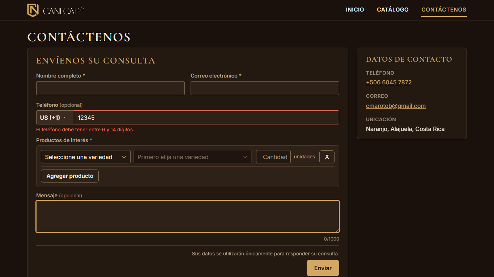
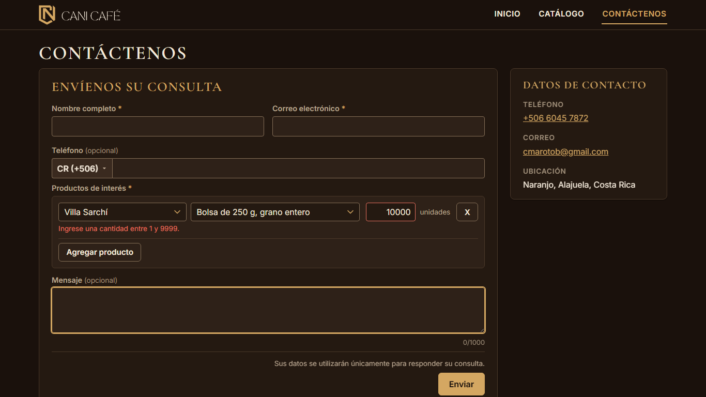
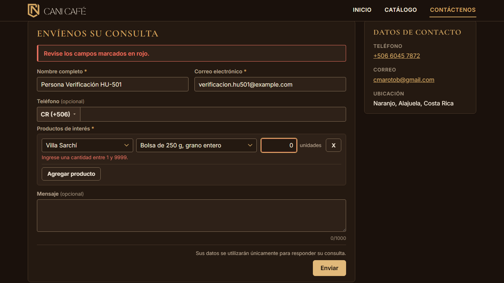
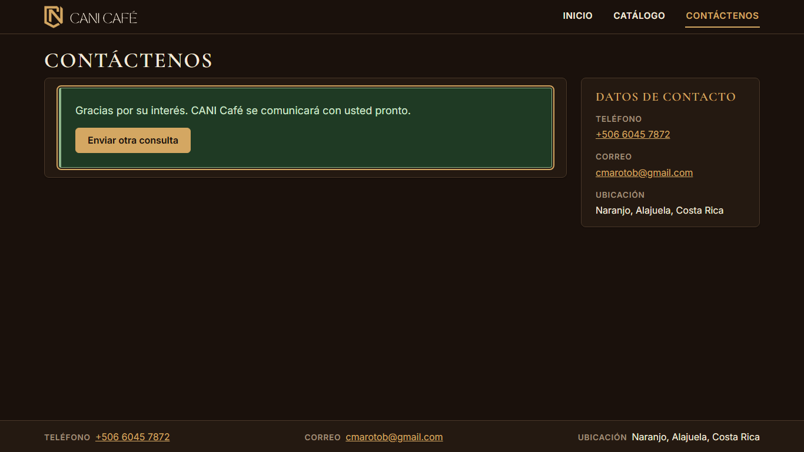

# Evidencia HU-501: Revisar los datos del formulario de interés

**Responsable:** Dylan (la validación vive en el formulario público) · **Verifica al cerrar HU-501:** Gabriel · **Fecha:** 2026-11-02

> Como persona interesada en un producto quiero que el formulario me avise si falta un dato o si algo está mal escrito
> para que pueda corregirlo antes de enviarlo.

**Alcance de esta entrega:** revisión de nombre, correo, teléfono, productos y cantidades, y el aviso general. "Enviar" todavía no escribe en Firestore (HU-405).

## Datos de prueba

- Capturas rehechas con el acomodo visual y móvil de la fase 3: contenedor de 1280 px, encabezado y pie compactos, encabezado fijo al desplazar (escritorio). Ver la tabla de antes y después en [HU-401](../HU-401/README.md#acomodo-visual-y-móvil-fase-3).
- Sitio público en `http://localhost:5174`, Edge headless a **1366 × 768**. Detalle en [recorrido.json](recorrido.json). Datos ficticios.

## Criterios de aceptación

| # | Criterio | Resultado | Evidencia |
|---|---|---|---|
| 1 | Cada dato se revisa al pasar al siguiente campo y otra vez al dar clic en "Enviar". | ✅ Cumple | [01](01-errores-al-salir-de-cada-campo.png). Al salir del nombre vacío aparece el error en ese momento (sin el aviso de arriba); lo mismo con correo y teléfono. El teléfono se revisa al salir del conjunto país + número. "Enviar" revisa todo de nuevo. |
| 2 | Si falta un dato obligatorio: "Este campo es obligatorio.". Si no se marcó ningún producto: "Seleccione al menos un producto.". | ✅ Cumple | [03](03-enviar-con-todo-vacio.png), [04](04-enviar-con-todo-vacio-pagina-completa.png). Con todo vacío: dos "Este campo es obligatorio." (nombre y correo) y "Seleccione al menos un producto.". |
| 3 | Correo que no es nombre@dominio.com: "Ingrese un correo electrónico válido.". | ✅ Cumple | [01](01-errores-al-salir-de-cada-campo.png), con `ana@example`. Al corregirlo el error desaparece. |
| 4 | Teléfono con cantidad incorrecta: "El teléfono debe tener 8 dígitos." (Costa Rica) o "El teléfono debe tener entre 6 y 14 dígitos." (otros países). Cantidad fuera de 1 a 9999: "Ingrese una cantidad entre 1 y 9999.". | ✅ Cumple | [01](01-errores-al-salir-de-cada-campo.png): Costa Rica con 7 dígitos. [02](02-telefono-otro-pais.png): Estados Unidos con 5 dígitos (y con 7 no hay error). Cantidad: [HU-404 captura 04](../HU-404/04-cantidad-invalida.png), con `0`, `10000`, `1.5`, `abc` y vacío, bajo la fila que tiene el error. |
| 5 | Si hay algún error, el formulario no se envía y arriba aparece "Revise los campos marcados en rojo.". | ✅ Cumple | [03](03-enviar-con-todo-vacio.png). El aviso está antes del primer campo y los campos con error quedan en rojo. Al corregir nombre y correo, el aviso sigue mientras falte el producto. "Enviar" no hizo ninguna petición a Firestore (`peticionesAFirestoreAlEnviar: 0`). El camino con datos correctos está en las pruebas de pantalla (nombre, correo y un producto marcado). |

## Con el selector de productos por filas (actualización)

- El selector de productos ahora funciona por filas, como el del sistema interno ([HU-404](../HU-404/README.md)). Además de los mensajes de HU-501, una fila puede mostrar dos mensajes **PROVISIONALES** (los mismos del sistema interno): "Seleccione un producto o elimine la fila." (fila sin presentación junto a otras completas) y "Este producto ya fue agregado." (producto repetido). Si ninguna fila tiene producto, el aviso es uno solo: "Seleccione al menos un producto.".
- Corrección: al dar clic en "Enviar" con el foco dentro de un campo, los errores que aparecían al salir de él empujaban el botón hacia abajo antes de soltar el clic, y había que hacer clic dos veces. Ahora presionar "Enviar" no le quita el foco al campo y el primer clic envía (o muestra "Revise los campos marcados en rojo."). Lo cubre una prueba de pantalla y se comprobó en Edge.
- Las capturas 01 a 04 se tomaron de nuevo con el selector por filas.

## Cómo funciona

- La lógica es pura y vive en `sitio-publico/src/formulario/validacion.ts` (el sitio público no puede importar la del sistema interno). Las reglas de correo y de cantidad son copias en `src/shared/validation/`, sin tocar los originales.
- Los mensajes del teléfono salen de `src/shared/phone/phone.ts`, que ya son los de la historia.
- Un error se ve al salir del campo o al enviar, y se actualiza mientras se escribe. El aviso de arriba aparece al enviar con errores y desaparece cuando ya no los hay.
- Nombre y correo no pasan de 100 caracteres y el mensaje de 1000 porque el campo no deja escribir más; por eso no hay un mensaje de "demasiado largo".
- Un teléfono con texto sin números también se revisa (no se ignora en silencio).

## Pruebas automatizadas

Salida en [pruebas.txt](pruebas.txt): `tests/unit/publicForm.test.ts` (todos los mensajes, correos válidos e inválidos, teléfono por país, cantidades) y `tests/components/ConsultaForm.test.tsx` (revisión al salir de cada campo, al enviar, aviso y corrección).

## Capturas

| | |
|---|---|
|  |  |
| 01. Errores al salir de cada campo | 02. Teléfono de otro país |
|  | |
| 03. "Enviar" con todo vacío | |

## Verificación de Gabriel

**Fecha:** 2026-11-03 · **Resultado:** ✅ **Cumple los 5 criterios.** Se encontró **un defecto menor** (D-1) que no
bloquea el cierre. Va descrito abajo para que lo corrija Dylan.

**Cómo se verificó**

1. **Criterios oficiales:** se compararon con la tabla de esta evidencia. Los textos son idénticos.
2. **Código:** se revisaron `sitio-publico/src/formulario/validacion.ts`, `sitio-publico/src/components/ConsultaForm.tsx`
   y `ProductosField.tsx` contra cada criterio.
3. **Pruebas de Dylan:** `publicForm.test.ts`, `ConsultaForm.test.tsx` y `ProductosField.test.tsx`, 99/99. Salida en
   [verificacion-pruebas.txt](verificacion-pruebas.txt).
4. **Recorrido propio:** con Playwright (Chromium headless, 1366 × 768) sobre `npm run dev:publico`, conectado a los
   emuladores con `npm run seed`. Incluye casos borde que no estaban en la evidencia original. Detalle en
   [verificacion-recorrido.json](verificacion-recorrido.json).
5. **Datos:** son ficticios. La solicitud de prueba que se envió al final se borró (`solicitudesDePruebaQueQuedan: 0`).

| # | Criterio | Resultado | Qué se comprobó |
|---|---|---|---|
| 1 | Cada dato se revisa al pasar al siguiente campo y otra vez al dar clic en "Enviar". | ✅ Cumple | Al salir del nombre vacío, del correo `ana@example` y del teléfono `8812345`, cada mensaje aparece en ese momento y el aviso de arriba todavía no. "Enviar" revisa también los campos que no se tocaron ([verificación 01](verificacion-01-al-salir-de-cada-campo.png), [02](verificacion-02-enviar-vacio.png)). |
| 2 | "Este campo es obligatorio." / "Seleccione al menos un producto.". | ✅ Cumple | Con todo vacío salen 2 × "Este campo es obligatorio." y "Seleccione al menos un producto.". Un nombre o un correo con solo espacios también cuenta como vacío. |
| 3 | Correo que no es nombre@dominio.com → "Ingrese un correo electrónico válido.". | ✅ Cumple | Inválidos: `ana@example`, `ana.example.com`, `ana @example.com`, `ana@@example.com`, `@example.com`, `ana@example.`. Válidos: `Ana.Prueba@Example.COM` y ` ana@example.com ` (con espacios alrededor). |
| 4 | Teléfono: 8 dígitos (Costa Rica) o entre 6 y 14 (otros países). Cantidad entre 1 y 9999. | ✅ Cumple | Costa Rica: 7 y 9 dígitos dan error, 8 no; `abc` da error. Estados Unidos: 5 y 15 dan error, 6 y 14 no ([verificación 03](verificacion-03-telefono-otro-pais.png)). Cantidad: `0`, `10000`, `1.5`, `-3`, `abc` y vacío dan error; `1`, `9999` y ` 25 ` no ([verificación 04](verificacion-04-cantidad-fuera-de-rango.png)). |
| 5 | Si hay algún error, no se envía y arriba aparece "Revise los campos marcados en rojo.". | ✅ Cumple (ver D-1) | Con un solo error (cantidad `0`) aparece el aviso y no hay ninguna escritura a Firestore ([verificación 05](verificacion-05-un-error-no-se-envia.png)). Al corregir, el aviso desaparece y "Enviar" guarda una sola solicitud en `formRequests` con `processed: false` y `submittedAt` del servidor ([verificación 06](verificacion-06-envio-correcto.png)). |

### Defecto D-1 (menor): sin productos elegidos, el selector no se marca en rojo

- **Dónde:** `sitio-publico/src/components/ProductosField.tsx`.
- **Pasos:**
  1. Abrir `/contactenos` y no elegir ningún producto.
  2. Dar clic en "Enviar" (con o sin los demás datos).
- **Resultado esperado:**
  - Aparece "Revise los campos marcados en rojo.".
  - Los campos con error se ven en rojo, también los selectores de la fila de productos, igual que se marcan el nombre,
    el correo, el teléfono y la cantidad.
- **Resultado obtenido:**
  - Aparece "Seleccione al menos un producto.", pero "Seleccione una variedad" queda con el borde normal
    ([verificación 02](verificacion-02-enviar-vacio.png)).
  - Los selectores no reciben `aria-invalid` ni se asocian con ese mensaje (`aria-describedby`). El lector de pantalla
    tampoco los anuncia como inválidos.
- **Causa probable:** `aria-invalid` de los selectores depende solo del error de la fila (`errores.producto`), y
  cuando ninguna fila tiene producto, el error va en `intereses` (`error` del componente), no en las filas.
- **Sugerencia:** con `error` presente, marcar `aria-invalid` y `aria-describedby={errorId}` en la variedad de la
  primera fila, o en todas las filas vacías.

### Observaciones (no son defectos de los criterios)

- **Mensajes sin `role="alert"`:** los mensajes bajo cada campo no tienen `role="alert"`. Están ligados con
  `aria-describedby`, así que el lector de pantalla los lee al volver al campo, pero no los anuncia en el momento de
  salir. El aviso general de arriba sí tiene `role="alert"`.
- **Alcance desactualizado:** la línea de "Alcance" de esta evidencia dice que "Enviar" todavía no escribe en
  Firestore. Ya escribe (HU-405), y la verificación lo comprobó.

### Capturas de la verificación

| | |
|---|---|
|  |  |
| V01. Errores al salir de cada campo | V02. "Enviar" con todo vacío (D-1: el selector no queda en rojo) |
|  |  |
| V03. Teléfono de otro país con 5 dígitos | V04. Cantidad 10000 |
|  |  |
| V05. Un solo error: no se envía | V06. Corregido: se envía |
