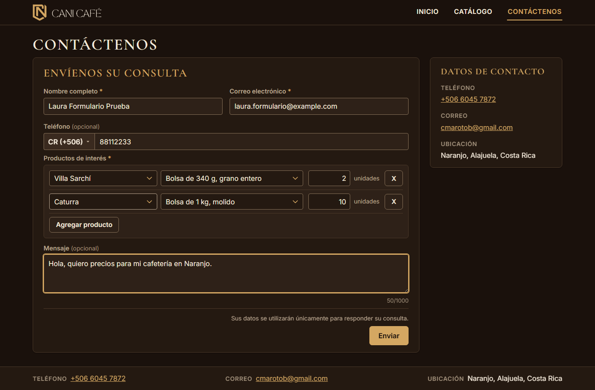
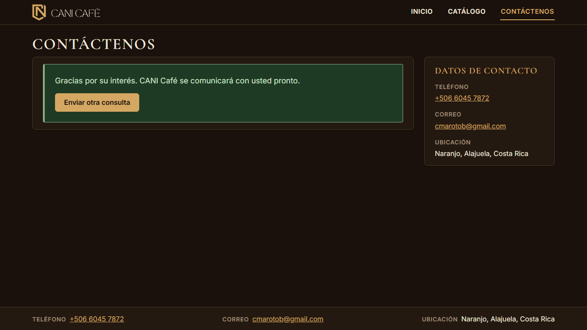
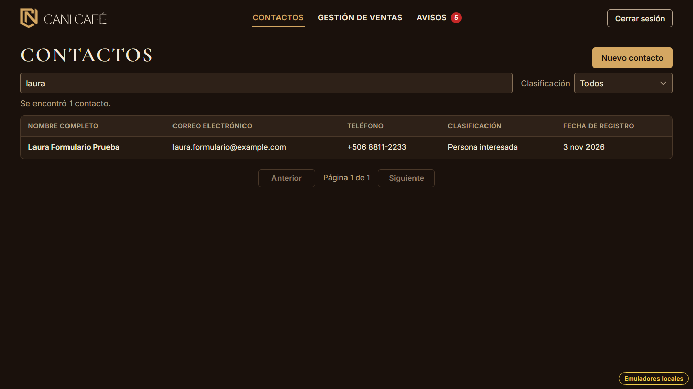
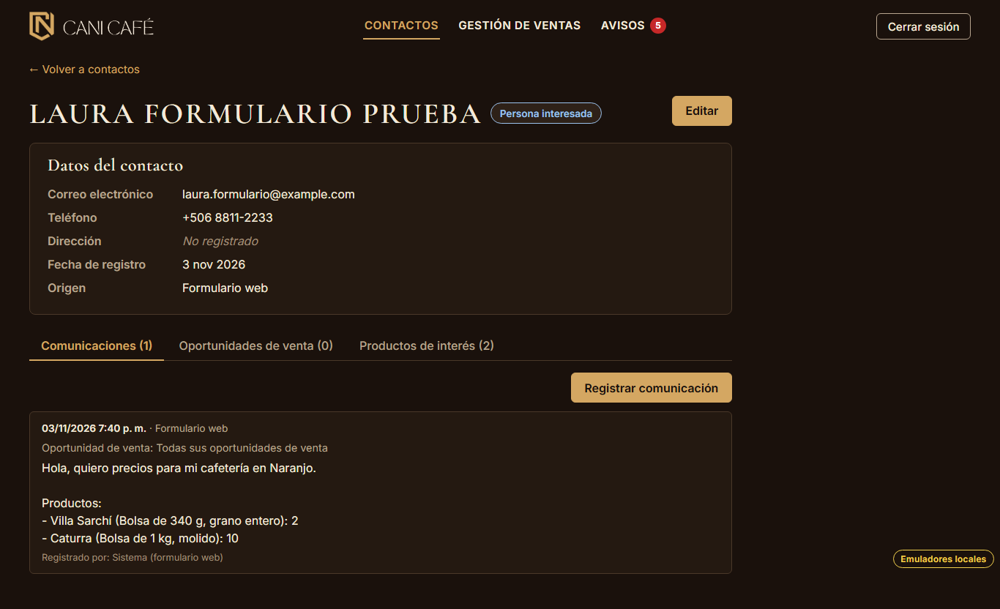
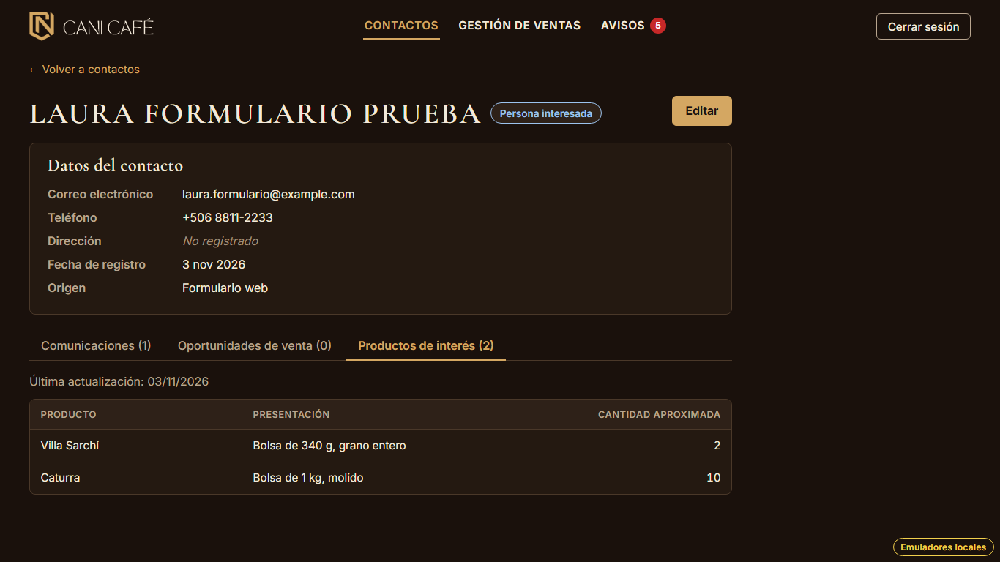

# Evidencia HU-502: Registrar automáticamente a una persona nueva

**Responsable:** Gabriel · **Revisa:** Dylan · **Fecha:** 2026-11-03 · Va en el mismo commit que [HU-503](../HU-503/README.md).

> Como administrador quiero que quien envía el formulario por primera vez quede registrado automáticamente
> para no tener que digitar sus datos.

## Datos de prueba

- Ambiente: Firebase Emulator Suite, proyecto `demo-cani-crm`, datos cargados con `npm run seed`, usuario `admin`.
- Dos sitios a la vez:
  - el sitio público, construido en modo desarrollo y servido con `vite preview` en `:4174`, conectado a los
    emuladores;
  - el sistema interno, en `:5173`.
- "Laura Formulario Prueba" (ficticia) envía el formulario con mensaje y dos productos. Después el administrador
  ingresa y el procesador toma la solicitud pendiente.
- El recorrido es automático, con Playwright (Chromium headless) en 1366 × 768. El detalle está en
  [recorrido.json](recorrido.json), con lo que quedó en Firestore. En ese archivo las cantidades aparecen como texto
  porque la API REST del emulador devuelve así los enteros; en Firestore son números.

## Criterios de aceptación

| # | Criterio | Resultado | Evidencia |
|---|---|---|---|
| 1 | Al recibir un formulario, el sistema revisa si la persona ya está en el directorio. Primero la busca por su correo y, si no la encuentra, por su teléfono (mismo país y mismo número). También revisa los contactos inactivos. | ✅ Cumple | `findPersonIn` busca primero por correo y después por `phoneCountry` + `phoneNumber`, sin filtrar por estado. Pruebas de emulador: coincidencia por teléfono con otro correo, el mismo número en otro país NO coincide, y un contacto inactivo se encuentra. Ver también [HU-503](../HU-503/README.md). |
| 2 | Si la persona no está en el directorio, el sistema crea un contacto nuevo con su nombre, correo y teléfono. El contacto queda como "Persona interesada" y con origen "Formulario web". | ✅ Cumple | [03](03-lista-contactos.png) y [04](04-ficha-datos-y-comunicacion.png): la ficha muestra el correo, "+506 8811-2233", "Persona interesada" y "Origen: Formulario web". La fecha de registro es la del envío, no la del procesamiento. |
| 3 | Los productos marcados y sus cantidades quedan guardados como productos de interés del contacto. | ✅ Cumple | [05](05-productos-de-interes.png): Villa Sarchí × 2 y Caturra × 10 en la pestaña de HU-209, con "Última actualización". |
| 4 | El mensaje queda guardado en el historial de comunicaciones del contacto, con la fecha y hora del envío y el medio "Formulario web". La nota incluye el mensaje (o "Sin mensaje") y los productos con sus cantidades. | ✅ Cumple | [04](04-ficha-datos-y-comunicacion.png): "03/11/2026 7:40 p. m. · Formulario web", la nota con el mensaje y "Productos:" con cada producto y su cantidad, y "Registrado por: Sistema (formulario web)". En Firestore, `date` es exactamente el `submittedAt` de la solicitud. Sin mensaje, la nota empieza con "Sin mensaje" (prueba de emulador). |
| 5 | El sistema no crea una posible venta de forma automática. | ✅ Cumple | "Oportunidades de venta (0)" en [04](04-ficha-datos-y-comunicacion.png). `posiblesVentasCreadas: 0` en el recorrido y en la prueba de emulador. Laura no aparece en el tablero. |

## Cómo funciona (`src/formRequests/`)

- **Dónde corre:** en el navegador del administrador, con su sesión (CC-01, costo 0, sin Cloud Functions).
  - `useFormRequestProcessor` está montado en `AppLayout`, así que corre en cualquier pantalla interna.
  - Escucha con `onSnapshot` las solicitudes con `processed == false`, ordenadas por `submittedAt` (el índice ya
    existe), y las procesa una por una.
- **Un solo procesador por navegador:** con `navigator.locks.request('cani-formRequests', …)`. Si hay otra pestaña
  abierta, espera; si esa se cierra, toma el relevo.
- **Reclamo:** una transacción lee la solicitud.
  - La salta si ya está procesada o si alguien la reclamó hace menos de 2 minutos.
  - Si no, escribe `claimedAt` (hora del servidor) y `claimedBy`.
  - Prueba de emulador: dos procesadores a la vez sobre la misma solicitud → uno la procesa y el otro se la salta; se
    crea un solo contacto y una sola comunicación.
- **Escritura atómica:** un solo `writeBatch` con el contacto, la comunicación, el `lastCommunicationAt` de las ventas
  abiertas y el cierre de la solicitud (`processed`, `processedAt`, `outcome`, `contactId`).
  - Las reglas solo dejan cerrar una solicitud que sigue sin procesar. Si otro la cerró, el lote completo falla.
- **Cada producto se revisa** (las reglas no pueden revisarlos uno por uno):
  - Cantidad no entera o fuera de 1 a 9999, elemento mal formado o repetido → se rechaza con su motivo
    (`outcome: 'rejected'`), sin tocar contactos.
  - Producto que no existe → se omite y la nota agrega "Productos no disponibles omitidos: N.". Si no queda ninguno,
    se rechaza.
  - Producto inactivo → se acepta.
- **Contacto nuevo:**
  - `classification: 'persona_interesada'`, `status: 'activo'`, `origin: 'formulario_web'`.
  - `createdAt` = la fecha del envío.
  - `interests`, `interestsUpdatedAt` (HU-209) y `formBadge: 'Nuevo'` (lo que se ve de esa etiqueta es HU-504).
- **Comunicación:**
  - `source` y `medium` 'formulario_web', `userId: null`, `saleId: null`, `appliesToAllSales: true`.
  - `date` = la fecha y hora exactas del envío.
  - `products` con el nombre y la presentación del momento.
  - La ficha muestra la hora solo en estas comunicaciones.
- **Reglas (`firestore.rules`):**
  - `isValidFormCommunication` comprueba el contacto con `existsAfter()`, porque en una persona nueva se crea en el
    mismo lote.
  - Se corrigió el comentario que decía que el formulario lo escribía el Admin SDK.
  - Pruebas de reglas permitidas y denegadas, incluido el lote con contacto nuevo.
- **Tipos:**
  - Orígenes `formulario_web` ('Formulario web') y `carga_inicial` ('Carga inicial'), que solo pone el sistema.
  - Medio 'Formulario web', fuera de la lista del registro manual.
  - `formBadge` en el contacto y `products` en la comunicación.
- **Índices:** no hace falta ninguno nuevo. El de `formRequests` (`processed` + `submittedAt`) ya está en
  `firestore.indexes.json` desde el parche 03 y Dylan tiene que desplegarlo.

## Diferencias con el contrato v3 (mandan los criterios)

- **Productos dentro de la nota:** el contrato decía que los productos iban solo en un campo aparte, mostrado debajo
  de la nota. El criterio 4 pide que "la nota incluye … los productos con sus cantidades".
  - Ahora la nota los lleva escritos: "Productos:" y una línea por producto, como "- Villa Sarchí (Bolsa de 340 g,
    grano entero): 2".
  - El campo `products` se guarda igual, como dato estructurado.
- **Largo de la nota:** por eso la nota de las comunicaciones del formulario admite hasta **8000** caracteres, no 1500.
  Las manuales siguen en 1000. Con el catálogo actual, el caso más largo (mensaje de 1000, 72 productos y las tres
  diferencias) cabe completo; si alguna vez no cupiera, la lista se corta con "… y N productos más.".
- `docs/CONTRATO_FORMULARIO.md` (puntos 4 y 11) quedó corregido.

## Textos no definidos en la HU

| Dónde | Texto |
|---|---|
| Encabezado de la lista de productos en la nota | "Productos:" |
| Una línea por producto | "- {variedad} ({presentación}): {cantidad}" |
| Lista que no cabe (no pasa con el catálogo actual) | "… y N productos más." |
| Fecha y hora en el historial | "05/10/2026 6:20 p. m." |

## Riesgos

- **Doble procesamiento:** dos administradores en dispositivos distintos procesando a la vez dos solicitudes
  DISTINTAS de la misma persona nueva podrían crear dos contactos (contrato v3, punto 8; aceptado). La misma solicitud
  nunca se procesa dos veces.
- **Sin sesión no se procesa:** las solicitudes solo se procesan mientras algún administrador tiene el sistema interno
  abierto. Mientras tanto se quedan pendientes en `formRequests`.

## Pruebas automatizadas

Salida en [pruebas.txt](pruebas.txt), compartida con HU-503.

- `npm run typecheck`: sin errores.
- `npm test`: 858/858. Del procesamiento son 33 unitarias, 5 del procesador (una por una, en orden, solo con sesión,
  candado del navegador) y 3 de la fecha, el medio y los orígenes.
- `npm run test:emulators`: 245/245. Del procesamiento son 18 y de las reglas de la comunicación del formulario 20.
  Incluyen todas las que pide el prompt: persona nueva, el mismo correo otra vez, coincidencia por teléfono, inactivo
  reactivado, diferencias anotadas, producto inexistente omitido, cantidad inválida rechazada, dos procesadores a la
  vez, `lastCommunicationAt` y el envío real del sitio público (Firestore Lite) seguido del procesamiento.

## Capturas

| | |
|---|---|
|  |  |
| 01. Formulario en el sitio público | 02. Enviado |
|  |  |
| 03. El contacto en la lista | 04. Ficha: datos, origen y comunicación con fecha y hora |
|  | |
| 05. Productos de interés | |
