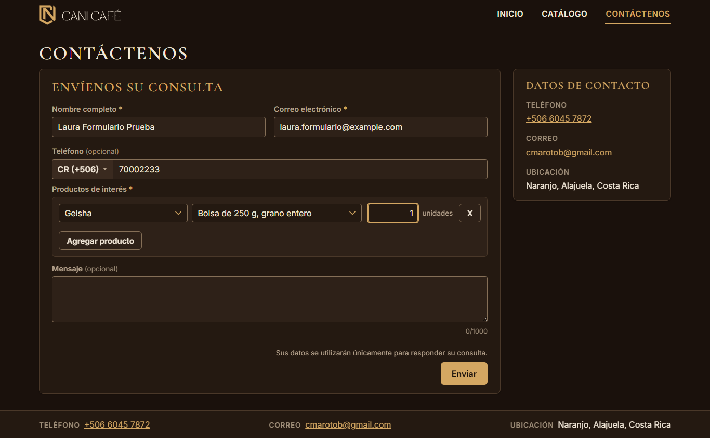
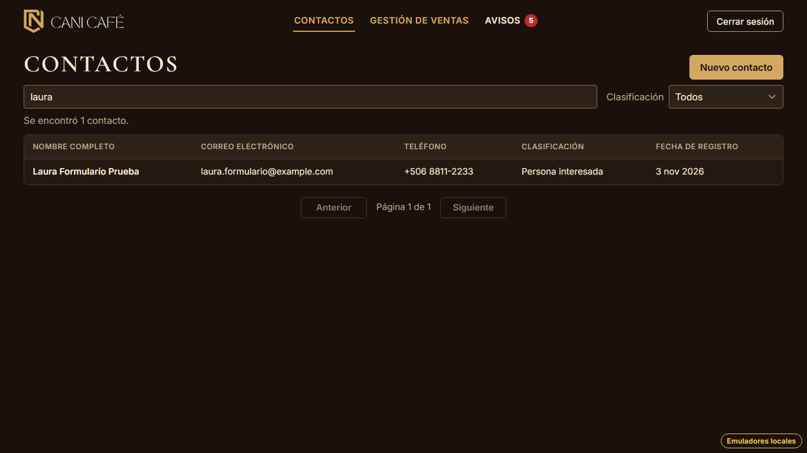
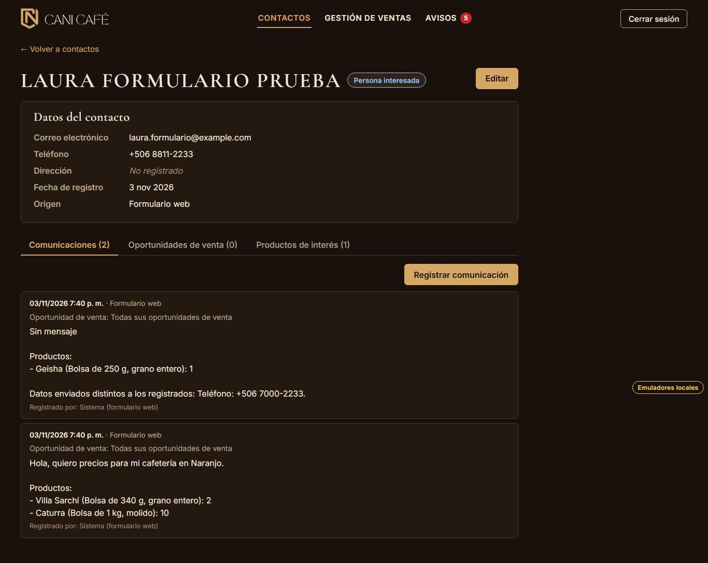
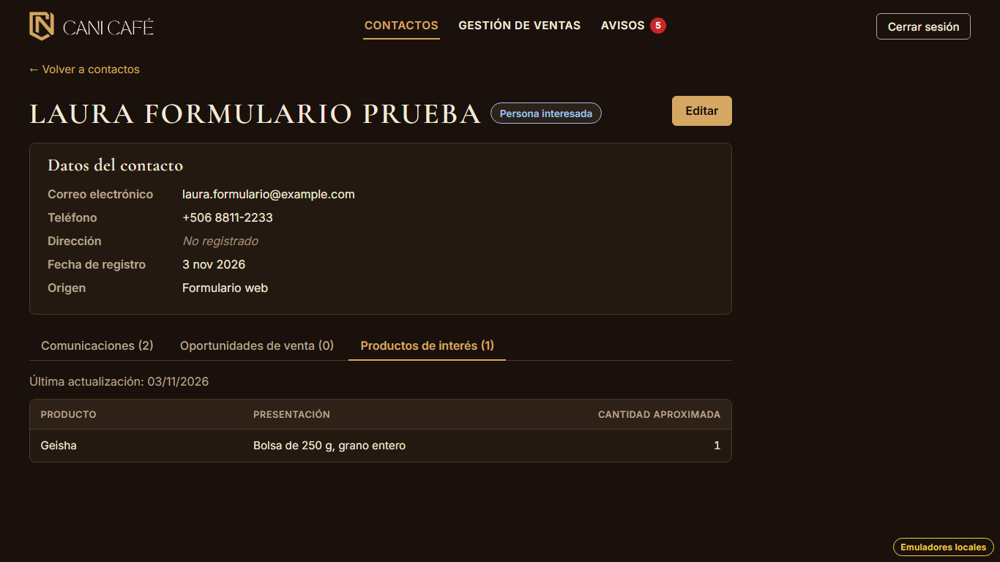
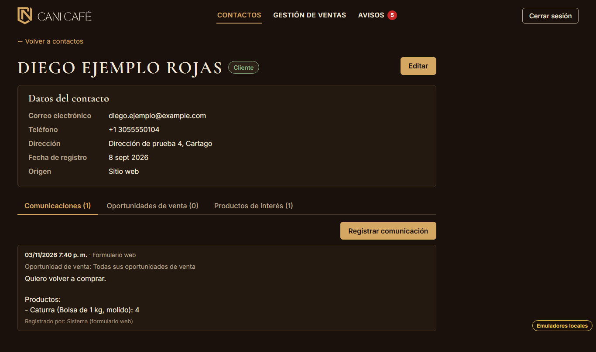

# Evidencia HU-503: Actualizar a una persona que ya está registrada

**Responsable:** Gabriel · **Revisa:** Dylan · **Fecha:** 2026-11-03 · Va en el mismo commit que [HU-502](../HU-502/README.md), que
explica cómo funciona el procesamiento.

> Como administrador quiero que, si alguien que ya está registrado vuelve a enviar el formulario, se actualice su
> información en lugar de crear un contacto repetido, para que el directorio se mantenga ordenado.

## Datos de prueba

- El mismo ambiente y recorrido que HU-502. Después de su primer envío, "Laura Formulario Prueba" vuelve a enviar el
  formulario con el mismo correo, **otro teléfono** (7000-2233), **otro producto** (Geisha × 1) y **sin mensaje**.
  El administrador sigue con la sesión abierta y el procesador la toma en cuanto llega.
- Además, "Diego Ejemplo Rojas" (`contact-004` del seed, **inactivo** y "Cliente") envía el formulario.
- Detalle en [recorrido.json](recorrido.json).

## Criterios de aceptación

| # | Criterio | Resultado | Evidencia |
|---|---|---|---|
| 1 | Si la persona ya está en el directorio (mismo correo o mismo teléfono), el sistema no crea un contacto nuevo. | ✅ Cumple | [02](02-lista-sin-duplicado.png): buscar "laura" da "Se encontró 1 contacto.". `contactosConEseCorreo: 1`. Por teléfono (mismo país y número, con otro correo) también se reconoce: prueba de emulador. |
| 2 | Sus productos de interés se reemplazan por los del nuevo formulario. | ✅ Cumple | [04](04-productos-reemplazados.png): queda solo Geisha × 1; Villa Sarchí y Caturra ya no están. |
| 3 | El nuevo mensaje se agrega a su historial de comunicaciones, con la fecha y hora del envío, el medio "Formulario web" y los productos enviados. | ✅ Cumple | [03](03-historial-con-diferencias.png): dos comunicaciones; la nueva arriba, con "03/11/2026 7:40 p. m. · Formulario web", "Sin mensaje" y "Productos: - Geisha (Bolsa de 250 g, grano entero): 1". |
| 4 | El contacto mantiene su clasificación. Si estaba inactivo, vuelve a quedar activo. | ✅ Cumple | Laura sigue "Persona interesada". Diego pasa de `inactivo` a `activo` y sigue "Cliente" ([05](05-inactivo-reactivado.png) y `recorrido.json`). |
| 5 | El nombre, el correo y el teléfono guardados no se cambian. Si la persona envió datos distintos, se anotan al final de la nota, por ejemplo: "Datos enviados distintos a los registrados: Teléfono: +506 8811-2233.". | ✅ Cumple | [03](03-historial-con-diferencias.png): la ficha sigue con "+506 8811-2233" y la nota termina con "Datos enviados distintos a los registrados: Teléfono: +506 7000-2233.". |

## Cómo se comparan los datos

- **Mismo orden que el ejemplo:** "Nombre: X. Correo: Y. Teléfono: +506 8811-2233.", con el teléfono escrito con
  `formatPhone`.
- **Mayúsculas:** nombre y correo se comparan sin distinguir mayúsculas. "ANA PRUEBA MORA" no cuenta como distinto
  (prueba de emulador).
- **Dato guardado vacío:** si el dato guardado está vacío y el enviado tiene valor, se anota y no se rellena, porque la
  HU dice que no se cambian.
- **Dato no enviado:** un dato que no se envió (el teléfono es opcional) no cuenta.
- **Teléfono de otro país:** el mismo número con otro país no es la misma persona.

## Además

- **HU-504:** la etiqueta pasa a 'Nuevo mensaje'. Si el contacto seguía en 'Nuevo' sin abrirse, se queda en 'Nuevo'.
  Lo que se ve en pantalla de esa etiqueta es HU-504.
- **Ventas abiertas:** su `lastCommunicationAt` se actualiza a la fecha del envío sin retroceder, para que los avisos
  de Dylan cuenten el formulario. Una venta ganada o perdida no se toca (prueba de emulador).
- **Dependencia:** el estado activo/inactivo depende de HU-218, que está en Backlog. Aquí solo se reactiva; el seed
  trae un contacto inactivo para probarlo.

## Pruebas automatizadas

Las mismas de HU-502. Salida en [pruebas.txt](pruebas.txt).

## Capturas

| | |
|---|---|
|  |  |
| 01. Reenvío con otro teléfono y otro producto | 02. Un solo contacto |
|  |  |
| 03. Nueva comunicación con la diferencia al final | 04. Productos reemplazados |
|  | |
| 05. Contacto inactivo que vuelve a quedar activo | |
