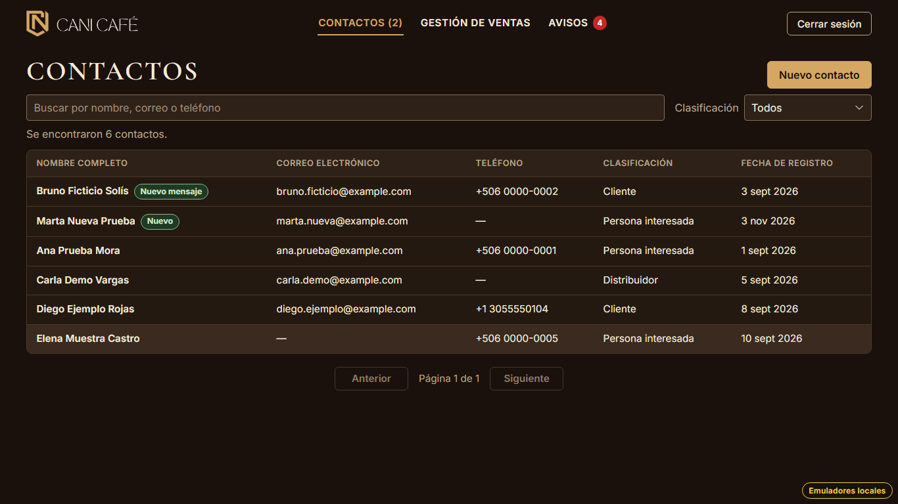
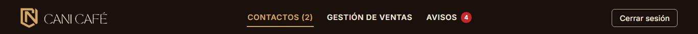
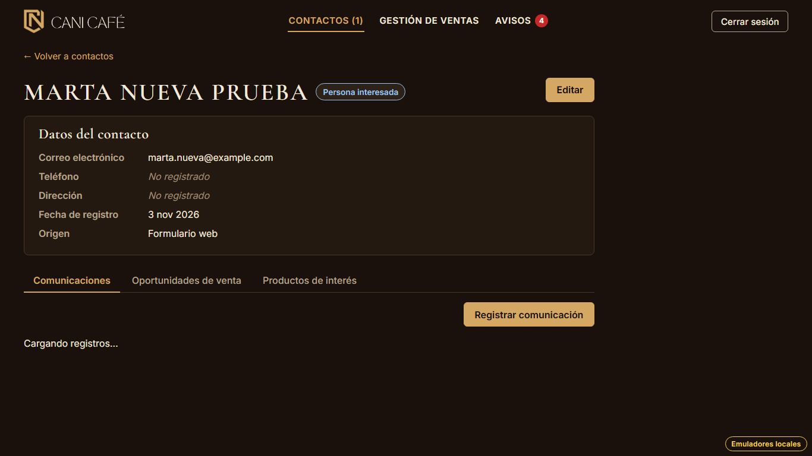
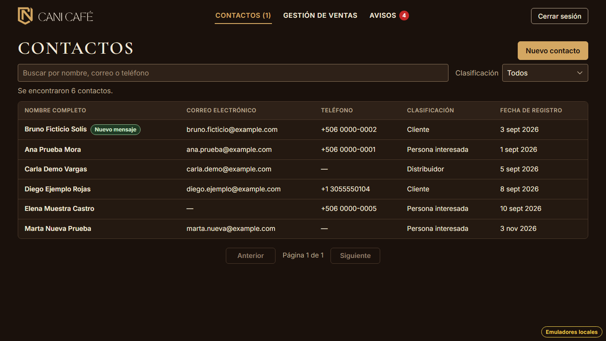

# Evidencia HU-504: Identificar los contactos que llegan por el formulario

**Responsable:** Gabriel · **Revisa:** Dylan · **Fecha:** 2026-11-03

> Como administrador quiero distinguir en la lista los contactos que enviaron un formulario y que aún no he revisado
> para responderles a tiempo.

## Datos de prueba

- Ambiente: Firebase Emulator Suite, proyecto `demo-cani-crm`, datos cargados con `npm run seed`, usuario `admin`.
  Los dos sitios corren a la vez, como en [HU-502](../HU-502/README.md).
- Con el administrador en "Contactos", llegan dos formularios desde el sitio público:
  - "Marta Nueva Prueba" (ficticia, persona nueva) → "Nuevo".
  - "Bruno Ficticio Solís" (`contact-002` del seed, ya registrado) → "Nuevo mensaje".
- El recorrido es automático, con Playwright (Chromium headless) en 1366 × 768. El detalle está en
  [recorrido.json](recorrido.json).

## Criterios de aceptación

| # | Criterio | Resultado | Evidencia |
|---|---|---|---|
| 1 | Si el formulario creó un contacto nuevo, el contacto aparece en la lista con la etiqueta verde "Nuevo". | ✅ Cumple | [01](01-lista-con-etiquetas.png): "Marta Nueva Prueba" con "Nuevo" en verde, con los mismos colores de la franja de confirmación (`colorEtiqueta` en el recorrido). |
| 2 | Si el formulario actualizó un contacto que ya existía, el contacto aparece con la etiqueta verde "Nuevo mensaje". | ✅ Cumple | [01](01-lista-con-etiquetas.png): "Bruno Ficticio Solís" con "Nuevo mensaje". Si un contacto con "Nuevo" vuelve a enviar sin que se haya abierto su ficha, sigue con "Nuevo" (prueba de emulador de HU-503). |
| 3 | Los contactos con etiqueta aparecen de primeros en la lista de contactos. | ✅ Cumple | [01](01-lista-con-etiquetas.png): Bruno y Marta arriba; después el resto en orden alfabético. También al buscar o filtrar (prueba de pantalla). |
| 4 | En la barra de arriba, la opción "Contactos" indica entre paréntesis cuántos contactos tienen etiqueta, por ejemplo: "Contactos (2)". | ✅ Cumple | [02](02-barra-contactos-2.png): "CONTACTOS (2)". El conteo cambia en vivo, sin recargar: pasó a "(1)" al llegar el primer formulario y volvió a "(1)" al abrir la ficha de Marta. Sin etiquetas, dice solo "Contactos". Está en todas las pantallas internas. |
| 5 | Al abrir la ficha de un contacto con etiqueta, la etiqueta desaparece. | ✅ Cumple | [03](03-ficha-abierta.png): al abrir la ficha de Marta, la barra pasa a "Contactos (1)". [04](04-lista-despues-de-abrir.png): de vuelta en la lista, Marta ya no tiene etiqueta y Bruno, que no se abrió, sigue primero con "Nuevo mensaje". |

## Cómo funciona

- **Quién pone la etiqueta:** el procesamiento del formulario de HU-502 y HU-503 deja `formBadge` en el contacto:
  - 'Nuevo' si lo creó;
  - 'Nuevo mensaje' si ya existía;
  - se queda en 'Nuevo' si todavía no se abrió.
- **Lista:** la etiqueta va junto al nombre (`.form-badge`) y `badgedFirst` pone esos contactos de primeros.
  - Para poder ordenarlos así, la lista trae todos los contactos una vez y ordena, busca, filtra y pagina en el
    navegador.
  - Firestore no puede ordenar por "tiene etiqueta": los contactos que nunca enviaron el formulario no tienen el campo
    y una consulta con ese orden los dejaría fuera.
  - CANI Café tiene pocos cientos de contactos. La paginación por consultas de HU-204 se quitó junto con sus funciones
    (`listContactsPageIn` y `countContactsIn`) y sus pruebas, para no dejar código muerto.
- **Barra:** `useFormBadgeCount` escucha en vivo (`onSnapshot`) los contactos con `formBadge` 'Nuevo' o 'Nuevo
  mensaje'. Es una consulta de un solo campo, que usa el índice automático.
- **Ficha:** al abrirla, si el contacto tiene etiqueta, se pone `formBadge: null`.
  - Si no se puede, por ejemplo sin conexión, la ficha se ve igual y se vuelve a intentar la próxima vez que se abra.
- **Origen:** la ficha muestra "Origen: Formulario web" de forma permanente ([03](03-ficha-abierta.png)).
- **Índices:** no hace falta ninguno nuevo.

## Diferencias y textos no definidos en la HU

| Tema | Decisión |
|---|---|
| Sin contactos con etiqueta | La barra dice solo "Contactos", sin "(0)" (texto no definido en la HU). |
| Orden entre los que tienen etiqueta | Alfabético, igual que el resto (la HU solo pide que vayan de primeros). |
| Origen en la lista | El diseño del prompt decía mostrar el origen "Formulario web" también en la lista. Los criterios no lo piden y agregar una columna cambiaría la tabla de HU-204, así que se ve en la ficha, donde ya estaba. |
| Carga de la lista | Ahora siempre se trae completa al abrir "Contactos" (antes, de 20 en 20 sin búsqueda). Se anotó en la evidencia de HU-204 y HU-205. |

## Riesgo

- **Lecturas:** cada vez que se abre "Contactos" se leen todos los contactos. Con pocos cientos está dentro del plan
  gratuito (50 000 lecturas al día). Si el directorio creciera a miles, convendría volver a paginar con consultas y
  guardar en cada contacto un campo de orden que siempre exista.

## Pruebas automatizadas

Salida en [pruebas.txt](pruebas.txt).

- `npm run typecheck`: sin errores.
- `npm test`: 867/867.
  - De HU-504: 8 de pantalla (las dos etiquetas, con etiqueta primero también al buscar, "Contactos (2)" en vivo y en
    todas las pantallas, se quita al abrir la ficha, no se toca sin etiqueta, falla al quitarla) y 2 unitarias del
    orden.
  - Se ajustaron las de HU-204, HU-205 y HU-207 a la nueva forma de cargar la lista.
- `npm run test:emulators`: 244/244.
  - De HU-504: el conteo cambia en vivo, con etiqueta primero, se quita al abrir la ficha, y sin sesión no se puede
    contar ni quitar.
  - El procesamiento que pone las etiquetas se prueba en HU-502 y HU-503.

## Capturas

| | |
|---|---|
|  |  |
| 01. "Nuevo mensaje" y "Nuevo", de primeros | 02. "Contactos (2)" en la barra |
|  |  |
| 03. Al abrir la ficha: "Contactos (1)" | 04. La etiqueta de Marta ya no está |
